# 산업안전지킴이 업무 스토리보드 (초안)

- 작성일: 2026-10-12 (마지막 고침 2026-10-29, 고친 이력은 8절)
- 상태: 초안, 큰 틀. 우리가 만들 서비스(지킴이 앱, 공장 웹, 운영자 웹)로 하는 지킴이 업무의 흐름이다. 지금 지킴이들이 일하는 방식은 `261022_산업안전지킴이_업무스토리보드_기존.md`에 있다.
- 출처: 지킴이 업무 설명(구두), 산업안전지킴이 체크리스트 종이 앞뒤(`UIUX_research/참고자료/산업안전지킴이 체크리스트_앞.pdf`, `_뒤.pdf`), 2026-10-21 지킴이 분과 미팅, 지금 시제품(지킴이 앱, 공장 웹, 운영자 웹)

## 1. 한눈에 보기

| 항목        | 내용                                                                                                                  |
| ----------- | --------------------------------------------------------------------------------------------------------------------- |
| 점검 대상   | 화성의 50인 미만 제조시설, 약 25,000곳                                                                                |
| 방문 주기   | 기업마다 보통 1년에 한 번                                                                                             |
| 점검조      | 3인 1조가 원칙. 아주 크거나 위험한 곳이 아니면 보통 2인 1조로 다닌다                                                  |
| 방문 건수   | 조마다 하루 평균 1.2곳                                                                                                |
| 예약        | 따로 없다. 전화로 날을 잡거나, 연결이 안 되면 연락 없이 간다                                                          |
| 강제력      | 법으로는 해야 하는 점검이지만, 안 받았다고 따로 받는 제재는 없다                                                      |
| 시정 기간   | 2주                                                                                                                   |
| 점검의 중심 | **개선사항**(종이 10번 현장점검 개선사항). 현장에서 사진으로 찍어 공장에 시정을 요구하고, 고쳤는지 판정한다         |
| 확정        | 지킴이가 개선을 위한 조언과 평가 점수를 적어 **제출**하면 확정된다. 운영자 승인은 없다                              |

## 2. 등장인물과 말

| 역할        | 누구                               | 하는 일                                                                                                   |
| ----------- | ---------------------------------- | --------------------------------------------------------------------------------------------------------- |
| 지킴이 조장 | 보통 소방 전문가                   | 조를 이끌고 점검한다                                                                                      |
| 지킴이 조원 | 화학(유해물질) 전문가, 전기 전문가 | 자기 분야를 중심으로 점검한다                                                                             |
| 공장 관계자 | 공장주 또는 안전담당자             | 사전미팅에 나오고, 라인투어에 같이 다니며 설명하고, 개선사항을 고쳐 고친 사진을 공장 웹에 올린다          |
| 운영자      | 산업안전지킴이 운영센터            | 지킴이를 조로 묶고 조마다 맡을 동네(읍·면·동)를 정하고, 체크리스트 문항을 관리하고, 제출된 점검을 받아 본다 |

이 문서에서 쓰는 말:

| 말                          | 뜻                                                                                                                                         |
| --------------------------- | ------------------------------------------------------------------------------------------------------------------------------------------ |
| 개선사항                    | 현장에서 사진으로 찍은 고칠 곳 한 건. 종이 10번의 한 줄이다. 지금 업무에서는 "지적사항"이라고 부른다                                       |
| 위험요인(지도유형)          | 개선사항이나 불량 문항에 붙이는 18가지 유해위험요인. 종이 10번에서는 "지도유형(유해위험요인)"이라고 쓴다                                   |
| 체크리스트                  | 종이 9번 분야별 안전점검. 문항마다 양호, 보통, 불량, 해당없음으로 답한다. 불량은 공장에 따로 가지 않는다(공장에 가는 것은 개선사항뿐)     |
| 점검 포인트                 | 체크리스트 문항마다 붙은, 그 문항에서 무엇을 보면 되는지 몇 줄                                                                             |
| 주안점                      | 지난 점검에서 안 고쳐진 것을 바탕으로 AI가 정리한, 이번에 중점적으로 볼 곳                                                                 |
| 사전점검, 현장점검, 분야별 안전점검 | 앱의 점검 화면 세 탭. 각각 사전미팅, 라인투어, 체크리스트를 하는 곳이다                                                                |
| 개선여부                    | 개선사항마다 지킴이가 정하는 판정. 앱에서는 승인, 반려, 보류 셋이다(보류의 뜻은 아직 정하지 않음). 판정을 저장하면 공장 웹에 승인은 고쳐짐, 반려와 보류는 안 고쳐짐으로 보인다. 판정을 저장하면 반려나 보류가 남아도 결과 제출로 가고, 그 뒤 공장이 다시 고쳐 보내면 결과 제출에서 고친다. 종이 10번에는 개선완료, 개선중, 미개선, 기타로 적혀 있다 |
| 개선 관리                   | 지킴이 앱 홈 카드. 점검을 저장한 뒤 공장이 고치는 동안(시정 중)을 지켜보고, 공장이 보낸 사진을 보고 판정하는 곳. 시정 중인 공장만 보이고 회신(새 사진), 기한초과로 거른다 |
| 결과 제출                   | 지킴이 앱 홈 카드. 판정을 마쳤거나 개선사항이 없던 점검(개선 관리에서 저장한 것)을 제출해 마무리하는 곳. 제출할 점검이 있는 공장만 보인다 |
| 점검 결과                   | 두 단계다. 점검을 저장할 때 개선사항이 없으면 점검완료, 있으면 재점검. 재점검이면 점검완료, 패트롤, 기타 가운데 지킴이가 고른다(최종 제출에서 고르게 할 예정, 지금 앱은 판정하면 점검완료) |
| 패트롤                      | 판정 결과의 하나. 개선하지 않았거나 거부한 공장. 그다음 처리는 아직 정하지 않았다                                                          |
| 기타(판정 결과)             | 50% 이상 고쳤지만 남은 것이 매우 위험해 특별 관리가 필요한 공장. 특별 관리 방법은 아직 없다. 개선여부의 "기타"와는 다른 말이다            |
| 개선을 위한 조언            | 종이 8번 종합평가결과. 기업 구분(일반, WOW, BOB)과 판 번호, 조언 글                                                                         |
| 평가 점수                   | 제출할 때 보는 0~100점, 높을수록 위험. AI가 여러 근거로 내고 지킴이가 고칠 수 있다. 지킴이와 운영자만 보고 공장주는 보지 못한다(2026-10-30 — 전에는 위험도 등급 상, 중, 하) |
| 점검거부 기록               | 기업이 점검을 거부했을 때 남기는 거부날짜, 거부사유, 방문하거나 연락한 사람. 지킴이 앱 기업등록의 기업 보기에서 적는다                     |
| 제출                        | 지킴이가 점검을 확정하는 것. 제출 전 확인 화면(탭 기업정보, 점검내역, 개선내역, 제출)에서 한다. 운영자 점검 기록에는 점검중(점검하는 중), 제출 전(점검을 마쳤지만 확정 전 — 지킴이가 고칠 수 있음), 제출로 보인다 |
| 체크리스트 버전             | 문항 묶음의 판(예: 26VER01). 문항이 바뀌면 운영자가 새 버전을 올린다                                                                      |

## 3. 흐름 한눈에 보기

```
[1] 방문할 기업 정하기 ──── 목록에 없는 기업은 미리 등록
 ↓
[2] 날짜 잡기 ──── 전화가 안 되면 연락 없이 그냥 간다
 ↓
[3] 방문 ──── 거부당하면 거부 기록을 남기고 끝
 ↓
[4] 사전미팅 (종이 1~7번, 9번의 01 산업안전 일반 4문항)
 ↓
[5] 라인투어 ──── 개선할 곳을 사진으로 찍는다 (개선사항)
 ↓
[6] 체크리스트 (종이 9번) ──── 저장하면 점검 결과가 정해진다: 개선사항이 없으면 점검완료, 있으면 재점검
 ↓  개선사항이 있을 때만 [7]~[9]
[7] 시정 요구 ──── 저장하면 개선사항이 바로 공장 웹에 보인다. 따로 보내지 않는다 (현장에서 고친 것은 승인, 모두 고쳤으면 바로 [10])
 ↓
[8] 공장 시정 (2주) ──── 고친 사진을 공장 웹에 올린다
 ↓
[9] 결과 판정 ─┬─ 점검완료 : 개선율 50% 이상
               ├─ 패트롤   : 개선하지 않음 또는 거부
               └─ 기타     : 50% 이상 고쳤지만 남은 것이 매우 위험해 특별 관리가 필요
 ↓
[10] 최종 제출 ──── 개선을 위한 조언(종이 8번)과 평가 점수를 확인하고 제출하면 확정
```


### 3-1. 점검 업무 자세히

지킴이 업무를 앱과 웹(지킴이 앱, 공장 웹, 운영자 웹)으로 하는 흐름을 **지금 시제품이 하는 그대로** 그렸다(2026-10-27에 앱과 웹을 끝까지 따라가 보고 맞췄고, 2026-10-29에 그날 바뀐 시제품대로 다시 맞춤). 앞으로 만들기로 했지만 시제품에 아직 없는 것은 **(아직 없음)** 으로 적었다. 장면의 "앱에서는"도 같은 기준이다. 화면의 자세한 모양과 단추는 `시제품/README.md`에 있다.

그림 읽는 법: 노란 칸은 세 가지다.

- **■ 장소**: 지킴이가 있는 곳. 바뀔 때마다 지킴이 줄 위에 적었다.
- **▶ 장면 n**: 4절의 장면 n이 여기부터 시작한다.
- **※**: 덧붙이는 설명.

화살표는 두 가지다.

- **실선**: 메시징. 상대에게 무언가 건너간다 — 전송, 알림, 상대 화면에 뜨는 것, 전화나 말로 묻고 답하는 것.
- **점선**: 행위. 혼자 하는 일이다. 방문처럼 상대 쪽으로 가는 일이어도 건너가는 것이 없으면 점선.

앱과 웹에 지금 있는 이름은 따로 표시했다. 화면, 탭, 홈 카드, 칸 이름은 「 」, 단추 이름은 〔 〕. (그림의 `alt` · `opt` · `loop` 칸 옆 [ ]는 갈래 조건이다.)

```mermaid
sequenceDiagram
    autonumber
    participant O as 운영자<br/>(운영자 웹)
    participant G as 지킴이<br/>(지킴이 앱)
    participant F as 공장 관계자<br/>(공장 웹)

    O-->>O: 준비: 지킴이를 조로 묶고 조마다 맡을 읍·면·동 정하기,<br/>체크리스트 문항 관리(문항이 바뀌면 새 버전 올리기)
    O->>G: 우리 조가 맡은 동네의 공장이 지킴이 앱 홈 「점검하기」 목록에 뜬다

    rect rgb(243, 246, 252)
    Note over G: ■ 장소: 사무실
    Note over G: ▶ 장면 1. 방문할 기업 정하기
    G-->>G: 목록에 없는 기업은 사무실에서 미리 「기업등록」 〔기업등록〕 — 아는 칸만 채움<br/>우리 조 동네면 바로 점검 대상 (운영자도 운영자 웹에서 등록할 수 있음)
    G-->>G: 「점검하기」에서 방문할 공장 고르기 — 우리 조 공장이 모두 보이고<br/>「예정」 「미정」 「미방문」으로 거른다(처음엔 예정) (고르는 규칙은 아직 없음)
    Note over G: ▶ 장면 2. 날짜 잡기
    G->>F: 전화로 방문 날짜를 정한다 (공장 웹에는 아무것도 가지 않음)
    G-->>G: 정한 방문일을 앱에 적어 둔다 — 「점검하기」 카드 〔방문일 정하기〕<br/>또는 「기업등록」 기업 보기의 〔캘린더 추가〕(달력 아이콘). 「캘린더」에 보인다
    alt 전화가 안 됨
        G-->>G: 연락 없이 그냥 간다 (전화 안 됨 기록은 아직 없음)
    end
    O-->>O: 운영자 웹 「점검」 → 「방문 일정」에서 보기만
    end

    rect rgb(255, 251, 240)
    Note over G: ■ 장소: 공장
    Note over G,F: ▶ 장면 3. 방문
    G-->>F: 방문
    alt 점검 거부
        F->>G: 거부 (제재는 없음)
        G-->>G: 「기업등록」 기업 보기 〔점검거부〕 — 거부날짜, 거부사유, 방문하거나 연락한 사람을 적는다<br/>그 기업 화면에 「점검거부 기록」으로 쌓이고, 기업등록 목록 최종점검 칸에 거부날짜와 점검거부가 빨강으로 보인다 (그 뒤에 점검하면 점검 날짜만. 점검 목록과 등록사유는 그대로)
        G->>O: 운영자 웹에서 거부 기록 보기 (아직 없음)
    else 받아들임
        Note over G,F: ▶ 장면 4. 사전미팅<br/>지킴이 앱의 「사전점검」 탭에서 한다
        G-->>G: 〔점검 시작〕
        G->>F: 기업정보, 관리정보, 담당자 정보, 점검정보, 점검조 정보를 물어 확인<br/>(종이 체크리스트의 1~5번 칸에 해당)<br/>기업등록 때 적어 둔 값이 미리 들어 있다. 빈 칸은 여기서 채우고, 못 채워도 넘어갈 수 있다<br/>고칠 때는 줄 오른쪽 연필을 누른다
        opt 현장에서 종이에 적어 둠
            G-->>G: 사무실에 돌아와 앱에서 채움 (지킴이 웹은 나중에 만듦)
        end
        G->>F: 유해위험기구 보유현황, 위험물질 취급여부를 물어 확인<br/>(종이 체크리스트의 6, 7번 칸에 해당)<br/>기업등록 때 적어 둔 값이 미리 체크돼 있고 고칠 수 있다<br/>여기서 고른 기구의 문항만 체크리스트에 나온다
        G->>F: 산업안전 일반 4문항을 묻는다<br/>(종이 체크리스트 9번 분야별 안전점검의 01에 해당)

        Note over G,F: ▶ 장면 5. 라인투어와 개선사항 찍기<br/>지킴이 앱의 「현장점검」 탭에서 한다<br/>원자재 → 가공 → 출하 순서로, 공장 관계자가 같이 다닌다
        loop 개선할 곳마다
            G-->>G: 사진을 찍으면 개선사항 한 건이 생긴다 (한 건에 5장까지 〔사진 추가〕, 첫 사진이 대표 사진)
            G-->>G: AI가 대표 사진을 보고 위험요인 추천 → 지킴이가 빼거나 더한다
            Note over G: ※ 시제품: 미리 넣어 둔 시험 사진은 사진마다 정해 둔 답,<br/>가상기기 카메라 등으로 실제로 찍은 사진은 18가지 중 셋을 아무렇게나 고른 흉내 답<br/>실제: 사진을 보는 AI를 붙인다 (아직 없음)<br/>어느 쪽이든 지킴이가 추천된 위험요인을 보고 빼거나(〔×〕) 18가지 중에서 더할(〔+ 추가〕) 수 있다
            G-->>G: 개선 전 내용 적기
            opt 위험요인을 다 지움
                G-->>G: 잘된 사항으로 따로 모임 (점검 기록에는 남지 않음)
            end
        end
    end
    end

    rect rgb(243, 246, 252)
    Note over G: ■ 장소: 공장 또는 사무실<br/>(라인투어 직후 공장에서, 또는 돌아와 사무실에서)
    opt 공장에서 다 못 함
        G-->>G: 적는 대로 저장되니 그대로 두고 사무실에서 이어서 개선 전 내용과 체크리스트를 채운다 (따로 누르는 임시저장 단추는 없다)
    end
    Note over G: ▶ 장면 6. 체크리스트<br/>지킴이 앱의 「분야별 안전점검」 탭에서 한다
    G-->>G: 「지난번 미흡 항목」 탭: 지난번 안 고쳐진 것을 바탕으로 AI가 정리한 이번 점검 주안점<br/>(없으면 첫 점검이거나 모두 고쳐짐)
    G-->>G: 「체크리스트」 탭: 02~05 문항마다 〔양호〕 〔보통〕 〔불량〕 〔해당없음〕 (문항마다 「점검 포인트」)
    G-->>G: 불량이면 위험요인(18가지)과 평가 내용
    G-->>G: 05 유해위험기구 문항은 사전미팅 「6. 유해위험기구 보유현황」에서 고른 기구 것만 체크리스트에 보인다<br/>고르지 않은 기구 문항은 앱과 웹 어디에도 보이지 않고, 기록(DB)에만 해당없음으로 남는다
    G-->>G: 〔완료〕 — 답하지 않은 문항이 있어도 저장된다<br/>(그 문항은 답 칸이 빈 채로 저장되고, 최종 제출 전에 채운다)<br/>점검 결과는 저절로 정해진다: 개선사항이 없으면 점검완료, 있으면 재점검 (시정 기한 2주)
    G->>F: 공장 웹 「기록 · 고칠 것」에 바로 보인다 — 개선사항과 체크리스트의 양호, 보통, 해당없음 문항<br/>(체크리스트 불량은 공장에 보이지 않음. 공장에 따로 가는 알림은 아직 없음)
    G->>O: 운영자 웹 「점검 기록」에 "제출 전"으로 보임 (제출할 때까지 지킴이가 고칠 수 있음)
    G-->>G: 저장하면 바로 홈으로 간다 (저장 완료 화면 없음)<br/>아래에 「점검이 완료되었습니다」가 잠깐 떴다 사라진다<br/>개선사항이 있든 없든 「개선 관리」에서 이어 간다
    end

    alt 개선사항이 없음
        G-->>G: 홈 「개선 관리」에 「개선사항 없음」 카드로 오른다 (시정 기한 없음)<br/>〔개선사항 보기〕 → 「개선사항 없음」 → 〔저장〕 → 「결과 제출」의 「제출할 것」으로
    else 개선사항이 있음 (재점검)
        rect rgb(255, 251, 240)
        Note over G,F: ▶ 장면 7. 시정 요구<br/>장면 6의 〔완료〕로 개선사항이 공장 웹에 뜬 것이 곧 시정 요구다 (따로 보내는 단추는 없다)
        opt 현장에서 바로 고친 것
            G-->>G: 홈 「개선 관리」 카드 〔개선사항 보기〕에서 개선 후 사진을 넣고 〔승인〕 → 〔저장〕<br/>(공장 웹에 고쳐짐으로 보인다. 모두 승인이면 〔저장〕만으로 점검완료가 되고 「결과 제출」로)
        end
        end

        rect rgb(243, 246, 252)
        Note over G,F: ▶ 장면 8. 공장 시정<br/>공장은 공장 웹에서 하고, 지킴이 앱에는 홈 「개선 관리」에 시정 중 카드로 보인다
        F-->>F: 공장 관계자가 개선사항마다 고친 뒤 사진(꼭)과 고친 내용 한 줄(안 써도 됨)을 올려 〔고쳤어요〕로 보낸다<br/>사진이 없으면 〔고쳤어요 보내기〕가 잠긴다<br/>지킴이가 판정하기 전까지는 〔표시 취소〕로 보낸 것을 거둘 수 있다
        F->>G: 지킴이에게 알림, 「개선 관리」 카드 이름 옆에 「새 사진 n」
        G-->>G: 「개선 관리」에는 시정 중인 공장만 보이고 「회신」(새 사진) 「기한초과」로 거른다<br/>시정 중 카드: 시정 기한(D-n), 「개선사항」 n건과 승인, 반려, 보류 수, 〔전화〕, 〔개선사항 보기〕
        end

        rect rgb(255, 251, 240)
        Note over G,F: ▶ 장면 9. 결과 판정<br/>「개선 관리」 카드 〔개선사항 보기〕 — 사진이 한 장이라도 왔거나 시정 기한이 지나면 판정 화면이 된다
        G-->>G: 개선 전 / 개선 후 사진과 공장 회신을 보고 개선사항마다 「개선여부」 〔승인〕 〔반려〕 〔보류〕<br/>사진이 오는 대로 하나씩 정해 둘 수 있다 (보류의 뜻은 아직 정하지 않음)
        G-->>G: 〔판정 저장〕 — 점검 결과는 여기서 고르지 않는다 (지금은 점검완료로 저장, 장면 10에서 고르게 할 예정)
        G->>F: 공장 웹에 판정 결과가 보인다<br/>점검 결과(지금은 점검완료)와 개선사항마다 고쳐짐 / 안 고쳐짐 (승인은 고쳐짐, 반려는 안 고쳐짐)
        G-->>G: 판정을 저장하면 바로 홈으로 간다 (저장 완료 화면 없음)<br/>아래에 「판정이 완료되었습니다」가 잠깐 떴다 사라진다
        G-->>G: 반려나 보류가 남아도 판정이 끝나 「개선 관리」에서 빠지고 「결과 제출」에서 이어 간다
        opt 기타
            G->>O: 특별 관리 (아직 없음)
        end
        opt 안 고쳐진 개선사항 (반려, 보류)
            F->>G: 판정 뒤에도 다시 고쳐 보낼 수 있다 — 그 건은 보류가 되고 고친 사진과 공장 회신이 붙는다<br/>(지킴이에게 가는 알림은 아직 없음)
            G-->>G: 「결과 제출」 → 「제출 전 확인」 「개선내역」에서 개선여부를 다시 고른다
            G-->>G: 끝내 안 고쳐진 것은 다음 점검 때 「지난번 미흡 항목」에 AI 주안점으로 붙는다
        end
        end
    end

    rect rgb(243, 246, 252)
    Note over G: ■ 장소: 사무실
    Note over G: ▶ 장면 10. 최종 제출<br/>지킴이 앱 홈 「결과 제출」에서 한다
    G-->>G: 「결과 제출」에는 제출할 점검이 있는 공장만 보인다 (점검일 최신순)
    G-->>G: 「제출할 것」 줄 → 「제출 전 확인」: 「기업정보」 「점검내역」 「개선내역」 탭에서 다시 보고 고칠 수 있다<br/>(점검 때의 사전점검, 분야별 안전점검, 개선사항 화면 그대로)
    G-->>G: 체크리스트(01~05)에 답 칸이 빈 문항이 하나라도 있거나 보유현황, 위험물질 취급여부를 안 골랐으면 제출할 수 없다 (「제출 전 확인」에 빨간 경고)<br/>〔제출〕(「제출」 탭 맨 아래에만 있음)이 잠기고, 누르면 그 빈 곳으로 바로 간다<br/>기업정보 빈 칸은 노란 주의로 보이기만 하고 제출은 된다 (기타정보는 비어 있어도 주의를 띄우지 않는다)
    G-->>G: 「제출」 탭: 개선을 위한 조언(종이 8번) — 판 번호 + 조언 글<br/>그 밑 「기업 구분」 일반, WOW, BOB<br/>그 밑 「평가 점수」 0~100점(높을수록 위험) — AI가 낸 점수, 지킴이가 고칠 수 있음 (공장주에게는 안 보임)<br/>「AI 판단 근거」 드롭다운에 AI가 이 점수를 낸 까닭 (시제품은 점검 기록으로 규칙대로 흉내)
    G-->>G: 점검 결과 고르기 — 점검완료, 패트롤, 기타 (아직 없음)
    G->>O: 〔제출〕 → 확정 (운영자 승인 없음)
    G-->>G: 제출하면 바로 「결과 제출」 목록으로 간다 (제출했어요 화면 없음. 제출한 공장은 목록에서 빠짐)<br/>아래에 「제출이 완료되었습니다」가 잠깐 떴다 사라진다
    O-->>O: 운영자 웹 「점검」 → 「제출된 점검」 목록과 알림으로 받고, 제출한 날, 평가 점수, 조언, 개선사항을 본다
    end

    O-->>O: 「점검 기록」(점검중, 제출 전, 제출), 「개선 요청」, 「통계」
```



## 4. 장면별 스토리보드

### 장면 1. 방문할 기업 정하기

- 상황: 기업마다 1년에 한 번꼴로 찾아가야 한다. 대상은 약 25,000곳이다.
- 지킴이가 하는 일: 방문할 기업을 고른다. 목록에 없는 기업은 사무실에서 미리 등록한다.
- 앱에서는: 홈 점검하기에 우리 조가 맡은 동네의 공장이 모두 뜨고, 예정(방문일 정함), 미정, 미방문으로 거른다. 처음엔 예정이 골라져 있고, 전체 칸은 없다. 목록에 없는 기업은 기업등록으로 등록한다. 등록할 때는 아는 칸만 채우고, 남은 칸은 현장 사전미팅에서 채운다(장면 4). 우리 조 동네면 바로 점검 대상이 된다. 운영자도 운영자 웹에서 등록할 수 있다. 고르는 규칙은 아직 없다.
- 다음: 장면 2

### 장면 2. 날짜 잡기

- 상황: 방문 예약 체계는 따로 없다.
- 지킴이가 하는 일: 기업에 전화해 방문 날짜를 잡는다.
- 어려운 점: 전화가 잘 안 되는 경우가 대부분이다. 그럴 때는 연락 없이 그냥 찾아가는 일이 많다.
- 앱에서는: 정한 방문일을 앱에 적어 둔다. 점검하기 카드의 방문일 정하기, 또는 기업등록 기업 보기의 캘린더 추가(달력 아이콘)로 적고, 캘린더에 보인다. 공장 웹에는 아무것도 가지 않는다. 운영자는 방문 일정을 보기만 한다. 전화가 안 됐다는 기록은 아직 없다.
- 다음: 장면 3

### 장면 3. 방문

- 상황: 지킴이 조(보통 2인)가 공장에 도착한다.
- 어려운 점: 가서 거부당하는 경우도 많다. 점검을 안 받아도 공장이 받는 제재는 없다.
- 앱에서는: 기업등록의 기업 보기에서 점검거부를 눌러 거부날짜(처음엔 오늘), 거부사유, 방문하거나 연락한 사람(처음엔 내 이름)을 적는다. 그 기업 화면 기업정보 표 밑에 점검거부 기록으로 쌓이고, 기업등록 목록의 최종점검 칸에는 거부날짜와 점검거부가 빨강으로 보인다(그 뒤에 점검하면 점검 날짜만). 운영자 웹에는 아직 보이지 않고, 거부한 기업도 점검 목록과 등록사유는 그대로다.
- 다음: 받아들이면 장면 4, 거부하면 거부 기록을 남기고 끝

### 장면 4. 사전미팅

- 상황: 현장에 들어가기 전, 공장 안전담당자 또는 공장주와 마주 앉는다.
- 지킴이가 하는 일:
  - 체크리스트 종이 앞면 1~7번을 공장 측에 물어 확인하고 채운다(기업정보, 관리정보, 담당자 정보, 점검정보, 점검조 정보, 유해위험기구 보유현황, 위험물질/유해화학물질 취급여부).
  - 분야별 안전점검 가운데 01 산업안전 일반 4문항을 묻는다.
  - 모든 항목을 다 볼 수는 없어서, 가능한 부분만 확인한다.
- 앱에서는: 점검을 시작하면 종이 1~7번과 01 4문항을 차례로 본다.
  - 등록된 값이 뜨고, 그 자리에서 고친다. 고칠 때는 줄 오른쪽 연필을 누른다(내용을 눌러서는 고쳐지지 않는다). 기업등록 때 못 채운 칸은 여기서 채우고, 빈 칸이어도 넘어갈 수 있다.
  - 현장에서 종이에 적어 왔으면 사무실에 돌아와 앱에서 채운다(지킴이 웹은 나중에 만든다).
  - 보유현황과 취급여부는 등록된 기업 정보의 값이 미리 체크돼 있고, 고칠 수 있다.
  - 보유현황에서 고른 기구의 문항만 체크리스트에 나온다(장면 6).
- 다음: 장면 5

### 장면 5. 라인투어와 개선사항 찍기

- 상황: 공장 관계자와 같이 현장으로 들어간다.
- 지킴이가 하는 일:
  - 라인투어를 한다. 원자재가 들어와서, 가공되고, 최종 출하되기까지의 과정을 따라가며 본다. 공장 관계자가 동행하며 설명한다.
  - **고칠 곳을 사진으로 찍는다.** 이것이 개선사항이 된다. 종이로 치면 10번 현장점검 개선사항의 한 줄(개선 전 사진, 지도유형, 개선 전 내용)이다.
    - 예: 호이스트 고리, 적재함이 쏟아질 위험, 페인트 통 안에 다른 화학물질
  - 체크리스트 문항에 하나하나 답하며 다니지 않는다. 체크리스트는 장면 6에서 채운다.
- 앱에서는:
  - 고칠 곳을 찍으면 개선사항 한 건이 생긴다. 한 건에 사진을 5장까지 넣고, 첫 사진이 대표 사진이다.
  - AI가 대표 사진을 보고 위험요인을 추천하고, 지킴이가 빼거나 더한다. 시제품은 흉내 답이다. 미리 넣어 둔 시험 사진은 사진마다 정해 둔 위험요인을, 가상기기 카메라 등으로 실제로 찍은 사진은 18가지 중 셋을 아무렇게나 골라 내놓는다. 사진을 보는 진짜 AI는 아직 없다.
  - 개선 전 내용을 적는다.
  - 위험요인을 다 지운 건은 잘된 사항으로 따로 모인다. 잘된 사항은 점검 기록에 남지 않는다.
  - 개선 후 사진과 개선여부(승인, 반려, 보류)는 개선 관리에서 정한다(장면 7, 9). 현장에서 바로 쓰는 화면이라 적을 것을 줄였다.
  - 현장에서 다 못 하면 그대로 두고 사무실에서 이어서 개선 전 내용과 체크리스트를 채운다. 적는 대로 저장되므로 따로 누르는 임시저장 단추는 없다(2026-10-30 — 전에는 점검 화면 머리 오른쪽에 임시저장).
- 다음: 장면 6

### 장면 6. 체크리스트

- 상황: 라인투어를 마쳤다.
- 지킴이가 하는 일: 분야별 안전점검 체크리스트(종이 9번)를 채운다. 개선사항과 관련된 문항은 불량으로 하고 위험요인과 평가 내용을 적는다(앱에서 개선사항과 문항을 잇지는 않는다 — 7절). 나머지 문항은 양호, 보통, 해당없음 가운데 고른다.
- 앱에서는:
  - **점검표가 종이 체크리스트를 대신한다.** 앱에 바로 채우므로 사무실에서 전산에 옮겨 적는 일이 없다.
  - 문항마다 점검 포인트가 붙어 있다.
    - 예: 분전반 → 문과 잠금, 누전차단기, 앞 공간. 연삭기 → 숫돌 덮개, 받침대 간격, 보안경.
  - 불량이면 위험요인(18가지)을 고른다. 문항에 맞는 위험요인을 AI가 미리 골라 두고, 지킴이가 빼거나 더한다. 평가 내용은 어느 답이든 적을 수 있다.
  - 지난번 미흡 항목에는 지난 점검에서 안 고쳐진 것을 바탕으로 AI가 정리한 주안점이 나온다. 없으면 첫 점검이거나 모두 고쳐졌다고 쓴다.
  - 05 유해위험기구 문항은 사전미팅 보유현황에서 고른 기구 것만 체크리스트에 보인다. 고르지 않은 기구 문항은 지킴이 앱(점검 화면, 점검 내용 보기), 운영자 웹, 공장 웹 어디에도 보이지 않고 문항 수에도 들지 않는다. 기록(DB)에만 해당없음으로 남는다.
  - 다 채우면 맨 아래 완료를 눌러 저장한다(2026-10-30 — 그 전에는 저장, 10-29 전에는 점검 마치기). 모든 문항에 답하지 않아도 저장할 수 있다. 답하지 않은 문항은 답 칸이 빈 채로 저장되고, 최종 제출 전에 채워야 한다(장면 10).
  - 저장하면 점검 결과가 저절로 정해진다(개선사항이 없으면 점검완료, 있으면 재점검). 따로 보내지 않아도 **개선사항과 체크리스트의 양호, 보통, 해당없음 문항이 바로 공장 웹에 보인다.** 체크리스트 불량은 공장에 보이지 않는다(공장이 고칠 것은 개선사항뿐). 운영자에게는 "제출 전"으로 보이고, 제출할 때까지 지킴이가 고칠 수 있다.
  - 완료를 누르면 바로 홈으로 가고, 아래에 "점검이 완료되었습니다"가 몇 초 떴다 사라진다(2026-10-30 — 전에는 저장 완료 화면, 그 뒤 같은 날 "저장했어요" 알림을 뺐다가 이 글로 다시 넣음). 개선사항이 있든 없든 개선 관리에서 이어 간다(2026-10-30 사용자 지시 — 전에는 개선사항이 없으면 바로 결과 제출). 개선사항이 없으면 개선 관리 카드에 "개선사항 없음"으로 오르고, 안에서 저장하면 결과 제출로 간다.
- 다음: 개선사항이 있으면 장면 7, 없으면 개선 관리에서 저장한 뒤 장면 10

### 장면 7. 시정 요구

- 상황: 점검을 저장했고 개선사항이 있다.
- 지킴이가 하는 일: 개선사항을 공장 측에 모두 알려 주고, 2주 안에 고쳐 달라고 요구한다.
- 앱에서는:
  - **따로 보내는 단계가 없다.** 장면 6에서 저장하면 개선사항(개선 전 사진, 지도유형, 개선 전 내용)이 바로 공장 웹에 보이고 시정 중이 된다(2026-10-29 — 전에는 개선 관리 보낼 것에서 정리해 공장에 전송했다).
  - 현장에서 바로 고친 것은 개선 관리에서 개선 후 사진을 넣고 승인으로 둔 뒤 저장한다. 공장 웹에는 고쳐짐으로 보인다. 모두 승인이면 같은 저장 단추로 저장하고(2026-10-30 — 전에는 단추 이름이 개선완료로 저장), 점검 결과가 점검완료로 바뀌어 장면 10(결과 제출)으로 간다.
  - 사진을 카톡으로 따로 보내지 않는다.
  - 시정 기한은 2주다. 지금은 점검일부터 센다.
  - 공장에 따로 가는 알림은 아직 없다. 공장이 웹에 들어와야 본다.
- 다음: 공장은 장면 8, 지킴이는 시정을 기다린다

### 장면 8. 공장 시정

- 상황: 2주의 시정 기간이다.
- 공장이 하는 일: 개선사항을 고치고, 고친 모습을 사진으로 찍어 올린다.
- 앱에서는:
  - **공장도 웹 서비스를 쓴다.** 공장주(또는 안전담당자)는 웹에서 개선사항과 지킴이가 찍은 사진을 본다. 고친 뒤 개선사항마다 고친 사진과 고친 내용 한 줄을 올린다. 사진은 꼭 올려야 하고(없으면 보내기가 잠긴다), 고친 내용은 안 써도 된다. 지킴이가 판정하기 전까지는 보낸 것을 거둘 수 있다.
  - 사진을 카톡으로 주고받지 않는다. 카톡으로 받은 사진을 지킴이가 대신 올리는 길은 없다.
  - 공장이 보내면 지킴이에게 알림이 가고, 개선 관리 카드 이름 옆에 "새 사진 n"이 붙는다.
  - 개선 관리에는 시정 중인 공장만 보이고 회신(새 사진), 기한초과로 거른다(2026-10-30 — 10-29에는 우리 조 공장 전부). 시정 중 카드에는 시정 기한(D-n)과 개선사항 수, 그중 승인, 반려, 보류 수가 보인다.
  - 시정 기한이 지나면 사진이 없어도 판정할 수 있다.
- 다음: 장면 9

### 장면 9. 결과 판정

- 상황: 공장이 고친 사진을 올렸다(또는 올리지 않았다).
- 지킴이가 하는 일: 개선사항마다 고쳐졌는지 보고 결과를 정한다.

| 결과     | 언제                                                         | 그다음           |
| -------- | ------------------------------------------------------------ | ---------------- |
| 점검완료 | 개선율 50% 이상                                              | 장면 10          |
| 패트롤   | 개선하지 않았거나 거부함                                     | 장면 10. 그 뒤 처리는 아직 정하지 않음 |
| 기타     | 50% 이상 개선했지만 남은 것이 매우 위험해 특별 관리가 필요 | 장면 10. 특별 관리는 아직 없음 |

- 앱에서는:
  - **공장이 웹에 올린 고친 사진을 앱에서 바로 보고 판단한다.** 개선 전과 개선 후 사진, 공장 회신을 보고 개선사항마다 개선여부를 승인, 반려, 보류 가운데 정한다. 공장이 하나씩 고쳐 올리므로 사진이 오는 대로 하나씩 정해 둘 수 있고, 개선 관리 카드에 그 수가 보인다. 보류의 뜻은 아직 정하지 않았다. 판정을 저장해도 지킴이가 고른 그대로 남는다(2026-10-30 — 전에는 승인이 아닌 것은 반려가 됐다).
  - 개선 수(개선율)는 보여 주기만 한다. 판정 화면에서는 점검 결과를 고르지 않는다(2026-10-30 사용자 지시). 점검완료, 패트롤, 기타는 나중에 최종 제출(장면 10)에서 **지킴이가 직접 고르게 할 예정**이고(앱이 50%로 미리 골라 두지 않는다), 그때까지 앱은 판정하면 점검완료로 둔다.
  - 공장 웹에는 판정 결과와 개선사항마다 고쳐짐, 안 고쳐짐이 보인다. 안 고쳐진 것은 공장이 다시 고쳐 보낼 수 있다.
  - 안 고쳐진 것은 다음 점검 때 지난번 미흡 항목에 주안점으로 나온다.
  - 판정을 저장하면 바로 홈으로 가고, 아래에 "판정이 완료되었습니다"가 몇 초 떴다 사라진다(2026-10-30 — 전에는 저장 완료 화면, 그 뒤 같은 날 "저장했어요" 알림을 뺐다가 이 글로 다시 넣음). 판정이 끝나 결과 제출에서 이어 간다.
  - **반려나 보류가 남아도 판정을 저장하면 그 공장은 개선 관리에서 빠지고 결과 제출로 간다**(2026-10-30 사용자 지시 — 같은 날 잠깐 반려나 보류가 남으면 개선 관리에 남게 했다가 되돌림). 공장 웹에는 그 건이 안 고쳐짐으로 남아 공장이 다시 고쳐 보낼 수 있다. 시정 기한이 지나 판정한 뒤 공장이 고쳤다고 하면, 그 건은 보류가 되고 지킴이가 결과 제출의 제출 전 확인 개선내역에서 사진을 보고 다시 고른다. 다시 보낸 것을 지킴이에게 알리는 것은 아직 없다.
  - 패트롤 뒤의 처리는 아직 정하지 않았고, 기타 뒤의 특별 관리는 아직 앱에 없다.
- 다음: 장면 10

### 장면 10. 최종 제출

- 상황: 판정이 끝났거나, 처음부터 개선사항이 없던 점검을 개선 관리에서 저장했다.
- 지킴이가 하는 일: 점검 내용을 다시 보고, 개선을 위한 조언(종이 8번)을 적고 평가 점수를 확인해 제출한다.
- 앱에서는:
  - 홈 결과 제출에서 한다(2026-10-29 — 전에는 개선 관리의 제출할 것). 제출할 점검이 있는 공장만 보인다(2026-10-30 — 10-29에는 우리 조 공장 전부와 제출할 것, 판정 전, 제출함 거르기).
  - 제출할 것을 누르면 제출 전 확인이다. 기업정보(사전점검), 점검내역(분야별 안전점검), 개선내역(개선사항) 탭에서 다시 보고 고칠 수 있다.
  - **체크리스트(01~05)는 모두 답해야 제출할 수 있다.** 답 칸이 빈 문항이 남아 있으면 제출 단추가 잠기고, 누르면 그 빈 문항으로 바로 간다. 보유현황과 위험물질 취급여부(해당없음도 고를 수 있음)도 골라야 제출된다. 제출 탭의 제출 전 확인에 이것들은 빨간 경고로, 기업정보(1~3번)의 빈 칸은 노란 주의로 보인다. 주의는 비어 있어도 제출할 수 있다(2026-10-30 사용자 결정). 기타정보는 비어 있어도 주의를 띄우지 않는다(같은 날 사용자 지시). 고르지 않은 기구 문항은 이미 해당없음이라 따로 채우지 않는다.
  - 개선을 위한 조언은 판 번호와 조언 글을 적는다. 그 밑에서 기업 구분(일반, WOW, BOB)을 고른다(2026-10-30 사용자 지시 — 전에는 조언 칸 안 맨 위).
  - 그 밑에 평가 점수가 있다(2026-10-30 사용자 지시 — 전에는 위험도 등급 상, 중, 하를 골랐다). 0~100점이고 높을수록 위험하다. AI가 여러 근거로 점수를 내고, 지킴이가 직접 고칠 수 있다. 그 아래 AI 판단 근거를 펼치면 AI가 왜 그 점수를 냈는지 글과 근거별 점수가 보인다. 고치지 않고 제출하면 AI 점수로 남는다. 지킴이와 운영자만 보고 공장주는 보지 못한다. 시제품의 AI 점수는 점검 기록(체크리스트 불량, 안 고쳐진 개선사항, 위험물질, 센서 이상, 보유 기구)으로 규칙대로 흉내 낸 것이다.
  - 제출하면 확정된다. 운영자 승인은 없다. 운영자 웹에 제출된 점검으로 오르고(평가 점수도 보인다) 운영자에게 알림이 간다.
  - 제출하면 바로 결과 제출 목록으로 가고, 아래에 "제출이 완료되었습니다"가 몇 초 떴다 사라진다(2026-10-30 — 전에는 제출했어요 화면, 그 뒤 같은 날 "제출했어요" 알림을 뺐다가 이 글로 다시 넣음). 제출한 공장은 목록에서 빠진다.
- 다음: 끝

## 5. 참고: 체크리스트 종이 구성

지킴이가 들고 다니는 종이 체크리스트에 어떤 칸이 있는지 정리한 것이다. 번호는 종이에 적힌 번호 그대로다. 앞면에 1~9번, 뒷면에 9번의 나머지(05 유해위험기구 기구별 문항)와 10번이 있다. 사전미팅(장면 4)에서 1~7번과 9번의 01을 보고, 라인투어(장면 5)에서 10번을 찍고, 체크리스트(장면 6)에서 9번을 채우고, 최종 제출(장면 10)에서 8번을 적는다.

| 번호 | 칸                             | 들어가는 것                                                                                                                                                                                                                              |
| ---- | ------------------------------ | ---------------------------------------------------------------------------------------------------------------------------------------------------------------------------------------------------------------------------------------- |
| 1    | 기업정보                       | 기업명, 사업자번호, 대표자명, 행정구역, 회사 전화번호, 회사 팩스번호, 회사 대표메일, 업종코드, 주 생산용품, 상시 근로자 수, 외국인 근로자 수, 소유형태(소유, 임차, 기타), 기업종류(소공인, 소기업, 중소기업, 기타), 사업장주소, 기타정보 |
| 2    | 관리정보                       | 전년도 재해건수, 등록사유(현장등록, 점검신청, 점검거부, 기업DB, 기타), 기업등록일자                                                                                                                                                      |
| 3    | 담당자 정보                    | 안전담당자, 담당자 전화번호, 담당자 이메일, 담당자 휴대폰                                                                                                                                                                                |
| 4    | 점검정보                       | 점검코드, 기업코드, 방문(예정)일, 점검결과(점검완료, 재점검, 패트롤, 기타)                                                                                                                                                               |
| 5    | 점검조 정보                    | 조장, 조원1, 조원2, 조원3                                                                                                                                                                                                                |
| 6    | 유해위험기구 보유현황          | 지게차, 크레인, 용접기, 리프트, 컨베이어, 프레스 등 장비 고르기                                                                                                                                                                          |
| 7    | 위험물질/유해화학물질 취급여부 | 제조, 취급, 기준량 이하 제조/취급, 해당없음                                                                                                                                                                                              |
| 8    | 종합평가결과                   | 개선을 위한 조언                                                                                                                                                                                                                         |
| 9    | 분야별 안전점검                | 분야별 평가 항목마다 양호, 보통, 불량, 해당없음 + 위험요인 + 평가 내용                                                                                                                                                                   |
| 10   | 현장점검 개선사항              | 개선사항 한 줄마다 개선 전 사진, 개선 후 사진, 개선여부(개선완료, 개선중, 미개선, 기타), 지도유형(유해위험요인), 개선 전 내용, 개선 후 내용. 10줄                                                                                        |

## 6. 지금 방식과 달라지는 점

| 장면          | 지금                                                                | 우리 서비스                                                                                     |
| ------------- | ------------------------------------------------------------------- | ----------------------------------------------------------------------------------------------- |
| 4 사전미팅    | 종이 윗부분을 물어 채우고, 산업안전 일반 4문항을 적는다             | 점검을 시작하면 종이 1~7번과 01 4문항을 차례로 본다. 등록된 값이 뜨고, 빈 칸이어도 넘어간다     |
| 5 라인투어    | 고칠 곳을 폰으로 찍는다. 체크리스트는 적지 않는다                   | 앱으로 찍으면 개선사항 한 건이 생긴다. 사진, AI가 추천한 위험요인, 개선 전 내용을 남긴다        |
| 6 체크리스트  | 사무실에서 사진을 보며 기억으로 전산에 입력한다                     | 앱 점검표에 바로 채운다. 문항마다 점검 포인트, 지난번 미흡은 주안점으로. 옮겨 적기 없음         |
| 7 시정 요구   | 현장에서 말로 알려 주고, 사진은 사무실에서 카톡 등으로 보낸다       | 앱에서 점검을 저장하면 개선사항과 사진이 바로 공장 웹에 보인다                                  |
| 8 공장 시정   | 공장이 고친 사진을 카톡 등으로 보낸다                               | 공장이 웹에서 개선사항을 보고 고친 사진을 올린다                                                |
| 9 결과 판정   | 카톡 사진을 보고 판단하고, 개선 후 사진과 결과를 전산에 옮겨 올린다 | 앱에서 개선 전과 개선 후를 나란히 보고 개선사항마다 승인, 반려, 보류를 정한 뒤 결과를 직접 고른다 |
| 10 최종 제출  | 사무실에서 기존 웹에 조언까지 적어 제출하고, 운영자가 승인한다     | 앱 결과 제출에서 조언을 적고 평가 점수를 확인해 제출하면 확정된다. 운영자 승인은 없다               |

아직 앱에 없는 것: 방문할 기업 정하기 규칙(장면 1), 전화 안 됨 기록(장면 2), 점검거부 기록을 운영자에게 보이기(장면 3), 실제 사진을 보는 AI(장면 5), 공장에 가는 알림(장면 7), 공장이 폰으로 바로 여는 웹 화면(장면 8), 판정 뒤 처리(패트롤 뒤 처리, 기타의 특별 관리), 지킴이 웹.

## 7. 정해야 할 것

- 시정 기간 2주를 언제부터 세는지(점검일인지, 저장해 공장에 보인 날인지). 지금 앱은 점검일부터 센다. 사무실에서 며칠 뒤 저장하면 공장이 고칠 날이 그만큼 줄어든다.
- 체크리스트(장면 6)를 현장에서 채우는지, 사무실에서 채우는지.
- 개선사항과 체크리스트 문항을 이을지(개선사항에서 문항을 고르면 그 문항이 불량이 되는 식).
- 공장(특히 소공인)이 실제로 웹에 들어와 사진을 올릴지. 개선사항을 보냈다는 것을 공장에 어떻게 알릴지(문자, 알림톡 링크로 로그인 없이 바로 여는 방식 등).
- 점검거부 기록을 운영자에게 보일지, 거부한 기업을 점검 목록에서 뺄지, 등록사유를 점검거부로 바꿀지. 지금은 기업 보기에 기록만 남는다.
- 패트롤의 "거부"가 시정을 거부한 것만인지, 방문 때 점검을 거부한 것(장면 3)도 포함하는지.
- 개선율 50%를 무엇으로 세는지(개선사항 개수 기준인지 등). 조금 고쳤지만 50%가 안 되는 공장은 어느 결과인지(패트롤은 "개선하지 않음 또는 거부"라서 빈다).
- 패트롤, 기타 뒤의 처리(특별 관리)와 그때 공장주에게 무엇이 가는지.
- 잘된 사항을 점검 기록에 남길지. 지금은 점검을 마치면 사라진다.
- 판정 결과가 공장 웹에 먼저 보이는데, 제출 전에 지킴이가 개선여부를 고치면 공장에 어떻게 알릴지.
- 조 안에서 누가 앱으로 찍고, 판정하고, 제출하는지(한 사람인지, 조원마다 나눠 쓰는지).
- 기업 구분 일반, WOW, BOB와 조언의 판 번호가 무엇을 뜻하는지(기존 웹 칸을 그대로 옮김).
- 개선여부의 보류가 무엇을 뜻하는지. 지금은 공장 웹에 반려와 똑같이 안 고쳐짐으로 보인다.
- 판정이 끝난 뒤 공장이 다시 고쳐 보낸 것을 지킴이가 어떻게 알지. 지금은 알림이 없고 제출 전 확인 개선내역을 열어야 보인다.
- 평가 점수를 AI가 어떤 근거로, 어떤 무게로 내는지. 지킴이가 고친 점수와 AI 점수를 둘 다 남길지, 운영자에게 근거도 보일지.

## 8. 고친 이력

- 2026-10-14: 장면마다 "앱에서는"과 6절을 더함. 재점검 사진을 카톡 대신 지킴이 앱과 공장 웹으로 주고받는 것으로.
- 2026-10-20: 사진 AI와 장비 AI가 체크리스트를 만드는 대신 점검 포인트를 알려 주는 것으로.
- 2026-10-22: 우리 서비스의 흐름으로 다시 씀. 현장에서 찍은 개선사항으로 시정을 요구한다.
- 2026-10-23: 점검을 시작하면 사전미팅 칸(종이 1~7번, 01 4문항)부터. 그때 장면 6, 8, 10(지금 5, 6, 9)을 시제품에 맞춤. 앱과 웹으로 본 머메이드를 더함.
- 2026-10-27: 시제품을 끝까지 따라가 보고 3-1을 다시 그림(개선 관리, 최종 제출, 운영자가 받는 제출). 사용자 검토대로 사전 조사 장면을 빼고, 장면 차례를 시제품 흐름대로 바꾸고(체크리스트 뒤에 시정 요구), 최종 제출 장면을 더함. 고용노동부 내용을 걷고, 주관점을 주안점으로. "개선사항"으로 말을 맞추고 말 정리 표, 운영자 등장인물을 더함. 옛 전체 지도 그림(옛 3-1), 3절 머메이드, 참고 절을 지움.
- 2026-10-28: 3-1 그림의 구간 이름을 "사전미팅 = 사전점검" 꼴에서 "사전미팅 (장면 4) — 지킴이 앱의 사전점검 탭에서 한다" 꼴로 풀어 씀. 노란 칸을 지킴이 장소(■, 바뀔 때마다), 장면 시작(▶ 장면 n, 장면마다 하나), 설명(※)으로 나누고, 일어나는 일은 화살표 줄로 옮김. 장소는 사용자 답대로: 체크리스트는 공장 또는 사무실, 시정 요구, 결과 판정, 최종 제출은 사무실. 사전미팅 줄을 "종이 n번 확인" 대신 "무엇을 물어 확인 (종이 체크리스트의 n번 칸에 해당)" 꼴로. 시제품 AI 흉내 답: 실제로 찍은 사진도 위험요인 셋을 아무렇게나 고름(사용자 지시). 고르지 않은 기구 05 문항은 앱과 웹 어디에도 안 보이고 기록에만 해당없음으로(사용자 지시, 시제품도 맞춤). 체크리스트는 점검 마칠 때는 비워 둘 수 있지만 최종 제출 전에는 다 채운다(사용자 지시, 시제품도 맞춤). 3-1 그림에 앱과 웹에 지금 있는 이름을 표시(화면 · 탭 · 홈 카드 「 」, 단추 〔 〕 — 그림의 갈래 조건 [ ]와 겹치지 않게). 공장의 고쳤어요는 고친 뒤 사진이 꼭 있어야 보내진다(사용자 지시, 시제품도 맞춤 — 전에는 사진 없이도 보내졌다). 시정 중 다시 알리기를 걷음(사용자 지시 — 따로 기능이 필요 없고 전화로 한다, 시제품도 뺌). 판정 결과 줄을 공장 웹에 보이는 것(점선)으로 풀어 씀.
- 2026-10-28: 3-1 그림의 화살표를 실선은 메시징, 점선은 행위로 다시 나눔(사용자 지시 — 전에는 점선이 상대 화면에 보이는 것이나 곁길이었다). 그림 읽는 법에 화살표 뜻을 적음.
- 2026-10-29: 그날 바뀐 시제품대로 맞춤. 점검 끝 〔점검 마치기〕 → 〔저장〕 — 저장하면 개선사항과 체크리스트 결과가 바로 공장 웹에 보이고 시정 중이 된다(개선 관리 보낼 것과 〔공장에 전송〕이 없어짐, 현장에서는 〔임시저장〕). 개선 관리는 안 탭을 걷고 한 목록(우리 조 공장 전부 + 시정 중, 새 사진, 기한 지남 거르기), 개선여부는 승인, 반려, 보류. 최종 제출은 홈 결과 제출에서(제출 전 확인 탭 기업정보, 점검내역, 개선내역, 제출 + 위험도 등급). 점검하기 거르기(방문일 정함 등), 기업 보기의 점검거부 기록과 캘린더 추가, 저장 뒤 화면 안내 글. 말 표에 결과 제출, 위험도 등급, 점검거부 기록을 더함. 정해야 할 것에서 답 없는 문항 제출(2026-10-28에 다 채워야 제출로 정함)을 빼고, 보류의 뜻과 위험도 등급 기준을 더함.
- 2026-10-30: 기업등록 목록 최종점검 칸에 가장 최근 일을 보임 — 거부가 마지막이면 거부날짜와 점검거부(빨강), 그 뒤에 점검했으면 점검 날짜만. 분야별 안전점검 맨 아래 〔저장〕 → 〔완료〕, 누르면 저장 완료 화면 없이 바로 홈. 개선 관리 판정 화면에서 점검 결과(점검완료, 패트롤, 기타) 고르기를 뺌(최종 제출로 옮길 예정, 그때까지 판정하면 점검완료), 판정 저장도 저장 완료 화면 없이 바로 홈. 제출 전 확인의 〔제출〕은 늘 보이는 아래 단추에서 「제출」 탭 맨 아래로만. 제출 전 확인 줄과 잠긴 〔제출〕은 탭 맨 위가 아니라 진짜 빈 곳(보유현황 칸, 맨 앞 빈 문항, 조언 칸)으로 내려 준다. 제출 전 확인에 경고(빨강, 채워야 제출)와 주의(노랑, 비어도 제출)를 나눔 — 위험물질 취급여부 안 고름은 경고, 기업정보 빈 칸은 주의(노란 원 느낌표, 개수는 안 알림). 홈 목록: 점검하기는 우리 조 공장 전부 그대로, 개선 관리는 시정 중인 공장만(거르기 회신, 기한초과), 결과 제출은 제출할 것만(거르기 없음). 점검하기 거르기 이름을 예정, 미정, 미방문으로 줄이고 홈 점검하기 카드 곳 수를 우리 조 공장 수로. 개선 관리 거르기 이름도 회신, 기한초과로. 최종 제출 뒤 제출했어요 화면 없이 바로 결과 제출 목록으로. 개선 관리에서 모두 승인일 때 단추도 〔개선완료로 저장〕 대신 그냥 〔저장〕. 판정 저장 때 반려나 보류가 남으면 시정 기한과 상관없이 개선 관리에 남고(보류를 반려로 바꾸지 않음), 공장이 다시 보낸 사진은 회신으로 다시 잡힘. 점검 화면 머리 오른쪽 〔임시저장〕을 뺌(적는 대로 저장됨). 제출 전 확인의 기업정보 빈 칸 주의에서 기타정보는 뺌. 완료, 개선 관리 저장, 판정 저장, 제출 뒤 아래에 잠깐 뜨던 검은 알림을 모두 뺌(화면만 바뀜). 판정 저장은 반려나 보류가 남아도 늘 결과 제출로(개선 관리에 남게 했던 것을 되돌림, 판정 뒤 공장이 다시 고쳐 보내면 결과 제출 개선내역에서 고침). 개선사항이 없던 점검도 완료하면 결과 제출이 아니라 개선 관리에 개선사항 없음 카드로 오르고, 안에서 저장하면 결과 제출로. 제출 탭에서 기업 구분을 조언 칸 밖으로 꺼내 위험도 등급 바로 위로. 위험도 등급(상, 중, 하)을 평가 점수(0~100, 높을수록 위험, AI가 내고 지킴이가 고칠 수 있음)로 바꾸고 그 밑에 AI 판단 근거 드롭다운. 카드 안 안내 글(0~100점, 높을수록 위험 / 공장주에게 안 보임)은 뺌. 카드 모양은 시안 넷 가운데 숫자 + 막대(사용자가 고름) — 큰 점수 / 100과 막대, 고친 점수면 막대에 AI 점수 자리 표시, 연필로 고침. 점검 완료, 판정 저장, 제출 뒤에 "점검이 / 판정이 / 제출이 완료되었습니다" 알림을 다시 넣음(몇 초 뒤 사라짐, 개선 관리 저장에는 없음). 공장 창 탭 점검 준비를 점검 이력으로, 기록을 센서 이력으로(센서 이상 기록만). 점검 이력 탭의 지난번 미흡 항목 타임라인에 언제 누가 점검했는지(날짜, 결과, 점검자)를 끼우고 "지난번 미흡 항목 n개" 머리 띠는 뺌(기록 탭에 있던 점검 이력 목록은 걷음). 점검 줄은 점검마다 하나 — 점검완료 - 이상 없음 / 점검완료 - 개선사항 n건 발견 + 점검자(점검에서 불량 발견 줄은 없앰). 카드 맨 위 문항 글(제목)도 뺌. 끝에는 미흡 항목마다 카드를 걷고 공장마다 타임라인 하나로 — 언제 누가 점검했나(결과 - 이상 없음 / 개선사항 n건 발견), 공장주가 언제 고쳤다고 알렸나만 날짜 차례로. 점검 이력 탭 옆 숫자(지난번 미흡 수)도 뺌. 센서 이력 탭도 같은 타임라인 — 날짜, 센서, 울린 시각과 조치까지 걸린 시간. 점검하기 거르기에서 전체를 뺌(예정, 미정, 미방문만, 처음엔 예정).
