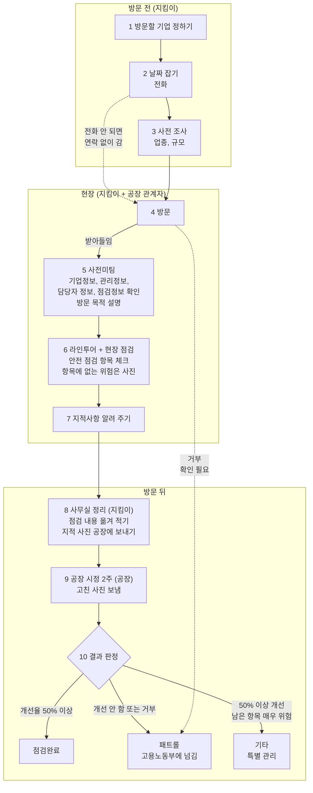

# 산업안전지킴이 업무 스토리보드 (초안)

- 작성일: 2026-10-12
- 상태: 초안. 지금 지킴이들이 일하는 방식(현재 업무)을 정리한 것이다.
- 출처: 지킴이 업무 설명(구두), 산업안전지킴이 체크리스트 종이 앞면(`UIUX_research/참고자료/산업안전지킴이 체크리스트_앞.pdf`)

## 1. 한눈에 보기

| 항목 | 내용 |
|---|---|
| 점검 대상 | 화성의 50인 미만 제조시설, 약 25,000곳 |
| 방문 주기 | 기업마다 보통 1년에 한 번 |
| 점검조 | 3인 1조가 원칙. 아주 크거나 위험한 곳이 아니면 보통 2인 1조로 다닌다 |
| 방문 건수 | 조마다 하루 평균 1.2곳 |
| 예약 | 따로 없다. 전화로 날을 잡거나, 연결이 안 되면 연락 없이 간다 |
| 강제력 | 법으로는 해야 하는 점검이지만, 안 받았다고 따로 받는 제재는 없다 |
| 시정 기간 | 점검 뒤 2주 |

## 2. 등장인물

| 역할 | 누구 | 하는 일 |
|---|---|---|
| 지킴이 조장 | 보통 소방 전문가 | 조를 이끌고 점검한다 |
| 지킴이 조원 | 화학(유해물질) 전문가, 전기 전문가 | 자기 분야를 중심으로 점검한다 |
| 공장 관계자 | 공장주 또는 안전담당관리자 | 사전미팅에 나오고, 라인투어에 같이 다니며 설명하고, 지적사항을 고쳐 사진을 보낸다 |
| 고용노동부 | | 개선하지 않거나 점검을 거부한 공장을 넘겨받는다(패트롤) |

## 3. 흐름 한눈에 보기

```
[1] 방문할 기업 정하기
 ↓
[2] 날짜 잡기 ──── 전화가 안 되면 연락 없이 그냥 간다
 ↓
[3] 사전 조사 (업종, 규모)
 ↓
[4] 방문 ──── 거부당하면 여기서 끝
 ↓
[5] 사전미팅 (기업정보, 관리정보, 담당자 정보, 점검정보 확인, 방문 목적 설명)
 ↓
[6] 라인투어 + 현장 점검 (안전 점검 항목 체크, 항목에 없는 위험은 사진)
 ↓
[7] 현장에서 지적사항 알려 주기
 ↓
[8] 사무실에서 점검 내용 옮겨 적기, 지적 사진 공장에 보내기
 ↓
[9] 공장 시정 (2주) → 고친 사진을 지킴이에게 보냄
 ↓
[10] 결과 판정 ─┬─ 점검완료 : 개선율 50% 이상
               ├─ 패트롤   : 개선하지 않음 또는 거부 → 고용노동부에 넘김
               └─ 기타     : 50% 이상 고쳤지만 남은 항목이 매우 위험해 특별 관리가 필요
```

같은 흐름을 머메이드로 그린 것이다. 점선은 아직 확인하지 않은 길이다.



## 4. 장면별 스토리보드

### 장면 1. 방문할 기업 정하기

- 상황: 기업마다 1년에 한 번꼴로 찾아가야 한다. 대상은 약 25,000곳이다.
- 지킴이가 하는 일: 방문할 기업을 고른다.
- 다음: 장면 2

### 장면 2. 날짜 잡기

- 상황: 방문 예약 체계는 따로 없다.
- 지킴이가 하는 일: 기업에 전화해 방문 날짜를 잡는다.
- 어려운 점: 전화가 잘 안 되는 경우가 대부분이다. 그럴 때는 연락 없이 그냥 찾아가는 일이 많다.
- 다음: 장면 3

### 장면 3. 사전 조사

- 상황: 방문하기로 정한 기업이 있다.
- 지킴이가 하는 일: 그 기업의 업종과 규모를 미리 조사한다.
- 다음: 장면 4

### 장면 4. 방문

- 상황: 지킴이 조(보통 2인)가 공장에 도착한다.
- 어려운 점: 가서 거부당하는 경우도 많다. 점검을 안 받아도 공장이 받는 제재는 없다.
- 다음: 받아들이면 장면 5, 거부하면 여기서 끝 (패트롤로 넘어가는지는 확인 필요)

### 장면 5. 사전미팅

- 상황: 현장에 들어가기 전, 공장 안전담당관리자 또는 공장주와 마주 앉는다.
- 지킴이가 하는 일:
  - 체크리스트 종이 윗부분에 있는 다음 정보를 공장 측에 물어 확인하고 채운다.
    - 기업정보: 기업명, 대표자명, 행정구역, 업종코드, 주 생산용품, 상시 근로자 수, 외국인 근로자 수 등
    - 관리정보: 전년도 재해 건수, 등록 사유, 기업 등록일
    - 담당자 정보: 공장 안전담당자 이름, 전화번호, 이메일, 휴대폰
    - 점검정보: 방문(예정)일, 점검 결과
  - 모든 항목을 다 볼 수는 없어서, 가능한 부분만 확인한다.
  - 방문과 점검의 목적을 설명한다.
- 다음: 장면 6

### 장면 6. 라인투어와 현장 점검

- 상황: 공장 관계자와 같이 현장으로 들어간다.
- 지킴이가 하는 일:
  - 라인투어를 한다. 원자재가 들어와서, 가공되고, 최종 출하되기까지의 과정을 따라가며 본다.
  - 공장 관계자가 동행하며 설명하고, 지킴이는 들으면서 체크리스트의 안전 점검 항목을 체크한다.
    - 점검 항목은 분야별(산업안전 일반, 소방, 전기, 화학, 유해위험기구와 시설)로 나뉜 질문이다. 예: "소방 시설과 화재감지시설을 주기적으로 관리하고 있는가?"
    - 항목마다 양호, 보통, 불량, 해당없음 중 하나로 답하고, 위험요인과 평가 내용을 적는다.
  - 점검 항목에 없는 위험은 따로 사진을 찍는다.
    - 예: 호이스트 고리, 적재함이 쏟아질 위험, 페인트 통 안에 다른 화학물질
- 다음: 장면 7

### 장면 7. 현장에서 지적사항 알려 주기

- 상황: 점검이 끝났다.
- 지킴이가 하는 일: 찾은 지적사항을 공장 측에 모두 알려 준다.
- 다음: 장면 8

### 장면 8. 사무실에서 정리하고 사진 보내기

- 상황: 지킴이가 사무실로 돌아왔다.
- 지킴이가 하는 일:
  - 종이에 적은 점검 내용을 옮겨 적는다.
  - 지적사항으로 찍은 사진을 공장에 보낸다.
  - 공장에 시정 기간 2주를 준다.
- 다음: 장면 9

### 장면 9. 공장 시정

- 상황: 2주의 시정 기간이다.
- 공장이 하는 일: 지적사항을 고치고, 고친 모습을 사진으로 찍어 지킴이에게 보낸다.
- 다음: 장면 10

### 장면 10. 결과 판정

- 상황: 공장이 보낸 시정 사진을 받았다(또는 받지 못했다).
- 지킴이가 하는 일: 개선 정도를 보고 결과를 정한다.

| 결과 | 언제 | 그다음 |
|---|---|---|
| 점검완료 | 개선율 50% 이상 | 끝 |
| 패트롤 | 개선하지 않았거나 거부함 | 고용노동부에 넘긴다 |
| 기타 | 50% 이상 개선했지만 남은 항목이 매우 위험해 특별 관리가 필요 | 특별 관리 |

## 5. 참고: 체크리스트 종이 앞면 구성

지킴이가 들고 다니는 종이 체크리스트 앞면에 어떤 칸이 있는지 정리한 것이다. 번호는 종이에 적힌 번호 그대로다. 사전미팅(장면 5)에서는 1번 기업정보부터 4번 점검정보까지를 본다.

| 번호 | 칸 | 들어가는 것 |
|---|---|---|
| 1 | 기업정보 | 기업명, 사업자번호, 대표자명, 행정구역, 회사 전화번호, 회사 팩스번호, 회사 대표메일, 업종코드, 주 생산용품, 상시 근로자 수, 외국인 근로자 수, 소유형태(소유, 임차, 기타), 기업종류(소공인, 소기업, 중소기업, 기타), 사업장주소, 기타정보 |
| 2 | 관리정보 | 전년도 재해건수, 등록사유(현장등록, 점검신청, 점검거부, 기업DB, 기타), 기업등록일자 |
| 3 | 담당자 정보 | 안전담당자, 담당자 전화번호, 담당자 이메일, 담당자 휴대폰 |
| 4 | 점검정보 | 점검코드, 기업코드, 방문(예정)일, 점검결과(점검완료, 재점검, 패트롤, 기타) |
| 5 | 점검조 정보 | 조장, 조원1, 조원2, 조원3 |
| 6 | 유해위험기구 보유현황 | 지게차, 크레인, 용접기, 리프트, 컨베이어, 프레스 등 장비 고르기 |
| 7 | 위험물질/유해화학물질 취급여부 | 제조, 취급, 기준량 이하 제조/취급, 해당없음 |
| 8 | 종합평가결과 | 개선을 위한 조언 |
| 9 | 분야별 안전점검 | 분야별 평가 항목마다 양호, 보통, 불량, 해당없음 + 위험요인 + 평가 내용 |

## 6. 정해야 할 것

- 체크리스트 종이의 점검결과 칸에는 "재점검"이 있지만, 이번 설명의 판정(장면 10)에는 나오지 않는다. 실제로 쓰이는지 확인이 필요하다.
- 장면 10 패트롤의 "거부"가 시정을 거부한 것만인지, 방문 때 점검을 거부한 것(장면 4)도 포함하는지 모른다.
- 개선율 50%를 무엇으로 세는지(지적사항 개수 기준인지 등) 아직 모른다.
- 체크리스트 종이의 점검조 정보, 유해위험기구 보유현황, 위험물질 취급여부, 종합평가결과, 분야별 안전점검 칸을 어느 장면에서 채우는지(사전미팅인지, 라인투어인지, 사무실에 돌아와서인지) 아직 모른다.
