# 산업안전지킴이 업무 스토리보드 (초안)

- 작성일: 2026-10-12 (마지막 고침 2026-10-27, 고친 이력은 8절)
- 상태: 초안, 큰 틀. 우리가 만들 서비스(지킴이 앱, 공장 웹, 운영자 웹)로 하는 지킴이 업무의 흐름이다. 지금 지킴이들이 일하는 방식은 `261022_산업안전지킴이_업무스토리보드_기존.md`에 있다.
- 출처: 지킴이 업무 설명(구두), 산업안전지킴이 체크리스트 종이 앞뒤(`UIUX_research/참고자료/산업안전지킴이 체크리스트_앞.pdf`, `_뒤.pdf`), 2026-10-21 지킴이 분과 미팅, 지금 시제품(지킴이 앱, 공장 웹, 운영자 웹)

## 1. 한눈에 보기

| 항목        | 내용                                                                                                                  |
| ----------- | --------------------------------------------------------------------------------------------------------------------- |
| 점검 대상   | 화성의 50인 미만 제조시설, 약 25,000곳                                                                                |
| 방문 주기   | 기업마다 보통 1년에 한 번                                                                                             |
| 점검조      | 3인 1조가 원칙. 아주 크거나 위험한 곳이 아니면 보통 2인 1조로 다닌다                                                  |
| 방문 건수   | 조마다 하루 평균 1.2곳                                                                                                |
| 예약        | 따로 없다. 전화로 날을 잡거나, 연결이 안 되면 연락 없이 간다                                                          |
| 강제력      | 법으로는 해야 하는 점검이지만, 안 받았다고 따로 받는 제재는 없다                                                      |
| 시정 기간   | 2주                                                                                                                   |
| 점검의 중심 | **개선사항**(종이 10번 현장점검 개선사항). 현장에서 사진으로 찍어 공장에 시정을 요구하고, 고쳤는지 판정한다         |
| 확정        | 지킴이가 개선을 위한 조언을 적어 **제출**하면 확정된다. 운영자 승인은 없다                                           |

## 2. 등장인물과 말

| 역할        | 누구                               | 하는 일                                                                                                   |
| ----------- | ---------------------------------- | --------------------------------------------------------------------------------------------------------- |
| 지킴이 조장 | 보통 소방 전문가                   | 조를 이끌고 점검한다                                                                                      |
| 지킴이 조원 | 화학(유해물질) 전문가, 전기 전문가 | 자기 분야를 중심으로 점검한다                                                                             |
| 공장 관계자 | 공장주 또는 안전담당자             | 사전미팅에 나오고, 라인투어에 같이 다니며 설명하고, 개선사항을 고쳐 고친 사진을 공장 웹에 올린다          |
| 운영자      | 산업안전지킴이 운영센터            | 지킴이를 조로 묶고 조마다 맡을 동네(읍·면·동)를 정하고, 체크리스트 문항을 관리하고, 제출된 점검을 받아 본다 |

이 문서에서 쓰는 말:

| 말                          | 뜻                                                                                                                                         |
| --------------------------- | ------------------------------------------------------------------------------------------------------------------------------------------ |
| 개선사항                    | 현장에서 사진으로 찍은 고칠 곳 한 건. 종이 10번의 한 줄이다. 지금 업무에서는 "지적사항"이라고 부른다                                       |
| 위험요인(지도유형)          | 개선사항이나 불량 문항에 붙이는 18가지 유해위험요인. 종이 10번에서는 "지도유형(유해위험요인)"이라고 쓴다                                   |
| 체크리스트                  | 종이 9번 분야별 안전점검. 문항마다 양호, 보통, 불량, 해당없음으로 답한다. 불량은 공장에 따로 가지 않는다(공장에 가는 것은 개선사항뿐)     |
| 점검 포인트                 | 체크리스트 문항마다 붙은, 그 문항에서 무엇을 보면 되는지 몇 줄                                                                             |
| 주안점                      | 지난 점검에서 안 고쳐진 것을 바탕으로 AI가 정리한, 이번에 중점적으로 볼 곳                                                                 |
| 사전점검, 현장점검, 분야별 안전점검 | 앱의 점검 화면 세 탭. 각각 사전미팅, 라인투어, 체크리스트를 하는 곳이다                                                                |
| 개선여부                    | 개선사항마다 개선완료, 개선 중, 미개선, 기타. 판정하면 개선완료가 아닌 것은 미개선이 되고, 공장 웹에는 고쳐짐, 안 고쳐짐으로 보인다          |
| 개선 관리                   | 점검을 마친 뒤의 일을 모아 보는 곳. 보낼 것(정리해 공장에 보내기) → 시정 중 → 판정 필요 → 제출할 것                                      |
| 점검 결과                   | 두 단계다. 점검을 마칠 때 개선사항이 없으면 점검완료, 있으면 재점검. 재점검이면 판정 때 점검완료, 패트롤, 기타 가운데 지킴이가 고른다       |
| 패트롤                      | 판정 결과의 하나. 개선하지 않았거나 거부한 공장. 그다음 처리는 아직 정하지 않았다                                                          |
| 기타(판정 결과)             | 50% 이상 고쳤지만 남은 것이 매우 위험해 특별 관리가 필요한 공장. 특별 관리 방법은 아직 없다. 개선여부의 "기타"와는 다른 말이다            |
| 개선을 위한 조언            | 종이 8번 종합평가결과. 기업 구분(일반, WOW, BOB)과 판 번호, 조언 글                                                                         |
| 제출                        | 지킴이가 점검을 확정하는 것. 운영자 점검 기록에는 점검중(점검하는 중), 제출 전(점검을 마쳤지만 확정 전 — 지킴이가 고칠 수 있음), 제출로 보인다 |
| 체크리스트 버전             | 문항 묶음의 판(예: 26VER01). 문항이 바뀌면 운영자가 새 버전을 올린다                                                                      |

## 3. 흐름 한눈에 보기

```
[1] 방문할 기업 정하기 ──── 목록에 없는 기업은 미리 등록
 ↓
[2] 날짜 잡기 ──── 전화가 안 되면 연락 없이 그냥 간다
 ↓
[3] 방문 ──── 거부당하면 여기서 끝
 ↓
[4] 사전미팅 (종이 1~7번, 9번의 01 산업안전 일반 4문항)
 ↓
[5] 라인투어 ──── 개선할 곳을 사진으로 찍는다 (개선사항)
 ↓
[6] 체크리스트 (종이 9번) ──── 마치면 점검 결과가 정해진다: 개선사항이 없으면 점검완료, 있으면 재점검
 ↓  개선사항이 있을 때만 [7]~[9]
[7] 시정 요구 ──── 개선사항을 정리해 공장 웹으로 보낸다 (현장에서 고친 것은 개선완료, 모두 고쳤으면 바로 [10])
 ↓
[8] 공장 시정 (2주) ──── 고친 사진을 공장 웹에 올린다
 ↓
[9] 결과 판정 ─┬─ 점검완료 : 개선율 50% 이상
               ├─ 패트롤   : 개선하지 않음 또는 거부
               └─ 기타     : 50% 이상 고쳤지만 남은 것이 매우 위험해 특별 관리가 필요
 ↓
[10] 최종 제출 ──── 개선을 위한 조언(종이 8번)을 적고 제출하면 확정
```


### 3-1. 점검 업무 자세히

지킴이 업무를 앱과 웹(지킴이 앱, 공장 웹, 운영자 웹)으로 하는 흐름을 **지금 시제품이 하는 그대로** 그렸다(2026-10-27에 앱과 웹을 끝까지 따라가 보고 맞춤). 앞으로 만들기로 했지만 시제품에 아직 없는 것은 **(아직 없음)** 으로 적었다. 장면의 "앱에서는"도 같은 기준이다. 화면의 자세한 모양과 단추는 `시제품/README.md`에 있다.

```mermaid
sequenceDiagram
    autonumber
    participant O as 운영자<br/>(운영자 웹)
    participant G as 지킴이<br/>(지킴이 앱)
    participant F as 공장 관계자<br/>(공장 웹)

    Note over O: 준비: 지킴이를 조로 묶고 조마다 맡을 읍·면·동 정하기,<br/>체크리스트 문항 관리(문항이 바뀌면 새 버전 올리기)
    O-->>G: 우리 조가 맡은 동네의 공장이 지킴이 앱 공장 목록에 뜬다

    rect rgb(248, 250, 253)
    Note over G: 방문 전 (장면 1~2)
    G->>G: 목록에 없는 기업은 사무실에서 미리 기업등록 — 아는 칸만 채움<br/>우리 조 동네면 바로 점검 대상 (운영자도 운영자 웹에서 등록할 수 있음)
    G->>G: 방문할 공장 고르기 (고르는 규칙은 아직 없음)
    Note over G,F: 전화로 방문 날짜를 정한다 (공장 웹에는 아무것도 가지 않음)
    G->>G: 정한 방문일을 앱에 적어 둔다
    alt 전화가 안 됨
        G-->>G: 연락 없이 그냥 간다 (전화 안 됨 기록은 아직 없음)
    end
    O-->>O: 방문 일정 보기 (보기만)
    end

    rect rgb(255, 251, 240)
    Note over G,F: 현장 (장면 3~5)
    G->>F: 방문
    alt 점검 거부
        F-->>G: 거부 (제재는 없음)
        G-->>O: 거부 기록 (아직 없음 — 따로 남기는 기능이 필요)
    else 받아들임
        Note over G,F: 사전미팅 = 사전점검
        G->>G: 점검 시작
        G->>F: 종이 1~5번(기업정보, 관리정보, 담당자 정보, 점검정보, 점검조 정보) 확인<br/>등록된 값이 뜨고, 기업등록 때 못 채운 칸은 여기서 채운다, 빈 칸도 넘어감
        opt 현장에서 종이에 적어 둠
            G-->>G: 사무실에 돌아와 앱에서 채움 (지킴이 웹은 나중에 만듦)
        end
        G->>F: 6 유해위험기구 보유현황, 7 위험물질 취급여부 확인<br/>등록된 기업 정보의 값이 미리 체크돼 있고 고칠 수 있다<br/>(고른 기구 문항만 체크리스트에 나옴)
        G->>F: 9번 01 산업안전 일반 4문항

        Note over G,F: 라인투어 = 현장점검 (원자재 → 가공 → 출하, 공장 관계자 동행)
        loop 개선할 곳마다
            G->>G: 사진을 찍으면 개선사항 한 건이 생긴다 (한 건에 5장까지, 첫 사진이 대표 사진)
            G->>G: AI가 대표 사진을 보고 위험요인 추천 → 지킴이가 빼거나 더한다
            Note over G: 시제품: 시험 사진에만 흉내 답, 실제로 찍은 사진은 추천 없음<br/>실제: 사진을 보는 AI를 붙인다 (아직 없음)
            G->>G: 개선 전 내용 적기
            opt 위험요인을 다 지움
                G->>G: 잘된 사항으로 따로 모임 (점검 기록에는 남지 않음)
            end
        end
    end
    end

    rect rgb(245, 250, 247)
    Note over G: 체크리스트 = 분야별 안전점검 (장면 6)
    G->>G: 지난번 미흡 항목: 지난번 안 고쳐진 것을 바탕으로 AI가 정리한 이번 점검 주안점<br/>(없으면 첫 점검이거나 모두 고쳐짐)
    G->>G: 02~05 문항마다 양호, 보통, 불량, 해당없음 (문항마다 점검 포인트)
    G->>G: 불량이면 위험요인(18가지)과 평가 내용
    G->>G: 05 기구 문항은 보유현황에서 고른 기구 것만 — 고르지 않은 기구 문항은 저절로 해당없음
    G->>G: 점검 마치기 (안 본 문항은 답 없음)<br/>점검 결과는 저절로: 개선사항 없음 → 점검완료, 있음 → 재점검 (시정 기한 2주)
    G-->>O: 점검 기록에 "제출 전"으로 보임 (제출할 때까지 지킴이가 고칠 수 있음)
    end

    alt 개선사항이 없음
        Note over G: 개선 관리의 제출할 것으로 바로 간다
    else 개선사항이 있음 (재점검)
        rect rgb(255, 251, 240)
        Note over G,F: 시정 요구 = 개선 관리의 보낼 것 (장면 7)
        G->>G: 개선사항마다 정리: 개선 전 / 개선 후 사진, 개선여부, 지도유형, 개선 전 / 개선 후 내용
        opt 현장에서 바로 고친 것
            G->>G: 개선 후 사진을 넣고 개선완료로
        end
        end
        alt 모두 개선완료
            G->>G: 점검 결과가 점검완료로 바뀌고 제출할 것으로
        else 고칠 것이 남음
            G->>F: 공장에 전송 → 공장 웹에 개선사항이 뜬다<br/>(개선완료로 둔 것은 "고쳐짐"으로 함께 보임)
            Note over F: 공장에 따로 알림은 아직 없다 — 공장 웹에 들어와야 본다

            rect rgb(245, 250, 247)
            Note over G,F: 공장 시정 (장면 8) — 지킴이 쪽은 개선 관리의 시정 중
            F->>F: 개선사항마다 고친 뒤 사진과 고친 내용 한 줄을 보낸다<br/>(둘 다 안 넣어도 됨, 지킴이가 판정하기 전까지 취소할 수 있음)
            F-->>G: 판정 필요로 넘어오고 지킴이에게 알림
            opt 공장이 아직 안 보냄
                G->>F: 다시 알리기
            end
            Note over G: 시정 기한이 지나면 사진이 없어도 판정 필요로
            end

            rect rgb(253, 246, 245)
            Note over G,F: 결과 판정 = 개선 관리의 판정 필요 (장면 9)
            G->>G: 개선 전 / 개선 후 사진과 공장 회신을 보고 개선사항마다 개선여부를 정한다<br/>(개선완료로 두지 않은 것은 판정하면 미개선)
            G->>G: 개선 수를 보고 점검 결과를 직접 고른다: 점검완료, 패트롤, 기타
            G->>F: 판정 결과와 개선사항마다 고쳐짐 / 안 고쳐짐
            opt 기타
                G-->>O: 특별 관리 (아직 없음)
            end
            opt 안 고쳐진 개선사항
                F->>F: 다시 고쳐 보낸다
                Note over G: 다음 점검 때 지난번 미흡 항목에 AI 주안점으로
            end
            end
        end
    end

    rect rgb(243, 246, 252)
    Note over G: 최종 제출 = 개선 관리의 제출할 것 (장면 10)
    G->>G: 제출 전 확인: 사전점검, 분야별 안전점검, 개선사항을 다시 보고 고칠 수 있다
    G->>G: 개선을 위한 조언(종이 8번) 적기: 기업 구분(일반, WOW, BOB) + 판 번호 + 조언 글
    G->>O: 제출 → 확정 (운영자 승인 없음)
    Note over O: 제출된 점검 목록과 알림으로 받고, 제출한 날, 조언, 개선사항을 본다
    end

    O-->>O: 점검 기록(점검중, 제출 전, 제출), 개선 요청, 통계
```



## 4. 장면별 스토리보드

### 장면 1. 방문할 기업 정하기

- 상황: 기업마다 1년에 한 번꼴로 찾아가야 한다. 대상은 약 25,000곳이다.
- 지킴이가 하는 일: 방문할 기업을 고른다. 목록에 없는 기업은 사무실에서 미리 등록한다.
- 앱에서는: 우리 조가 맡은 동네의 공장이 목록에 뜬다. 목록에 없는 기업은 기업등록으로 등록한다. 등록할 때는 아는 칸만 채우고, 남은 칸은 현장 사전미팅에서 채운다(장면 4). 우리 조 동네면 바로 점검 대상이 된다. 운영자도 운영자 웹에서 등록할 수 있다. 고르는 규칙은 아직 없다.
- 다음: 장면 2

### 장면 2. 날짜 잡기

- 상황: 방문 예약 체계는 따로 없다.
- 지킴이가 하는 일: 기업에 전화해 방문 날짜를 잡는다.
- 어려운 점: 전화가 잘 안 되는 경우가 대부분이다. 그럴 때는 연락 없이 그냥 찾아가는 일이 많다.
- 앱에서는: 정한 방문일을 앱에 적어 둔다(공장 웹에는 아무것도 가지 않는다). 운영자는 방문 일정을 보기만 한다. 전화가 안 됐다는 기록은 아직 없다.
- 다음: 장면 3

### 장면 3. 방문

- 상황: 지킴이 조(보통 2인)가 공장에 도착한다.
- 어려운 점: 가서 거부당하는 경우도 많다. 점검을 안 받아도 공장이 받는 제재는 없다.
- 앱에서는: 거부 기록은 아직 없다. 따로 남기는 기능이 필요하다.
- 다음: 받아들이면 장면 4, 거부하면 여기서 끝

### 장면 4. 사전미팅

- 상황: 현장에 들어가기 전, 공장 안전담당자 또는 공장주와 마주 앉는다.
- 지킴이가 하는 일:
  - 체크리스트 종이 앞면 1~7번을 공장 측에 물어 확인하고 채운다(기업정보, 관리정보, 담당자 정보, 점검정보, 점검조 정보, 유해위험기구 보유현황, 위험물질/유해화학물질 취급여부).
  - 분야별 안전점검 가운데 01 산업안전 일반 4문항을 묻는다.
  - 모든 항목을 다 볼 수는 없어서, 가능한 부분만 확인한다.
- 앱에서는: 점검을 시작하면 종이 1~7번과 01 4문항을 차례로 본다.
  - 등록된 값이 뜨고, 그 자리에서 고친다. 기업등록 때 못 채운 칸은 여기서 채우고, 빈 칸이어도 넘어갈 수 있다.
  - 현장에서 종이에 적어 왔으면 사무실에 돌아와 앱에서 채운다(지킴이 웹은 나중에 만든다).
  - 보유현황과 취급여부는 등록된 기업 정보의 값이 미리 체크돼 있고, 고칠 수 있다.
  - 보유현황에서 고른 기구의 문항만 체크리스트에 나온다(장면 6).
- 다음: 장면 5

### 장면 5. 라인투어와 개선사항 찍기

- 상황: 공장 관계자와 같이 현장으로 들어간다.
- 지킴이가 하는 일:
  - 라인투어를 한다. 원자재가 들어와서, 가공되고, 최종 출하되기까지의 과정을 따라가며 본다. 공장 관계자가 동행하며 설명한다.
  - **고칠 곳을 사진으로 찍는다.** 이것이 개선사항이 된다. 종이로 치면 10번 현장점검 개선사항의 한 줄(개선 전 사진, 지도유형, 개선 전 내용)이다.
    - 예: 호이스트 고리, 적재함이 쏟아질 위험, 페인트 통 안에 다른 화학물질
  - 체크리스트 문항에 하나하나 답하며 다니지 않는다. 체크리스트는 장면 6에서 채운다.
- 앱에서는:
  - 고칠 곳을 찍으면 개선사항 한 건이 생긴다. 한 건에 사진을 5장까지 넣고, 첫 사진이 대표 사진이다.
  - AI가 대표 사진을 보고 위험요인을 추천하고, 지킴이가 빼거나 더한다. 시제품은 시험 사진에만 흉내 답이 있고, 실제 사진을 보는 AI는 아직 없다.
  - 개선 전 내용을 적는다.
  - 위험요인을 다 지운 건은 잘된 사항으로 따로 모인다. 잘된 사항은 점검 기록에 남지 않는다.
  - 개선 후 사진, 개선여부, 개선 후 내용은 장면 7에서 적는다. 현장에서 바로 쓰는 화면이라 적을 것을 줄였다.
- 다음: 장면 6

### 장면 6. 체크리스트

- 상황: 라인투어를 마쳤다.
- 지킴이가 하는 일: 분야별 안전점검 체크리스트(종이 9번)를 채운다. 개선사항과 관련된 문항은 불량으로 하고 위험요인과 평가 내용을 적는다(앱에서 개선사항과 문항을 잇지는 않는다 — 7절). 나머지 문항은 양호, 보통, 해당없음 가운데 고른다.
- 앱에서는:
  - **점검표가 종이 체크리스트를 대신한다.** 앱에 바로 채우므로 사무실에서 전산에 옮겨 적는 일이 없다.
  - 문항마다 점검 포인트가 붙어 있다.
    - 예: 분전반 → 문과 잠금, 누전차단기, 앞 공간. 연삭기 → 숫돌 덮개, 받침대 간격, 보안경.
  - 불량이면 위험요인(18가지)을 고른다. 문항에 맞는 위험요인을 AI가 미리 골라 두고, 지킴이가 빼거나 더한다. 평가 내용은 어느 답이든 적을 수 있다.
  - 지난번 미흡 항목에는 지난 점검에서 안 고쳐진 것을 바탕으로 AI가 정리한 주안점이 나온다. 없으면 첫 점검이거나 모두 고쳐졌다고 쓴다.
  - 05 기구 문항은 보유현황에서 고른 기구 것만 나오고, 고르지 않은 기구 문항은 저절로 해당없음이 된다.
  - 모든 문항에 답하지 않아도 점검을 마칠 수 있다. 안 본 문항은 답 없음으로 남는다.
  - 체크리스트 불량은 공장에 가지 않는다. 공장에 가는 것은 개선사항뿐이다.
  - 점검을 마치면 점검 결과가 저절로 정해진다(개선사항이 없으면 점검완료, 있으면 재점검). 운영자에게는 "제출 전"으로 보이고, 제출할 때까지 지킴이가 고칠 수 있다.
- 다음: 개선사항이 있으면 장면 7, 없으면 장면 10

### 장면 7. 시정 요구

- 상황: 점검을 마쳤고 개선사항이 있다.
- 지킴이가 하는 일: 개선사항을 공장 측에 모두 알려 주고, 2주 안에 고쳐 달라고 요구한다.
- 앱에서는:
  - 개선 관리에서 개선사항마다 정리한다. 개선 전과 개선 후 사진, 개선여부, 지도유형, 개선 전과 개선 후 내용이다.
  - 현장에서 바로 고친 것은 개선 후 사진을 넣고 개선완료로 둔다.
  - 모두 개선완료면 점검 결과가 점검완료로 바뀌고, 공장에 보내지 않고 장면 10으로 간다.
  - 고칠 것이 남으면 공장 웹으로 보낸다. 개선완료로 둔 것도 "고쳐짐"으로 함께 보인다. 사진을 카톡으로 따로 보내지 않는다.
  - 시정 기한은 2주다. 지금은 점검일부터 센다.
  - 공장에 따로 가는 알림은 아직 없다. 공장이 웹에 들어와야 본다.
- 다음: 공장은 장면 8, 지킴이는 시정을 기다린다

### 장면 8. 공장 시정

- 상황: 2주의 시정 기간이다.
- 공장이 하는 일: 개선사항을 고치고, 고친 모습을 사진으로 찍어 올린다.
- 앱에서는:
  - **공장도 웹 서비스를 쓴다.** 공장주(또는 안전담당자)는 웹에서 개선사항과 지킴이가 찍은 사진을 본다. 고친 뒤 개선사항마다 고친 사진과 고친 내용 한 줄을 올린다(둘 다 안 넣어도 된다). 지킴이가 판정하기 전까지는 취소할 수 있다.
  - 사진을 카톡으로 주고받지 않는다. 카톡으로 받은 사진을 지킴이가 대신 올리는 길은 없다.
  - 공장이 보내면 지킴이에게 알림이 가고, 판정할 점검으로 넘어간다. 공장이 아직 안 보냈으면 지킴이가 다시 알린다.
  - 시정 기한이 지나면 사진이 없어도 판정으로 넘어간다.
- 다음: 장면 9

### 장면 9. 결과 판정

- 상황: 공장이 고친 사진을 올렸다(또는 올리지 않았다).
- 지킴이가 하는 일: 개선사항마다 고쳐졌는지 보고 결과를 정한다.

| 결과     | 언제                                                         | 그다음           |
| -------- | ------------------------------------------------------------ | ---------------- |
| 점검완료 | 개선율 50% 이상                                              | 장면 10          |
| 패트롤   | 개선하지 않았거나 거부함                                     | 장면 10. 그 뒤 처리는 아직 정하지 않음 |
| 기타     | 50% 이상 개선했지만 남은 것이 매우 위험해 특별 관리가 필요 | 장면 10. 특별 관리는 아직 없음 |

- 앱에서는:
  - **공장이 웹에 올린 고친 사진을 앱에서 바로 보고 판단한다.** 개선 전과 개선 후 사진, 공장 회신을 보고 개선사항마다 개선여부를 정한다. 개선완료로 두지 않은 것은 판정하면 미개선이 된다.
  - 개선 수(개선율)는 보여 주기만 한다. 점검완료, 패트롤, 기타는 **지킴이가 직접 고른다**(앱이 50%로 미리 골라 두지 않는다).
  - 공장 웹에는 판정 결과와 개선사항마다 고쳐짐, 안 고쳐짐이 보인다. 안 고쳐진 것은 공장이 다시 고쳐 보낼 수 있다.
  - 안 고쳐진 것은 다음 점검 때 지난번 미흡 항목에 주안점으로 나온다.
  - 패트롤 뒤의 처리는 아직 정하지 않았고, 기타 뒤의 특별 관리는 아직 앱에 없다.
- 다음: 장면 10

### 장면 10. 최종 제출

- 상황: 판정이 끝났거나, 처음부터 개선사항이 없던 점검이다.
- 지킴이가 하는 일: 점검 내용을 다시 보고, 개선을 위한 조언(종이 8번)을 적어 제출한다.
- 앱에서는:
  - 제출 전에 사전미팅(사전점검), 체크리스트(분야별 안전점검), 개선사항 내용을 다시 보고 고칠 수 있다.
  - 개선을 위한 조언은 기업 구분(일반, WOW, BOB)을 고르고, 판 번호와 조언 글을 적는다.
  - 제출하면 확정된다. 운영자 승인은 없다. 운영자 웹에 제출된 점검으로 오르고 운영자에게 알림이 간다.
- 다음: 끝

## 5. 참고: 체크리스트 종이 구성

지킴이가 들고 다니는 종이 체크리스트에 어떤 칸이 있는지 정리한 것이다. 번호는 종이에 적힌 번호 그대로다. 앞면에 1~9번, 뒷면에 9번의 나머지(05 유해위험기구 기구별 문항)와 10번이 있다. 사전미팅(장면 4)에서 1~7번과 9번의 01을 보고, 라인투어(장면 5)에서 10번을 찍고, 체크리스트(장면 6)에서 9번을 채우고, 최종 제출(장면 10)에서 8번을 적는다.

| 번호 | 칸                             | 들어가는 것                                                                                                                                                                                                                              |
| ---- | ------------------------------ | ---------------------------------------------------------------------------------------------------------------------------------------------------------------------------------------------------------------------------------------- |
| 1    | 기업정보                       | 기업명, 사업자번호, 대표자명, 행정구역, 회사 전화번호, 회사 팩스번호, 회사 대표메일, 업종코드, 주 생산용품, 상시 근로자 수, 외국인 근로자 수, 소유형태(소유, 임차, 기타), 기업종류(소공인, 소기업, 중소기업, 기타), 사업장주소, 기타정보 |
| 2    | 관리정보                       | 전년도 재해건수, 등록사유(현장등록, 점검신청, 점검거부, 기업DB, 기타), 기업등록일자                                                                                                                                                      |
| 3    | 담당자 정보                    | 안전담당자, 담당자 전화번호, 담당자 이메일, 담당자 휴대폰                                                                                                                                                                                |
| 4    | 점검정보                       | 점검코드, 기업코드, 방문(예정)일, 점검결과(점검완료, 재점검, 패트롤, 기타)                                                                                                                                                               |
| 5    | 점검조 정보                    | 조장, 조원1, 조원2, 조원3                                                                                                                                                                                                                |
| 6    | 유해위험기구 보유현황          | 지게차, 크레인, 용접기, 리프트, 컨베이어, 프레스 등 장비 고르기                                                                                                                                                                          |
| 7    | 위험물질/유해화학물질 취급여부 | 제조, 취급, 기준량 이하 제조/취급, 해당없음                                                                                                                                                                                              |
| 8    | 종합평가결과                   | 개선을 위한 조언                                                                                                                                                                                                                         |
| 9    | 분야별 안전점검                | 분야별 평가 항목마다 양호, 보통, 불량, 해당없음 + 위험요인 + 평가 내용                                                                                                                                                                   |
| 10   | 현장점검 개선사항              | 개선사항 한 줄마다 개선 전 사진, 개선 후 사진, 개선여부(개선완료, 개선중, 미개선, 기타), 지도유형(유해위험요인), 개선 전 내용, 개선 후 내용. 10줄                                                                                        |

## 6. 지금 방식과 달라지는 점

| 장면          | 지금                                                                | 우리 서비스                                                                                     |
| ------------- | ------------------------------------------------------------------- | ----------------------------------------------------------------------------------------------- |
| 4 사전미팅    | 종이 윗부분을 물어 채우고, 산업안전 일반 4문항을 적는다             | 점검을 시작하면 종이 1~7번과 01 4문항을 차례로 본다. 등록된 값이 뜨고, 빈 칸이어도 넘어간다     |
| 5 라인투어    | 고칠 곳을 폰으로 찍는다. 체크리스트는 적지 않는다                   | 앱으로 찍으면 개선사항 한 건이 생긴다. 사진, AI가 추천한 위험요인, 개선 전 내용을 남긴다        |
| 6 체크리스트  | 사무실에서 사진을 보며 기억으로 전산에 입력한다                     | 앱 점검표에 바로 채운다. 문항마다 점검 포인트, 지난번 미흡은 주안점으로. 옮겨 적기 없음         |
| 7 시정 요구   | 현장에서 말로 알려 주고, 사진은 사무실에서 카톡 등으로 보낸다       | 앱에서 개선사항과 사진을 정리해 공장 웹으로 보낸다                                              |
| 8 공장 시정   | 공장이 고친 사진을 카톡 등으로 보낸다                               | 공장이 웹에서 개선사항을 보고 고친 사진을 올린다                                                |
| 9 결과 판정   | 카톡 사진을 보고 판단하고, 개선 후 사진과 결과를 전산에 옮겨 올린다 | 앱에서 개선 전과 개선 후를 나란히 보고 개선사항마다 정한 뒤 결과를 직접 고른다                 |
| 10 최종 제출  | 사무실에서 기존 웹에 조언까지 적어 제출하고, 운영자가 승인한다     | 앱에서 조언을 적어 제출하면 확정된다. 운영자 승인은 없다                                       |

아직 앱에 없는 것: 방문할 기업 정하기 규칙(장면 1), 전화 안 됨과 방문 거부 기록(장면 2, 3), 실제 사진을 보는 AI(장면 5), 공장에 가는 알림(장면 7), 공장이 폰으로 바로 여는 웹 화면(장면 8), 판정 뒤 처리(패트롤 뒤 처리, 기타의 특별 관리), 지킴이 웹.

## 7. 정해야 할 것

- 시정 기간 2주를 언제부터 세는지(공장에 보낸 날인지 점검일인지). 지금 앱은 점검일부터 센다.
- 체크리스트(장면 6)를 현장에서 채우는지, 사무실에서 채우는지.
- 개선사항과 체크리스트 문항을 이을지(개선사항에서 문항을 고르면 그 문항이 불량이 되는 식).
- 공장(특히 소공인)이 실제로 웹에 들어와 사진을 올릴지. 개선사항을 보냈다는 것을 공장에 어떻게 알릴지(문자, 알림톡 링크로 로그인 없이 바로 여는 방식 등).
- 점검 거부를 어디에 어떻게 남길지.
- 패트롤의 "거부"가 시정을 거부한 것만인지, 방문 때 점검을 거부한 것(장면 3)도 포함하는지.
- 개선율 50%를 무엇으로 세는지(개선사항 개수 기준인지 등). 조금 고쳤지만 50%가 안 되는 공장은 어느 결과인지(패트롤은 "개선하지 않음 또는 거부"라서 빈다).
- 패트롤, 기타 뒤의 처리(특별 관리)와 그때 공장주에게 무엇이 가는지.
- 잘된 사항을 점검 기록에 남길지. 지금은 점검을 마치면 사라진다.
- 답 없는 문항이 남아도 제출할 수 있게 둘지.
- 판정 결과가 공장 웹에 먼저 보이는데, 제출 전에 지킴이가 개선여부를 고치면 공장에 어떻게 알릴지.
- 조 안에서 누가 앱으로 찍고, 판정하고, 제출하는지(한 사람인지, 조원마다 나눠 쓰는지).
- 기업 구분 일반, WOW, BOB와 조언의 판 번호가 무엇을 뜻하는지(기존 웹 칸을 그대로 옮김).

## 8. 고친 이력

- 2026-10-14: 장면마다 "앱에서는"과 6절을 더함. 재점검 사진을 카톡 대신 지킴이 앱과 공장 웹으로 주고받는 것으로.
- 2026-10-20: 사진 AI와 장비 AI가 체크리스트를 만드는 대신 점검 포인트를 알려 주는 것으로.
- 2026-10-22: 우리 서비스의 흐름으로 다시 씀. 현장에서 찍은 개선사항으로 시정을 요구한다.
- 2026-10-23: 점검을 시작하면 사전미팅 칸(종이 1~7번, 01 4문항)부터. 그때 장면 6, 8, 10(지금 5, 6, 9)을 시제품에 맞춤. 앱과 웹으로 본 머메이드를 더함.
- 2026-10-27: 시제품을 끝까지 따라가 보고 3-1을 다시 그림(개선 관리, 최종 제출, 운영자가 받는 제출). 사용자 검토대로 사전 조사 장면을 빼고, 장면 차례를 시제품 흐름대로 바꾸고(체크리스트 뒤에 시정 요구), 최종 제출 장면을 더함. 고용노동부 내용을 걷고, 주관점을 주안점으로. "개선사항"으로 말을 맞추고 말 정리 표, 운영자 등장인물을 더함. 옛 전체 지도 그림(옛 3-1), 3절 머메이드, 참고 절을 지움.
