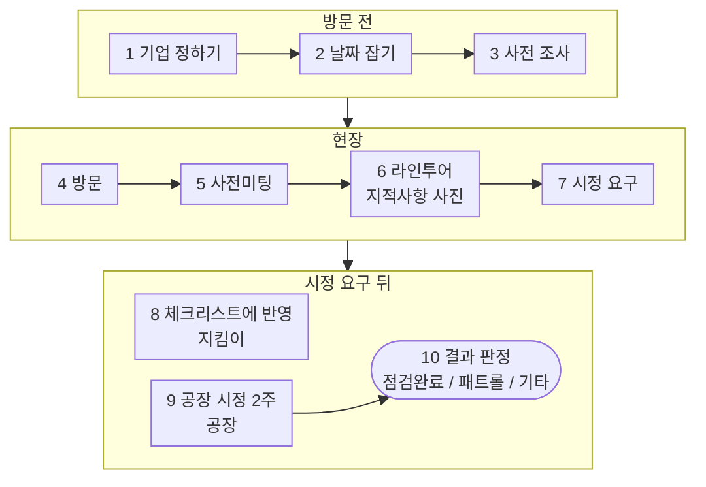
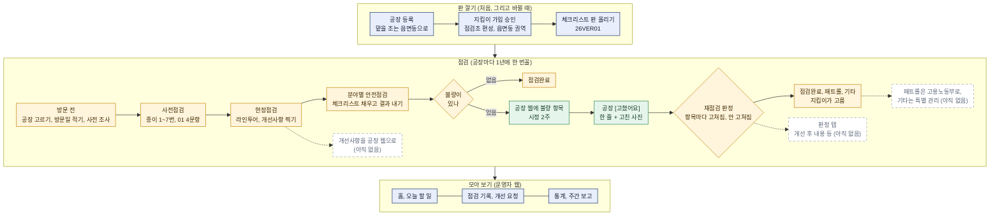

# 산업안전지킴이 업무 스토리보드 (초안)

- 작성일: 2026-10-12 (2026-10-14 고침: 장면마다 "앱에서는" 줄과 6절 "앱에서 바뀌는 점"을 더함. 같은 날 재점검 사진을 카톡 대신 지킴이 앱과 공장 웹으로 주고받는 것으로 고침. 2026-10-20 고침: 장면 6의 사진 AI와 장비 AI가 체크리스트를 만드는 대신 그 설비의 점검 포인트(주관점)를 알려 주는 것으로. 2026-10-22 고침: 우리 서비스의 흐름으로 다시 씀 — 현장에서 찍은 지적사항으로 시정을 요구한 뒤 체크리스트에 반영. 2026-10-23 고침: 점검을 시작하면 사전 확인(기업 정보, 유해위험기구 보유현황, 위험물질 취급여부, 01 산업안전 일반 4문항)부터. 같은 날 저녁 고침: 장면 6 · 8 · 10을 시제품에 맞춤 — 현장점검 개선사항을 앱 카메라로 한 장씩, 잘된 사항 나누기, 사진 AI 걷음, 분야별 안전점검의 [지난번 미흡 항목 | 체크리스트] 탭과 문항마다 점검 포인트. 같은 날 3-1~3-3 앱과 웹으로 본 지킴이 업무 머메이드를 더함 — 지금 시제품 그대로, 없는 것은 "아직 없음")
- 상태: 초안, 큰 틀. 우리가 만들 서비스(지킴이 앱, 공장 웹)의 업무 흐름이다. 지금 지킴이들이 일하는 방식은 `261022_산업안전지킴이_업무스토리보드_기존.md`에 있다.
- 출처: 지킴이 업무 설명(구두), 산업안전지킴이 체크리스트 종이 앞뒤(`UIUX_research/참고자료/산업안전지킴이 체크리스트_앞.pdf`, `_뒤.pdf`), 2026-10-21 지킴이 분과 미팅

## 1. 한눈에 보기

| 항목        | 내용                                                                                                                                                                              |
| ----------- | --------------------------------------------------------------------------------------------------------------------------------------------------------------------------------- |
| 점검 대상   | 화성의 50인 미만 제조시설, 약 25,000곳                                                                                                                                            |
| 방문 주기   | 기업마다 보통 1년에 한 번                                                                                                                                                         |
| 점검조      | 3인 1조가 원칙. 아주 크거나 위험한 곳이 아니면 보통 2인 1조로 다닌다                                                                                                              |
| 방문 건수   | 조마다 하루 평균 1.2곳                                                                                                                                                            |
| 예약        | 따로 없다. 전화로 날을 잡거나, 연결이 안 되면 연락 없이 간다                                                                                                                      |
| 강제력      | 법으로는 해야 하는 점검이지만, 안 받았다고 따로 받는 제재는 없다                                                                                                                  |
| 시정 기간   | 점검 뒤 2주                                                                                                                                                                       |
| 점검의 중심 | **지적사항**(종이 10번 현장점검 개선사항). 현장에서 사진으로 찍어 공장에 시정을 요구하고, 체크리스트(종이 9번 분야별 안전점검)는 그 지적사항을 바탕으로 채운다 (2026-10-22) |

## 2. 등장인물

| 역할        | 누구                               | 하는 일                                                                                          |
| ----------- | ---------------------------------- | ------------------------------------------------------------------------------------------------ |
| 지킴이 조장 | 보통 소방 전문가                   | 조를 이끌고 점검한다                                                                             |
| 지킴이 조원 | 화학(유해물질) 전문가, 전기 전문가 | 자기 분야를 중심으로 점검한다                                                                    |
| 공장 관계자 | 공장주 또는 안전담당관리자         | 사전미팅에 나오고, 라인투어에 같이 다니며 설명하고, 지적사항을 고쳐 고친 사진을 공장 웹에 올린다 |
| 고용노동부  |                                    | 개선하지 않거나 점검을 거부한 공장을 넘겨받는다(패트롤)                                          |

## 3. 흐름 한눈에 보기

```
[1] 방문할 기업 정하기
 ↓
[2] 날짜 잡기 ──── 전화가 안 되면 연락 없이 그냥 간다
 ↓
[3] 사전 조사 (업종, 규모)
 ↓
[4] 방문 ──── 거부당하면 여기서 끝
 ↓
[5] 사전미팅 (기업정보, 관리정보, 담당자 정보, 점검정보 확인, 방문 목적 설명)
 ↓
[6] 라인투어 ──── 지적할 곳을 사진으로 찍는다 (지적사항)
 ↓
[7] 시정 요구 ──── 지적사항(사진 + 내용)을 공장에 알려 주고 공장 웹으로 보낸다
 ↓
[8] 체크리스트에 반영 ──── 지적사항을 바탕으로 분야별 안전점검을 채운다 (공장 시정과 같은 때)
 ↓
[9] 공장 시정 (2주) → 고친 사진을 공장 웹에 올린다
 ↓
[10] 결과 판정 ─┬─ 점검완료 : 개선율 50% 이상
               ├─ 패트롤   : 개선하지 않음 또는 거부 → 고용노동부에 넘김
               └─ 기타     : 50% 이상 고쳤지만 남은 항목이 매우 위험해 특별 관리가 필요
```

같은 흐름을 머메이드로 그린 것이다. 8(지킴이)과 9(공장)는 같은 때에 일어난다.



아래 3-1~3-3은 2026-10-23에 더한 것이다. 지킴이 업무를 앱과 웹(지킴이 앱, 공장 웹, 운영자 웹)으로 하는 흐름을 **지금 시제품이 하는 그대로** 그렸다. 앞으로 만들기로 했지만 시제품에 아직 없는 것은 **(아직 없음)** 으로 적었다(3-1에서는 점선 칸). 4절 장면 6~10은 목표 흐름(지적사항 중심)이라, 시제품과 다른 곳이 있다 — 가장 큰 차이는 **현장점검에서 찍은 개선사항이 아직 공장 웹과 재점검으로 이어지지 않고, 공장에 가서 재점검하는 단위가 체크리스트의 불량 항목**이라는 점이다.

### 3-1. 전체 지도 (앱과 웹)

색은 누가 하는 일인지를 뜻한다. 점선 칸과 점선 화살표는 아직 없는 것이다.



| 색           | 누가                            | 무엇으로  |
| ------------ | ------------------------------- | --------- |
| 남색         | 운영자(산업안전지킴이 운영센터) | 운영자 웹 |
| 노랑         | 지킴이(조장, 조원)              | 지킴이 앱 |
| 초록         | 공장주 또는 안전담당자          | 공장 웹   |
| 흰 바탕 점선 |                                 | 아직 없음 |

### 3-2. 점검 업무 자세히

```mermaid
sequenceDiagram
    autonumber
    participant O as 운영자<br/>(운영자 웹)
    participant G as 지킴이<br/>(지킴이 앱)
    participant F as 공장 관계자<br/>(공장 웹)
    participant L as 고용노동부

    Note over O: 판 깔기: 공장 등록, 점검조와 읍면동 권역, 체크리스트 판
    O-->>G: 권역의 공장이 지킴이 앱 공장 목록에 뜬다

    rect rgb(248, 250, 253)
    Note over G: 방문 전 (장면 1~3)
    G->>G: 홈 [점검하기], [전체 공장], 지도에서 방문할 공장 고르기<br/>(고르는 규칙은 아직 없음)
    G->>F: 공장 창 [전화 걸기]로 날 잡기
    G->>G: 공장 창 [방문일]에 적어 두기 (예약, 공장 승인 없음)
    alt 전화가 안 됨
        G-->>G: 연락 없이 그냥 간다 (전화 안 됨 기록은 아직 없음)
    end
    G->>G: 공장 창 기업 정보, 기록 탭 보기 (사전 조사)
    O-->>O: 방문 일정 보기 (보기만)
    end

    rect rgb(255, 251, 240)
    Note over G,F: 현장 (장면 4~7)
    G->>F: 방문
    alt 점검 거부
        F-->>G: 거부 (제재는 없음)
        G-->>O: 거부 기록 (아직 없음)
    else 받아들임
        Note over G,F: 사전미팅 = [사전점검] 탭
        G->>G: [점검 시작]
        G->>F: 1 기업정보 ~ 5 점검조 정보 묻기<br/>등록된 값이 뜨고, 칸을 눌러 그 자리에서 고침, 빈 칸도 넘어감
        G->>F: 6 유해위험기구 보유현황 (고른 기구만 체크리스트에 나옴)
        G->>F: 7 위험물질/유해화학물질 취급여부
        G->>F: 9번 01 산업안전 일반 4문항
        G->>F: 방문과 점검 목적 설명 (앱 밖)

        Note over G,F: 라인투어 = [현장점검] 탭 (원자재 → 가공 → 출하, 공장 관계자 동행)
        loop 지적할 곳마다
            G->>G: 카메라 → 앱 카메라로 한 장 → [다시 찍기] / [사진 사용]
            G->>G: 개선사항 n 생김 (이 사진이 대표 사진)
            G->>G: AI가 대표 사진을 보고 위험요인 추천 → 빼거나 더하기<br/>(시험 사진에만 답이 있고, 실제로 찍은 사진은 "AI가 찾은 위험요인 없음")
            G->>G: 개선 전 내용 바로 적기
            opt 사진을 더 넣음
                G->>G: [사진 추가]로 한 장씩 (5장까지)
            end
            opt 위험요인을 다 지움
                G->>G: 잘된 사항으로 따로 모임
            end
        end

        Note over G,F: 시정 요구 (장면 7)
        G->>F: 지적사항을 말로 알리고 2주 안에 고쳐 달라고 요구 (앱 밖)
        G-->>F: 개선사항(사진, 위험요인, 개선 전 내용)을 공장 웹으로 보내기 (아직 없음)
        Note over G: 개선사항은 점검 결과에 담기지 않는다 —<br/>결과를 내면 체크리스트 답만 남는다
    end
    end

    rect rgb(245, 250, 247)
    Note over G: 체크리스트 = [분야별 안전점검] 탭 (장면 8)
    G->>G: [지난번 미흡 항목] 탭: 지난번 안 고쳐진 불량 항목을 바탕으로 한 AI 주관점<br/>(없으면 "첫 점검이라 …" 또는 "모두 고쳐짐")
    G->>G: [체크리스트] 탭: 02~05를 한 쪽에서 아래로<br/>문항마다 양호, 보통, 불량, 해당없음
    G->>G: 문항마다 점검 포인트 펼쳐 보기
    G->>G: 불량이면 위험요인(18가지), 평가 내용은 바로 적기
    G->>G: 05는 고른 기구 문항만 ([수정]으로 기구 다시 고르기)<br/>나머지 기구 문항은 저절로 해당없음
    G->>G: [점검 결과 내기] (안 본 문항은 답 없음)<br/>결과는 저절로: 불량 없음 → 점검완료, 불량 있음 → 재점검
    G->>O: 점검 기록에 오름 (제출 검사 없이 바로 확정)
    end

    alt 불량이 없음
        Note over G: 점검완료로 끝
    else 불량이 있음 (재점검, 시정 기한 2주가 낸 날부터)
        rect rgb(245, 250, 247)
        Note over G,F: 공장 시정 (장면 9)
        G->>F: 불량 항목이 공장 웹 "기록 · 고칠 것"으로<br/>(위험요인, 위험요인 내용, 평가 내용)
        Note over F: 고치기 전 사진은 붙지 않는다 — 불량 창 사진 칸은 10-22에 뺐고,<br/>개선사항 사진은 아직 이어지지 않음
        F->>F: 불량 항목마다 [고쳤어요]: 어떻게 고쳤나 한 줄 + 고친 뒤 사진<br/>(시제품은 흉내 사진, 둘 다 안 넣어도 됨, 재점검 전까지 취소 가능)
        F-->>G: 홈 [재점검] "판정 필요"에 오름
        opt 공장이 아직 안 보냄
            G->>F: 할 일 [공장에 다시 알리기]
        end
        end

        rect rgb(253, 246, 245)
        Note over G,F: 결과 판정 = 재점검 화면 (장면 10)
        G->>G: 불량 항목마다 고치기 전 / 고친 뒤 사진을 나란히 보기
        G->>G: 고쳐짐 / 안 고쳐짐 (안 고쳐진 까닭은 공장주에게 전해짐)
        G->>G: 개선 수를 보고 결과를 직접 고르기 (앱이 50%로 미리 고르지 않음)<br/>→ [재점검 결과 내기]
        G-->>G: 판정 탭: 개선 후 내용, 개선여부 넷 (아직 없음)
        alt 점검완료 — 개선율 50% 이상
            G->>F: 판정 결과
        else 패트롤 — 개선하지 않음 또는 거부
            G->>F: 판정 결과
            G-->>L: 고용노동부에 넘김 (아직 없음)
        else 기타 — 50% 넘게 고쳤지만 남은 것이 매우 위험
            G->>F: 판정 결과
            G-->>O: 특별 관리 (아직 없음)
        end
        Note over F: 항목마다 "지킴이가 고쳐짐 확인" 또는 "안 고쳐짐으로 봄", 고쳐짐 n개 중 n개
        opt 안 고쳐진 항목
            F->>F: [다시 고쳤어요]
            Note over G: 다음 점검 때 [지난번 미흡 항목] 탭에 AI 주관점으로
        end
        end
    end

    O-->>O: 점검 기록, 개선 요청(아직 안 고침, 공장주가 고쳤다고 함, 점검에서 안 고쳐짐, 고쳐짐 확인), 통계<br/>(제출 검사 화면은 남아 있지만 비어 있음)
```



### 3-3. 아직 그리지 못한 것

- 패트롤, 기타 뒤의 처리(고용노동부 넘김, 특별 관리)와 그때 공장주에게 무엇이 가는지.
- 제출 검사(운영자 승인, 반려)를 둘지 — 지금 그림은 두지 않는 쪽(2026-10-14)이다. 두면 3-2 "점검 결과 내기" 뒤에 운영자 승인이 끼고, 반려면 지킴이에게 돌아간다.
- 주간 보고 — 진흥원 답을 받은 뒤 다시 만들기로 미뤘다(2026-10-01).

## 4. 장면별 스토리보드

### 장면 1. 방문할 기업 정하기

- 상황: 기업마다 1년에 한 번꼴로 찾아가야 한다. 대상은 약 25,000곳이다.
- 지킴이가 하는 일: 방문할 기업을 고른다.
- 다음: 장면 2

### 장면 2. 날짜 잡기

- 상황: 방문 예약 체계는 따로 없다.
- 지킴이가 하는 일: 기업에 전화해 방문 날짜를 잡는다.
- 어려운 점: 전화가 잘 안 되는 경우가 대부분이다. 그럴 때는 연락 없이 그냥 찾아가는 일이 많다.
- 다음: 장면 3

### 장면 3. 사전 조사

- 상황: 방문하기로 정한 기업이 있다.
- 지킴이가 하는 일: 그 기업의 업종과 규모를 미리 조사한다.
- 다음: 장면 4

### 장면 4. 방문

- 상황: 지킴이 조(보통 2인)가 공장에 도착한다.
- 어려운 점: 가서 거부당하는 경우도 많다. 점검을 안 받아도 공장이 받는 제재는 없다.
- 다음: 받아들이면 장면 5, 거부하면 여기서 끝 (패트롤로 넘어가는지는 확인 필요)

### 장면 5. 사전미팅

- 상황: 현장에 들어가기 전, 공장 안전담당관리자 또는 공장주와 마주 앉는다.
- 지킴이가 하는 일:
  - 체크리스트 종이 윗부분에 있는 다음 정보를 공장 측에 물어 확인하고 채운다.
    - 기업정보: 기업명, 대표자명, 행정구역, 업종코드, 주 생산용품, 상시 근로자 수, 외국인 근로자 수 등
    - 관리정보: 전년도 재해 건수, 등록 사유, 기업 등록일
    - 담당자 정보: 공장 안전담당자 이름, 전화번호, 이메일, 휴대폰
    - 점검정보: 방문(예정)일, 점검 결과
    - 유해위험기구 보유현황(6번), 위험물질/유해화학물질 취급여부(7번)
  - 분야별 안전점검 가운데 01 산업안전 일반 4문항을 묻는다.
  - 모든 항목을 다 볼 수는 없어서, 가능한 부분만 확인한다. 사전미팅에서 안 적고 사무실에서 웹으로 적는 지킴이도 있다.
  - 방문과 점검의 목적을 설명한다.
- 앱에서는 (2026-10-23 사용자 지시): **점검 시작을 누르면 사전 확인이 차례로 이어진다.** 종이 체크리스트(공식판) 앞면 1~7번 칸을 칸 이름과 차례 그대로 넣었다 — 1 기업정보 → 2 관리정보 · 3 담당자 정보 · 4 점검정보 · 5 점검조 정보 → 6 유해위험기구 보유현황 → 7 위험물질/유해화학물질 취급여부 → 9번 01 산업안전 일반 4문항. 기업 정보를 공장 창 탭에만 두면 놓칠 수 있어서다.
  - 1~3번은 번호 칸마다 "수정"으로 고친다(기업명 · 행정구역 · 업종코드 · 기업등록일자는 빼고). 4 점검정보(점검코드, 기업코드, 방문일, 점검결과)와 5 점검조 정보는 앱이 아는 값을 보인다.
  - 등록된 값이 있으면 그대로 뜨고, 칸이 비어 있어도 넘어갈 수 있다. 나중에 웹에서 이어 적을 수 있게 한다(웹은 나중에).
  - 보유현황 칸은 종이 6번 그대로다(기타장비는 이름을 적는다). 여기서 고른 기구의 문항만 체크리스트에 나오고 나머지는 저절로 해당없음이 된다(장면 8).
- 다음: 장면 6

### 장면 6. 라인투어와 지적사항 찍기

- 상황: 공장 관계자와 같이 현장으로 들어간다.
- 지킴이가 하는 일:
  - 라인투어를 한다. 원자재가 들어와서, 가공되고, 최종 출하되기까지의 과정을 따라가며 본다. 공장 관계자가 동행하며 설명한다.
  - **지적할 곳을 사진으로 찍는다.** 이것이 지적사항이 된다. 종이로 치면 10번 현장점검 개선사항의 한 줄(개선 전 사진, 지도유형(유해위험요인), 개선 전 내용)이다.
    - 예: 호이스트 고리, 적재함이 쏟아질 위험, 페인트 통 안에 다른 화학물질
  - 체크리스트 항목에 하나하나 답하며 다니지 않는다. 체크리스트는 지적사항을 바탕으로 장면 8에서 채운다.
- 앱에서는 (시제품 시험판, 2026-10-22 시작 · 10-23 고침):
  - 점검 안의 탭은 **사전점검 | 현장점검 | 분야별 안전점검** 셋이다. 지적사항은 사전점검 다음 **현장점검** 탭에서 한 건씩 남기고, 앱에서는 한 건을 **개선사항 1, 2, 3 …** 으로 부른다.
  - 지적할 곳을 보면 빈 화면 카드나 목록 아래 점선 칸("개선사항 n 찍기")의 카메라를 누른다. **앱 안 카메라**가 열리고, 찍으면 사진을 멈춰 보여 주며 [다시 찍기] / [사진 사용]을 묻는다. 사용하면 새 개선사항이 생기고 바로 앱으로 돌아온다(이 사진이 대표 사진).
  - 한 건에 사진을 더 넣으려면 그 줄의 [사진 추가]로 한 장씩 찍는다(5장까지).
  - AI가 대표 사진을 보고 위험요인(18가지 중)을 추천하고(보이는 만큼만, 없으면 없다고), 지킴이가 빼거나 더한다. 시제품은 시험 사진에만 정해 둔 답이 있고, 실제로 찍은 사진은 "AI가 찾은 위험요인 없음"이다.
  - 펼친 줄에서 **개선 전 내용**을 바로 적는다(회색 안내 "여기에 개선 전 내용 입력").
  - 위험요인을 다 지운 줄은 **잘된 사항**이 되어 개선사항 아래에 따로 모인다(다시 위험요인을 더하면 개선사항으로 돌아감).
  - 현장에서 바로 쓰는 화면이라 단추와 정보를 적게 둔다. 종이 10번의 나머지 칸(개선 후 사진, 개선여부, 개선 후 내용)은 판정 탭(장면 10)에서 적는다 (2026-10-22 사용자 지시. 개선 전 내용은 10-23부터 여기서 적는다).
  - 사진 AI가 사진 속 설비의 점검 포인트를 알려 주던 기능은 걷었다(2026-10-23 사용자 지시). 점검 포인트는 체크리스트 문항마다 붙는다(장면 8).
- 다음: 장면 7

### 장면 7. 시정 요구

- 상황: 라인투어가 끝났다.
- 지킴이가 하는 일: 찾은 지적사항을 공장 측에 모두 알려 주고, 2주 안에 고쳐 달라고 요구한다.
- 앱에서는:
  - 지적사항(사진 + 내용)을 앱에서 공장 웹으로 보낸다("지적 사항 보내기"). 사진을 카톡으로 따로 보내지 않는다.
  - 보낸 날부터 시정 기간 2주가 돈다 `가설`.
  - 지적사항이 있으면 점검은 재점검(시정 기다림)으로 남아 장면 10에서 판정한다. 없으면 체크리스트만 채우고 점검완료다.
- 다음: 지킴이는 장면 8, 공장은 장면 9

### 장면 8. 체크리스트에 반영

- 상황: 지적사항을 공장에 보냈다. 공장은 시정을 시작한다(장면 9).
- 지킴이가 하는 일: 분야별 안전점검 체크리스트(종이 9번)를 채운다. 지적사항이 걸린 항목은 불량으로 하고 위험요인과 평가 내용을 적는다. 나머지 항목은 양호, 보통, 해당없음 중에서 고른다.
- 앱에서는:
  - **점검표는 종이 체크리스트를 대신한다** (2026-10-22). 항목마다 양호, 보통, 불량, 해당없음 중 하나를 고르고, 불량이면 위험요인(18가지 중)을 고른다 — 처음 불량을 누르면 문항에 맞는 AI 추천 위험요인이 미리 골라져 있고, 아니면 눌러서 뺀다(10-26). 평가 내용은 어느 답이든 문항 아래 칸에 바로 적는다(2026-10-23). 점검표에서는 사진을 고르지 않는다.
  - 앱에 바로 채우므로 사무실에서 전산에 옮겨 적는 일이 없다.
  - 분야별 안전점검 탭 안에 탭이 둘 있다 (2026-10-23 사용자 지시).
    - **지난번 미흡 항목**: 지난 점검에서 불량으로 남아 안 고쳐진 것을 바탕으로, 이번에 중점적으로 볼 곳(주관점)을 AI가 정리해 보인다. 문항을 따로 만들지 않는다. 없으면 없다고 쓴다("첫 점검이라 지난 점검 기록 없음" 또는 "지난 점검에서 고칠 것이 없었거나 모두 고쳐짐").
    - **체크리스트**: 분야(02 소방안전 등)를 쪽으로 나누지 않고 한 쪽에 차례로 이어, 아래로 내려 가며 본다. 분야 제목은 달지 않고 번호만 이어 가며, 문항 상자도 분야마다 나누지 않고 보유 기구 카드 위(02~05 일반)와 아래((유해위험기구)) 두 개로만 묶는다(10-26 — 전엔 "(공통)화학안전" 꼴로 작게, 분야마다 상자). 01 산업안전 일반은 사전점검에서 보므로 여기 없다. 맨 아래에서 결과를 낸다 — 마무리에는 점검 결과와 시정 기한, [점검 결과 내기]만 있다(10-26. 안 본 수는 맨 위 진행 막대에, 불량 항목 목록은 아직 없음 — 나중에 다른 탭에서).
  - 문항마다 **점검 포인트**(그 문항에서 무엇을 보면 되는지 몇 줄)가 접혀 있고, 누르면 펼쳐진다. 05 기구 문항은 그 기구의 점검 포인트다.
    - 예: 분전반 → 문과 잠금, 누전차단기, 앞 공간. 연삭기 → 숫돌 덮개, 받침대 간격, 보안경.
  - 05 유해위험기구는 사전 확인 보유현황에서 고른 기구의 문항만 나오고, [수정]으로 고른 기구를 다시 보고 고칠 수 있다. 05 일반 네 문항((작업환경) · (건축물) · (기계분야) · (가스분야)) 다음, (유해위험기구) 문항 바로 위에 "유해위험기구 · 보유 n종 · 수정" 머리가 있다(안 골랐으면 [보유 기구 고르기]). 없는 기구 문항은 저절로 해당없음으로 들어간다(기존 웹에서는 하나하나 눌렀다).
  - 모든 항목에 답하지 않아도 낼 수 있다. 안 본 항목은 "답 없음"으로 남는다.
  - 운영자가 승인 · 반려하는 제출 검사는 두지 않는다(2026-10-14, 아직 정해진 것 아님).
- 다음: 공장 시정(장면 9)이 끝나면 장면 10

### 장면 9. 공장 시정

- 상황: 2주의 시정 기간이다.
- 공장이 하는 일: 지적사항을 고치고, 고친 모습을 사진으로 찍어 올린다.
- 앱에서는 (2026-10-14 사용자 결정): **공장도 웹 서비스를 쓴다.** 공장주(또는 안전담당자)는 웹에서 지적사항과 지킴이가 찍은 사진을 보고, 고친 뒤 지적사항마다 **고친 사진을 웹에 올린다.** 사진을 카톡으로 주고받지 않는다. 카톡으로 받은 사진을 지킴이가 대신 올리는 길은 없다(2026-10-19). 공장주 웹은 아직 다듬지 않았다(지금은 PC형 화면에 "고쳤어요"와 가짜 사진 — 알림톡 링크로 폰에서 바로 여는 화면을 생각 중).
- 다음: 장면 10

### 장면 10. 결과 판정

- 상황: 공장이 고친 사진을 올렸다(또는 올리지 않았다).
- 지킴이가 하는 일: 지적사항마다 고쳐졌는지 보고 결과를 정한다.

| 결과     | 언제                                                         | 그다음              |
| -------- | ------------------------------------------------------------ | ------------------- |
| 점검완료 | 개선율 50% 이상                                              | 끝                  |
| 패트롤   | 개선하지 않았거나 거부함                                     | 고용노동부에 넘긴다 |
| 기타     | 50% 이상 개선했지만 남은 항목이 매우 위험해 특별 관리가 필요 | 특별 관리           |

- 앱에서는:
  - **판정 탭(가칭)** (2026-10-22 사용자 지시, 아직 안 만듦): 홈의 재점검 카드를 이것으로 바꾼다. 점검하기에서 넣은 지적사항(고치기 전 사진, 위험요인, 내용)이 저절로 넘어오고, 여기서 종이 10번의 나머지(개선 후 사진, 개선여부, 개선 후 내용)를 적는다. 점검하기와 합치지 않는 것은 점검하기가 현장에서 바로 쓰는 화면이라 단추와 정보가 많으면 안 되기 때문이다.
  - 지금 시제품의 재점검 화면: 홈 "할 일"의 재점검 칸에서 들어간다. **공장이 웹에 올린 고친 사진을 앱에서 바로 보고 판단한다.** 지적사항마다 **고치기 전(지킴이가 찍은 것, 여러 장이면 넘겨 봄) · 고친 뒤(공장이 올린 것) 사진을 나란히** 보고(누르면 크게) 고쳐짐 · 안 고쳐짐을 정한다. 안 고쳐짐에는 까닭을 적을 수 있다. 고쳐진 수는 보여 주기만 하고 점검완료 · 패트롤 · 기타는 **지킴이가 직접 고른다**(앱이 50%로 미리 골라 두지 않음). 안 고쳐진 것은 다음 점검 때 분야별 안전점검의 [지난번 미흡 항목] 탭에 AI 주관점으로 나온다(2026-10-23 — 전에는 체크리스트에 문항으로 붙었다). 패트롤 · 기타 뒤의 처리(노동부 넘김, 특별 관리)는 아직 앱에 없다.

## 5. 참고: 체크리스트 종이 구성

지킴이가 들고 다니는 종이 체크리스트에 어떤 칸이 있는지 정리한 것이다. 번호는 종이에 적힌 번호 그대로다. 앞면에 1~9번, 뒷면에 9번의 나머지(05 유해위험기구 기구별 문항)와 10번이 있다. 사전미팅(장면 5)에서는 1번 기업정보부터 4번 점검정보까지를 본다. 우리 서비스의 중심은 10번(장면 6, 7, 10)이고, 9번은 그 지적사항을 바탕으로 채운다(장면 8).

| 번호 | 칸                             | 들어가는 것                                                                                                                                                                                                                              |
| ---- | ------------------------------ | ---------------------------------------------------------------------------------------------------------------------------------------------------------------------------------------------------------------------------------------- |
| 1    | 기업정보                       | 기업명, 사업자번호, 대표자명, 행정구역, 회사 전화번호, 회사 팩스번호, 회사 대표메일, 업종코드, 주 생산용품, 상시 근로자 수, 외국인 근로자 수, 소유형태(소유, 임차, 기타), 기업종류(소공인, 소기업, 중소기업, 기타), 사업장주소, 기타정보 |
| 2    | 관리정보                       | 전년도 재해건수, 등록사유(현장등록, 점검신청, 점검거부, 기업DB, 기타), 기업등록일자                                                                                                                                                      |
| 3    | 담당자 정보                    | 안전담당자, 담당자 전화번호, 담당자 이메일, 담당자 휴대폰                                                                                                                                                                                |
| 4    | 점검정보                       | 점검코드, 기업코드, 방문(예정)일, 점검결과(점검완료, 재점검, 패트롤, 기타)                                                                                                                                                               |
| 5    | 점검조 정보                    | 조장, 조원1, 조원2, 조원3                                                                                                                                                                                                                |
| 6    | 유해위험기구 보유현황          | 지게차, 크레인, 용접기, 리프트, 컨베이어, 프레스 등 장비 고르기                                                                                                                                                                          |
| 7    | 위험물질/유해화학물질 취급여부 | 제조, 취급, 기준량 이하 제조/취급, 해당없음                                                                                                                                                                                              |
| 8    | 종합평가결과                   | 개선을 위한 조언                                                                                                                                                                                                                         |
| 9    | 분야별 안전점검                | 분야별 평가 항목마다 양호, 보통, 불량, 해당없음 + 위험요인 + 평가 내용                                                                                                                                                                   |
| 10   | 현장점검 개선사항              | 지적사항 한 줄마다 개선 전 사진, 개선 후 사진, 개선여부(개선완료, 개선중, 미개선, 기타), 지도유형(유해위험요인), 개선 전 내용, 개선 후 내용. 10줄                                                                                        |

## 6. 지금 방식과 달라지는 점

| 장면         | 지금                                                                | 우리 서비스                                                                                                    |
| ------------ | ------------------------------------------------------------------- | -------------------------------------------------------------------------------------------------------------- |
| 5 사전미팅   | 종이 윗부분을 물어 채우고, 산업안전 일반 4문항을 적는다             | 점검 시작 뒤 사전 확인에서 종이 1~7번 칸과 01 4문항을 차례로 본다. 등록된 값이 뜨고, 빈 칸이어도 넘어간다      |
| 6 라인투어   | 지적할 곳을 폰으로 찍는다. 체크리스트는 적지 않는다                 | 앱 카메라로 찍으면 개선사항 한 건이 생긴다. 사진(5장까지), AI가 추천한 위험요인, 개선 전 내용을 남긴다         |
| 7 시정 요구  | 현장에서 말로 알려 주고, 사진은 사무실에서 카톡 등으로 보낸다       | 앱에서 지적사항과 사진을 공장 웹으로 보낸다                                                                    |
| 8 체크리스트 | 사무실에서 지적 사진을 보며 기억으로 전산에 입력한다                | 지적사항을 바탕으로 앱 점검표에 바로 채운다. 문항마다 점검 포인트, 지난번 미흡은 AI 주관점으로. 옮겨 적기 없음 |
| 9 공장 시정  | 공장이 고친 사진을 카톡 등으로 보낸다                               | 공장이 웹에서 지적사항을 보고 고친 사진을 올린다                                                               |
| 10 결과 판정 | 카톡 사진을 보고 판단하고, 개선 후 사진과 결과를 전산에 옮겨 올린다 | 앱에서 고치기 전 · 고친 뒤를 나란히 보고 지적사항마다 정한 뒤 결과를 직접 고른다                              |

지적사항 사진이 오가는 길 (장면 7~10, 2026-10-14 사용자 결정):

```
지금:  지킴이 ──카톡 등──▶ 공장 ──카톡 등──▶ 지킴이 ──옮겨 올림──▶ 기존 웹

앱:    지킴이 앱 ──지적사항 + 사진(시정 요구)─▶ 공장 웹
           ▲                                   │ 고친 뒤 지적사항마다 사진 올림
           └───────────고친 사진───────────────┘
       지킴이가 앱에서 고치기 전 · 고친 뒤를 보고 판정 (판단과 기록이 한 곳에서)
```

아직 앱에 없는 것: 방문할 기업 정하기 규칙(장면 1), 전화 안 됨 · 방문 거부 기록(장면 2, 4), 지적사항 보내기(장면 7 — 남기기는 현장점검 탭에 있지만, 시제품은 아직 체크리스트의 불량 항목이 개선 요청으로 간다), 실제로 찍은 사진의 AI 위험요인 추천(장면 6), 종이 8번 칸(종합평가), 공장이 폰으로 고친 사진을 올리는 웹 화면(장면 9), 판정 뒤 처리(패트롤 · 특별 관리).

## 7. 정해야 할 것

- 지적사항을 언제, 어디서 공장에 보내는지(현장에서 바로인지, 사무실에 돌아와서인지). 시정 기간 2주를 그날부터 세는지.
- 체크리스트(장면 8)를 현장에서 채우는지, 사무실에서 채우는지. (01 산업안전 일반 4문항은 사전 확인에서 — 2026-10-23)
- 지적사항과 체크리스트 항목을 이을지(지적사항에서 항목을 고르면 그 항목이 불량이 되는 식). 한 건에 사진, 위험요인(AI 추천), 내용을 적는 것은 정함(2026-10-22).
- ~~AI 점검 포인트(사진 AI, 장비 AI)를 새 흐름의 어느 화면에 둘지.~~ 정함(2026-10-23): 사진 AI는 걷고, 점검 포인트는 체크리스트 문항마다 붙인다(장면 8).
- 판정 탭의 개선여부를 종이 10번처럼 넷(개선완료, 개선중, 미개선, 기타)으로 할지, 지금 재점검 화면처럼 고쳐짐 · 안 고쳐짐 둘로 할지. (개선 전 내용은 2026-10-23부터 현장점검에서 적는다.)
- 공장(특히 소공인)이 실제로 웹에 들어와 사진을 올릴지. 알림톡 링크로 로그인 없이 바로 여는 방식이 필요한지.
- 체크리스트 종이의 점검결과 칸에는 "재점검"이 있지만, 이번 설명의 판정(장면 10)에는 나오지 않는다. 실제로 쓰이는지 확인이 필요하다. (앱은 2026-10-13에 두 단계로 정했다 — 처음 낸 점검의 결과는 점검완료 또는 재점검, 재점검이면 판정에서 점검완료 · 패트롤 · 기타)
- 장면 10 패트롤의 "거부"가 시정을 거부한 것만인지, 방문 때 점검을 거부한 것(장면 4)도 포함하는지 모른다.
- 개선율 50%를 무엇으로 세는지(지적사항 개수 기준인지 등) 아직 모른다.
- 체크리스트 종이의 8번(종합평가결과, 개선을 위한 조언) 칸을 어느 장면에서 채우는지 아직 정하지 않았다. (1~7번은 사전 확인에서 — 2026-10-23)
