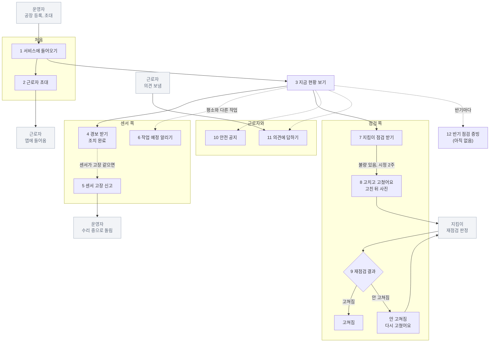

# 공장주 업무 스토리보드 (초안)

- 작성일: 2026-10-20
- 상태: 초안. 공장주가 하는 일을 장면별로 정리했다. 틀은 지킴이 스토리보드(`261012_산업안전지킴이_업무스토리보드.md`)와 같다.
- 바탕:
  - "지금은" 줄: 지킴이 업무 설명(지킴이 스토리보드)에 나온 공장 쪽 이야기와 기존 산업안전지킴이 웹 분석(`260921_기존시스템_분석.md`). 공장주에게 직접 들은 것은 아니다.
  - "앱에서는" 줄: 시제품 공장주 웹(`시제품/owner.js` · `시제품/owner2.js`, 2026-10-20 기준)과 방법론 문서의 결정.
  - 짐작한 것은 `가설`로 표시했다.
- 공장주 웹은 아직 다듬지 않았다. 2026-09-17에 만든 PC형 화면에 10-13 재점검 문구만 더한 상태이고, 지킴이 앱 모양으로 맞추지 않았다. 폰에서 알림톡 링크로 바로 여는 화면을 생각 중이다(지킴이 스토리보드 장면 9).

## 1. 한눈에 보기

| 항목 | 내용 |
|---|---|
| 누구 | 50인 미만 제조 공장의 대표. 공장 쪽 담당은 공장주 또는 안전담당관리자다(지킴이 설명) |
| 법으로 해야 하는 일 | 유해·위험요인을 파악해 개선한다(산업안전보건법 제5조). 위험성평가 결과를 기록하고 보존한다(같은 법 제36조). 개선 여부를 반기 1회 이상 점검하고 종사자 의견을 듣는다(중대재해처벌법 시행령 제4조) |
| 무엇으로 | 웹은 PC. 경보는 근로자와 같은 앱으로 휴대폰에서 받는다(2026-09-16 결정) |
| 로그인 | 휴대폰 번호 인증, 앱과 웹이 같은 계정(설계). 시제품의 아이디와 비밀번호는 시험 편의다 |
| 얼마나 자주 | 하루 한두 번, 경보가 올 때, 지킴이 점검 뒤, 반기 점검 때 |
| 한 번에 얼마나 | 몇 분 |
| 사람 | 제조업 대표의 33.5%가 60세 이상이고 평균 55.3세다. 20인 미만은 안전보건관리담당자 의무가 없어 공장주가 직접 챙기는 일이 많다. 법률 용어가 낯설다 |
| 제일 궁금한 것 | 우리 공장 괜찮나? 무엇을 고쳐야 하나? |

기존 웹에서 공장주는 가장 얇은 역할이었다. 점검을 받아들이고(또는 거부하고) 지적된 것을 고치는 정도다. 우리 서비스에서는 일이 두 겹으로 붙는다. 센서가 생겨서 한 번(경보, 고장 신고, 작업 예정), 근로자가 생겨서 또 한 번(초대, 공지, 의견)이다.

## 2. 등장인물

| 역할 | 누구 | 공장주와 얽히는 일 |
|---|---|---|
| 공장주 | 공장 대표(앱에서 근로자에게는 "대표님") | 이 문서의 주인공 |
| 근로자 | 공장에서 일하는 사람 | 공장주의 초대로 앱에 들어온다. 경보를 받아 조치하고, 공지를 읽고, 의견을 보낸다 |
| 지킴이 | 2~3인이 한 조로 공장을 찾아온다 | 점검하고 지적사항을 남긴다. 재점검에서 고쳐졌는지 정한다 |
| 운영자 | 산업안전지킴이 운영센터 | 공장을 등록하고 공장주를 초대한다. 센서를 등록한다. 고장 신고를 받아 "수리 중"으로 돌린다. 미루기를 다 쓴 경보를 함께 받는다 |
| 중앙 시스템(AI) | | 센서 이상을 판정해 경보를 만든다. 작업 예정 글을 읽고 그 시간 기준을 맞춘다. 공지와 의견을 번역한다 |

## 3. 흐름 한눈에 보기

공장주의 일은 갈래가 셋이다. 지킴이 점검은 모든 공장에 있고, 센서와 근로자 일은 센서를 단 공장에 붙는다.

```
처음
[1] 서비스에 들어오기 (운영자가 등록하고 초대 → 휴대폰 번호로 로그인)
[2] 근로자 초대
 ↓
평소
[3] 지금 현황 보기 ── 맨 위 한 줄: "지금 이상 없음" 또는 "경보 n건"

센서 쪽
[4] 경보 받기 ── 근로자와 같은 경보, 조치 완료도 누를 수 있다
                 근로자가 미루기를 다 쓰면 "현장을 직접 확인해 주세요"
[5] 센서가 고장 같으면 → 운영자에게 신고 → 운영자가 수리 중으로 돌림
[6] 평소와 다른 작업이 있으면 → 작업 예정 알리기 → AI가 그 시간 기준을 맞춤

점검 쪽
[7] 지킴이 점검 받기 ──── 거부하면 기록으로 남는다
 ↓ 불량이 있으면 재점검, 시정 2주
[8] 고치고 "고쳤어요" (어떻게 고쳤나, 고친 뒤 사진)
 ↓
[9] 재점검 결과 받기 ─┬─ 고쳐짐
                      └─ 안 고쳐짐 → "다시 고쳤어요", 다음 점검 때 다시 본다

근로자와
[10] 안전 공지 올리기 → 읽은 사람 보기 → 안 읽은 사람에게 다시 알리기
[11] 근로자 의견 읽고 답하기 → 해결함

반기마다
[12] 점검 증빙 (아직 시제품에 없음)
```

같은 흐름을 머메이드로 그린 것이다. 회색 칸은 다른 역할이 하는 일이다.



## 4. 장면별 스토리보드

### 장면 1. 서비스에 들어오기

- 상황: 운영자가 공장을 등록했다. 공장이 들어오는 길은 다섯이다: 현장등록, 점검신청, 점검거부, 기업DB, 기타.
- 지금은: 기존 웹의 등록사유에 "점검신청"과 "점검거부"가 있다. 공장주가 점검을 신청하거나 거부한 것이 기록으로 남는다. 공장주가 기존 웹에서 어떤 메뉴를 보는지는 확인하지 못했다 `가설`.
- 앱에서는:
  - 운영자가 공장을 등록할 때 대표 휴대폰을 적고 "등록하고 초대 보내기"를 누른다. 공장주는 그 초대로 들어와 휴대폰 번호 인증으로 로그인한다(설계).
  - 웹과 앱이 같은 계정이다. 공장주는 웹에서 관리하고, 경보는 앱으로 받는다.
- 모르는 것: 공장주가 우리 웹에서 점검을 신청하거나 거부하는 화면은 아직 없다. 공장 쪽 담당이 안전담당관리자일 때 그 사람도 계정을 받나.
- 다음: 장면 2, 3

### 장면 2. 근로자 초대

- 상황: 공장에 센서가 달렸다. 경보를 받을 근로자를 앱에 들인다.
- 지금은: 없다. 기존 시스템에는 근로자라는 역할이 없다.
- 앱에서는:
  - 근로자 탭 → "근로자 초대". 이름, 앱 화면 언어(한국어, 베트남어, 영어), 일하는 곳(안 골라도 됨)을 적고 "초대 만들기"를 누른다.
  - QR과 코드가 나온다. 사무실에서 근로자 휴대폰으로 QR을 바로 찍게 하거나 링크를 복사해 메신저로 보낸다. 초대는 사람마다 하나이고 7일 동안 한 번만 쓸 수 있다(7일은 `가설`).
  - 명단에는 이름, 언어, 앱 알림(켜짐, 꺼짐), 들어온 날, 일하는 곳이 있다. 알림이 꺼진 사람이 있으면 맨 위에 "경보가 울리지 않아요. 직접 말해 주세요."가 보인다.
  - 초대했지만 아직 안 들어온 사람은 따로 보이고, 링크를 다시 복사하거나 초대를 취소한다. 안 들어온 사람은 공지 읽음 인원에 넣지 않는다.
  - 그만둔 사람은 "빼기"로 뺀다. 확인 창: 경보와 공지를 받지 않고, 앱에 못 들어오고, 남긴 기록은 이름 그대로 남는다.
- 다음: 장면 3

### 장면 3. 지금 현황 보기

- 상황: 사무실에서 웹을 연다. 하루 한두 번이다.
- 지금은: 없다. 기존 웹에 공장주가 보는 현황판은 확인하지 못했다.
- 앱에서는:
  - 맨 위에 결론 한 줄. "지금 이상 없음, 센서 5대 감시 중" 또는 "경보 n건, 조치 안 됨 n건". 디지털이 낯선 고령 공장주도 몇 초 안에 알게 하려는 것이다.
  - 경보가 있으면 경보 카드가 바로 아래에 온다(장면 4).
  - 카드 넷:
    - 고칠 것: 재점검에서 안 고쳐짐, 아직 안 고침, 재점검 기다림
    - 개선: 요청 수와 고쳐짐 확인 비율
    - 지킴이 방문: 다음 방문 날짜와 시간, 지난 점검, 담당 지킴이
    - 센서 이상 기록: 최근 3개월 경보 수, 조치 완료, 아무도 안 누름
  - 센서 카드: 센서마다 상태(감시 중, 이상, 수리 중, 값 모름)와 한 줄 설명, 아래에 "작업 예정 알리기".
  - 기록·고칠 것 탭 › 센서 이상 기록: 시작, 무엇이, 조치 완료(누가, 몇 분 뒤), 끝남. 기록은 고칠 수 없다.
- 모르는 것: 지킴이 방문 날짜를 공장주에게 보여 주는지 `가설`. 지킴이는 불시에 가기도 한다.
- 다음: 경보가 있으면 장면 4, 지킴이 점검 뒤에는 장면 7~9

### 장면 4. 경보 받기

- 상황: 센서 값이 이상해 경보가 났다.
- 지금은: 없다. 기존 시스템에는 센서도 경보도 없다.
- 앱에서는:
  - 공장주는 근로자 앱에 로그인해 근로자와 같은 경보를 받는다(2026-09-16 결정). 작은 공장일수록 조치하는 사람이 공장주 본인이라서다. 조치 완료도 누를 수 있고, 기록에는 누가 눌렀는지 남는다.
  - 웹 지금 현황에도 같은 경보가 카드로 보인다: 무엇이, 어디서, 언제부터, 평소보다 몇 배, 지금 상태(조치 안 됨, 아직 이상과 다시 알림 중, 누가 조치하고 지켜보는 중). 웹에서도 "조치 완료" 또는 "다시 조치했어요"를 누를 수 있다.
  - 근로자가 미루기(경보 하나에 2번, `가설`)를 다 쓰면 공장주와 운영자에게 알린다. 카드에 "근로자가 미루기를 2번 다 썼어요. 현장을 직접 확인해 주세요."가 붙는다.
  - 공장주는 센서 값과 그래프를 볼 수 있다(근로자는 보지 않는다). 다만 지금 시제품 웹에는 "평소보다 몇 배"만 있고 그래프는 없다.
- 모르는 것: 아무도 조치하지 않으면 몇 분 뒤 공장주에게 따로 알리나(제안: 공장주 먼저, 더 지나면 운영자).
- 다음: 센서가 고장 같으면 장면 5

### 장면 5. 센서 고장 신고

- 상황: 기계는 멀쩡한데 경보가 계속 울린다. 센서가 고장 같다.
- 앱에서는:
  - 경보 카드나 센서 줄의 "센서 고장 같아요"를 누른다.
  - 창에서 어떤지 하나 고른다. 보통 센서는 "기계는 멀쩡한데 값만 이상해요", "소리·냄새·열 같은 이상이 없어요". 누수 센서는 "바닥은 말라 있어요", "물기가 없는데 계속 울려요". 메모와 사진은 붙이지 않아도 된다.
  - 창에 "진짜 이상일 수도 있어요. 현장을 먼저 확인하고 알려 주세요."와 "작업 때문에 오른 거라면 고장 신고 대신 작업 예정 알리기"가 있다.
  - "운영자에게 알리기"를 누르면 센서 줄이 "고장 신고함, 운영자 확인 기다림(그동안 경보는 계속 울려요)"이 된다.
  - 운영자가 수리 중으로 돌리면 그 센서의 열린 경보가 닫히고, 고칠 때까지 경보가 울리지 않는다. 운영자가 센서는 정상이라고 보면 "진짜 이상일 수 있어요, 현장을 확인해 주세요"가 보인다.
  - 값이 안 오는 센서는 공장주가 할 일 없이 "운영자에게 알렸어요, 그동안 경보가 못 울려요"로 보인다.
- 설계 원칙: 공장주는 경보를 끄지 못한다. 신고만 하고, 닫는 것은 운영자다(2026-09-17 결정).
- 시제품 한계: 앱 쪽 고장 신고 화면은 없다. 웹에만 있다.
- 다음: 장면 3

### 장면 6. 작업 예정 알리기

- 상황: 오늘 저녁 도장 작업이 있어 전력이 평소보다 오를 것이다. 그대로 두면 근로자에게 헛경보가 간다.
- 앱에서는:
  - 센서 카드의 "작업 예정 알리기" → "무슨 작업이 있나요?"에 말하듯 적는다. 예: "오늘 저녁 6시부터 10시까지 도장 작업이 있어서 전력이 50 부근까지 오를 예정".
  - 잘 알아듣는 글: 언제, 무슨 작업, 어느 기계나 센서, 얼마까지 오를지(숫자가 있으면 좋다).
  - "AI에게 보내기"를 누르면 "AI가 이렇게 알아들었어요, 틀릴 수 있어요"에 센서, 시간, 작업, 오를 수준이 나오고 "그래서 이렇게 바뀌어요"가 붙는다.
    - 그 시간 그 센서의 기준을 적은 수준까지 비율로 올려 잡는다
    - 시작과 끝 무렵 몇 분은 경보를 잠시 보류한다
    - 사양서 안전 한계는 그대로다. 그 선을 넘으면 작업 중이라도 경보가 울린다
  - 보내면 바로 적용된다. 틀렸으면 "틀렸어요, 고쳐 쓰기". 시간이 없으면 지금부터 2시간으로 본다.
  - 어느 센서인지 못 알아들으면 "기준은 바뀌지 않았어요"와 센서 이름 예를 보인다. AI가 답하지 않으면 "급하면 운영센터에 전화해 주세요".
  - 아래에 보낸 작업 예정 표(보낸 때, 보낸 글, AI가 알아들은 것, 결과).
- 설계 원칙: 센서를 끄는 "수리 중"과 달리 센서는 계속 지켜본다. 근로자는 쓰지 않는다(센서 값을 보지 않으므로).
- 모르는 것: 작업이 취소되거나 미뤄지면 되돌리는 기능이 엔진에 없다. 화면의 "작업 취소"는 엔진 보강이 필요하다고 적어 두었다.
- 다음: 장면 3

### 장면 7. 지킴이 점검 받기

- 상황: 지킴이 조가 공장을 찾아온다. 1년에 한 번꼴이다.
- 지금은 (지킴이 설명):
  - 지킴이가 전화로 날을 잡는다. 전화가 안 되면 연락 없이 찾아온다.
  - 공장이 점검을 거부할 수 있다. 거부해도 받는 제재는 따로 없다.
  - 공장주나 안전담당관리자가 사전미팅에 나와 기업 정보, 관리 정보, 담당자 정보를 답한다.
  - 라인투어에 같이 다니며 원자재가 들어와 출하되기까지를 설명한다.
  - 점검이 끝나면 현장에서 지적사항을 듣는다.
- 앱에서는:
  - 공장주가 이 장면에서 앱으로 하는 일은 없다. 지킴이가 지킴이 앱에 답하고 결과를 낸다.
  - 낸 순간 공장 웹 "기록·고칠 것 › 지킴이 점검·고칠 것"에 점검이 올라온다. 불량 항목에는 위험요인, 위험요인 내용, 평가 내용, 지킴이가 찍은 사진이 붙는다. 양호, 보통, 해당 없음은 접혀 있다. 점검 결과는 고칠 수 없다.
  - 불량이 없으면 점검완료로 끝난다. 불량이 있으면 재점검이 되고, 그날부터 시정 기한 2주가 돈다.
  - 지난번 미흡 항목이 있었으면 이번 점검에서 다시 본 결과도 함께 보인다.
- 모르는 것: 방문 때 거부한 것을 패트롤로 보나. 현장에서 지적사항을 공장주에게 화면으로 보여 주는 기능은 없다(지킴이 스토리보드 장면 7).
- 다음: 불량이 있으면 장면 8

### 장면 8. 고치고 알리기

- 상황: 시정 기간 2주다.
- 지금은 (지킴이 설명): 지적사항을 고치고, 고친 모습을 사진으로 찍어 지킴이에게 카톡 등으로 보낸다.
- 앱에서는 (2026-10-14 사용자 결정):
  - 공장 웹 점검 화면 위에 "재점검, 9월 29일까지. 고친 뒤 고쳤어요로 사진을 보내 주세요. 지킴이가 보고 판정해요."가 보인다.
  - 불량 항목마다 "고쳤어요"를 누른다. 창에서 고친 뒤 사진과 어떻게 고쳤는지 한 줄을 올린다. 사진은 꼭 올려야 보낼 수 있고(2026-10-28), 한 줄은 안 써도 된다.
  - 누르면 지킴이 재점검 목록에 오르고 그 항목은 "고쳤어요 표시함, 지킴이 확인 기다림"이 된다. 재점검 전까지는 "표시 취소"로 되돌릴 수 있다.
  - 사진을 카톡으로 주고받지 않는다. 이 서비스로 주고받는다(2026-10-19 지킴이 쪽 "카톡으로 받은 사진 올리기" 비상구도 걷음).
- 모르는 것:
  - 공장주(특히 소공인)가 실제로 웹에 들어와 사진을 올릴지. 알림톡 링크로 로그인 없이 폰에서 바로 여는 화면이 필요한지.
  - 고친 사진을 꼭 넣게 할지(지금은 안 넣어도 됨).
  - 2주 안에 사진이 안 오면 어떻게 하나(기한 연장, 바로 패트롤).
- 다음: 장면 9

### 장면 9. 재점검 결과 받기

- 상황: 지킴이가 공장주가 올린 사진을 보고 판정했다.
- 지금은 (지킴이 설명): 지킴이가 카톡 사진을 보고 판단하고 시스템에는 결과만 적는다. 개선율 50% 이상이면 점검완료, 개선하지 않았거나 거부하면 패트롤(고용노동부에 넘김), 50% 넘게 고쳤지만 남은 항목이 매우 위험하면 기타(특별 관리).
- 앱에서는:
  - 항목마다 "지킴이가 고쳐짐 확인" 또는 "지킴이가 안 고쳐짐으로 봄"이 되고, 판정 기록(날짜, 고쳐짐 또는 안 고쳐짐, 안 고쳐진 사정)이 항목 아래에 쌓인다.
  - 점검 화면 위에 "재점검 날짜, 결과(점검완료, 패트롤, 기타), 고쳐짐 n개 중 n개"가 보인다.
  - 안 고쳐진 항목은 "다시 고쳤어요"로 다시 알릴 수 있고, 다음 점검 때 "지난번 미흡 항목"으로 다시 본다.
  - 지금 현황 "고칠 것" 카드에서 "재점검에서 안 고쳐짐"이 맨 앞에 선다.
- 모르는 것: 패트롤이나 기타가 되면 공장주에게 무엇이 오나. 앱에는 그 뒤가 없다.
- 다음: 장면 3

### 장면 10. 안전 공지 올리기

- 상황: 위험성평가를 했다. 결과를 근로자에게 알려야 한다(사업장 위험성평가에 관한 지침, 작업 전 안전점검회의).
- 지금은: 작업 전 안전점검회의에서 말로 전한다 `가설`. 기존 웹에는 없다.
- 앱에서는:
  - 안전 공지 탭 → "공지 쓰기". 제목, 내용, 위험성평가와 연결할지(예, 아니요)를 정한다.
  - 옆에 받는 사람 수와 언어가 보인다. 외국어 근로자에게는 AI 번역으로 간다고 알리고 "짧은 문장이면 덜 틀려요"를 보인다.
  - 확인 창: "근로자 n명에게 바로 알림이 가요. 올린 뒤에는 고칠 수 없어요." 틀렸으면 새로 올린다.
  - 공지 목록에 읽음 수(n / 전체, 번역으로 읽은 사람 수)와 "번역 이상 n"이 보인다.
  - 공지 한 건에는 읽은 사람(언제, 어느 언어 AI 번역으로 읽었는지)과 안 읽은 사람(언어, 앱 알림 꺼짐)이 있다. "안 읽은 n명에게 다시 알리기"를 누른다.
  - 근로자가 "번역이 이상해요"를 누르면 누가 어느 언어로 눌렀는지 보이고 "직접 말로 설명해 주세요"를 보인다.
  - 누가 언제 읽었는지가 위험성평가 결과를 공유한 증빙이 된다.
- 다음: 장면 3

### 장면 11. 근로자 의견에 답하기

- 상황: 근로자가 앱으로 의견을 보냈다. 공장주는 종사자 의견을 듣고 필요하면 조치해야 한다(중대재해처벌법 시행령 제4조).
- 지금은: 근로자가 대표에게 말로 한다 `가설`. 기존 웹에는 없다.
- 앱에서는:
  - 의견 탭에 받은 의견이 "위험해 보여요" 먼저, 그다음 최근 순으로 선다. 종류, 내용, 보낸 사람, 진행(안 읽음, 읽음, 답함, 해결함)이 보인다.
  - 외국어 의견은 AI 번역으로 보인다. 이름을 뺀 의견은 보낸 사람과 원문, 쓴 언어가 보이지 않는다.
  - 의견을 열면 읽음이 되고 근로자 앱에 "대표님이 읽음"이 뜬다.
  - 답을 쓰면 근로자 언어로 AI 번역돼 간다. 고쳤거나 처리했으면 "해결함 표시"를 누른다.
  - 받은 의견, 보낸 답, 해결함 표시는 고치거나 지울 수 없다.
- 다음: 장면 3

### 장면 12. 반기 점검 증빙

- 상황: 반기마다 개선 여부를 점검하고 그 증빙을 남겨야 한다(중대재해처벌법 시행령 제4조).
- 앱에서는:
  - 설계: 센서 이상 기록, 지킴이 점검과 개선 기록, 공지 읽음, 의견과 답을 모아 버튼 하나로 내려받는다(3단계 화면 원칙). 이 기록은 아무도 고칠 수 없어서 증빙으로 쓸 수 있다.
  - 시제품: "점검 증빙" 탭은 아직 "다음 차례"다. 모양은 흑백 시안 O4에만 있다.
- 모르는 것: 증빙에 내려받은 날짜가 찍히는지 `가설`. 어떤 양식이 실제로 쓸모 있나.

## 5. 참고: 공장주가 보는 것

방법론 문서 2단계 "누가 무엇을 보나" 표에서 공장주와 근로자 칸만 옮겼다.

| 정보 | 공장주 | 근로자 |
|---|---|---|
| 경보 | 봄 + 조치 완료 씀 | 봄 + 조치 완료 씀 |
| 센서 값, 그래프 | 봄 | 안 봄 |
| 센서 이상 기록 | 봄 | 받은 경보만 봄(값 없음) |
| 센서 상태(모름, 수리 중) | 봄 + 고장 신고 씀 | 홈에서 봄 |
| 작업 예정 알림 | 씀 + 봄 | 안 봄 |
| 지킴이 점검 기록 | 봄 | 안 봄 |
| 개선 조치(고쳤어요, 한 줄, 사진) | 씀 | 안 봄 |
| 재점검 결과 | 봄 | 안 봄 |
| 안전 공지 | 씀 + 읽은 사람 봄 + 다시 알리기 | 봄 + 읽었어요 씀 |
| 근로자 의견 | 봄 + 답, 해결함 씀 | 씀 + 내 것의 답 봄 |
| 근로자 명단 | 씀(초대, 빼기) | 내 것만 |
| 기계, 센서, 구역 이름 | 봄(등록은 운영자) | 경보 안에서만 봄 |
| 다른 공장과의 비교 | 안 봄 | 안 봄 |

## 6. 앱에서 바뀌는 점

| 장면 | 지금 | 앱에서는 |
|---|---|---|
| 7 지킴이 점검 | 현장에서 지적사항을 말로 듣는다 | 지킴이가 낸 순간 지적사항과 지킴이 사진이 공장 웹에 올라온다 |
| 8 고치고 알리기 | 고친 사진을 카톡 등으로 지킴이에게 보낸다 | 항목마다 "고쳤어요"와 고친 사진을 웹에 올린다. 지킴이 재점검 목록에 저절로 오른다 |
| 9 재점검 결과 | 결과를 따로 듣는지 모른다 | 항목마다 고쳐짐, 안 고쳐짐과 결과가 웹에 보인다 |
| 3~6 센서 | 없다 | 경보 받기, 조치 완료, 고장 신고, 작업 예정 알리기 |
| 2, 10, 11 근로자 | 없다 | 근로자 초대와 명단, 안전 공지와 읽음 현황, 의견에 답하기 |
| 12 증빙 | 모른다 | 기록을 모아 내려받기(아직 없음) |

## 7. 아직 공장주 웹에 없는 것

- 공장주가 근로자 앱에 로그인해 경보를 받는 화면. 시제품 근로자 앱 첫 화면의 "공장주 로그인"은 웹으로 간다. 공장주의 앱 조치 완료는 조작판 "박대표가 조치 완료"로 흉내 낸다.
- 앱 쪽 센서 고장 신고와 작업 예정 알리기(설계는 앱과 웹 둘 다).
- 센서 값과 그래프.
- 점검 신청과 점검 거부.
- 반기 점검 증빙.
- 폰에서 바로 여는 고친 사진 올리기 화면(알림톡 링크).
- 휴대폰 번호 인증 로그인.
- 지킴이 앱 모양으로 다듬기(근로자 앱과 운영자 웹은 2026-10-20에 맞춤).

## 8. 정해야 할 것, 확인할 것

- 공장 쪽 상대가 공장주인가 안전담당관리자인가. 담당자도 계정을 받나.
- 공장주(특히 소공인)가 실제로 웹에 들어와 사진을 올릴지. 로그인 없이 알림톡 링크로 바로 여는 폰 화면이 필요한지.
- 고친 사진을 꼭 넣게 할지. 2주 안에 안 오면 어떻게 하나.
- 패트롤이나 기타가 되면 공장주에게 무엇을 알리나.
- 방문 때 점검을 거부한 것을 패트롤로 보나. 점검 거부를 공장주가 웹에서 하나.
- 지킴이 방문 날짜를 공장주에게 보여 주나.
- 아무도 조치하지 않은 경보를 몇 분 뒤 공장주에게 따로 알리나.
- 센서가 없는 공장에도 근로자 초대, 안전 공지, 의견을 쓰나.
- 반기 점검 증빙의 양식.
- 공장주를 직접 만날 기회가 생기면 먼저 확인할 것: 지킴이 점검 뒤 지적사항을 어떻게 받고 고치나, 위험성평가 결과를 근로자에게 어떻게 알리나, 웹을 PC와 폰 가운데 무엇으로 볼까.
