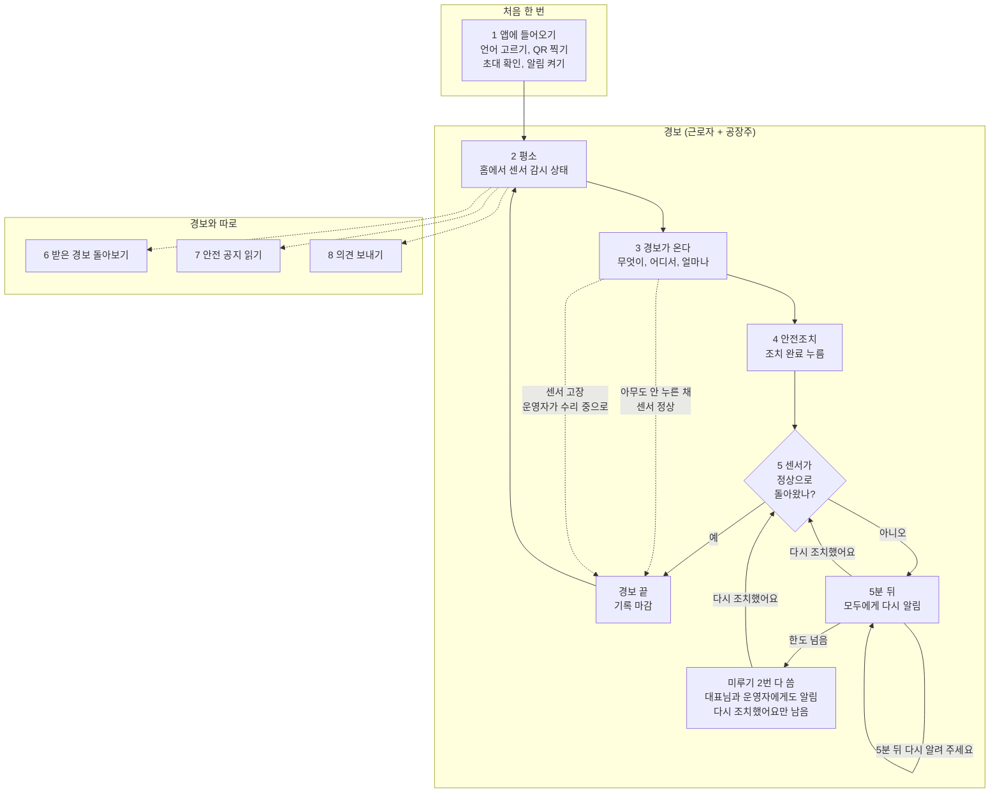

# 근로자 업무 스토리보드 (초안)

- 작성일: 2026-10-20
- 상태: 초안. 근로자가 우리 서비스(근로자 앱)로 하는 일을 장면별로 정리했다. 틀은 지킴이 스토리보드(`261012_산업안전지킴이_업무스토리보드.md`)와 같다.
- 지킴이 스토리보드와 다른 점: 근로자 업무는 아직 직접 듣지 못했다. 그래서 "지금 업무"가 아니라 **지금까지 정한 설계와 시제품 근로자 앱**(2026-10-20 기준)을 바탕으로 썼다. 자료로 확인하지 못하고 짐작한 것은 `가설`로 표시했다. 근로자 업무를 들을 기회가 생기면 지킴이 스토리보드처럼 "지금 업무 + 앱에서는" 꼴로 고친다.
- 출처: `260914_UIUX_개발_방법론.md` 1단계 역할별 할 일, 2단계 흐름도 A(센서 이상)와 누가 무엇을 보나 표, 3단계 평균 사용자 특징. 시제품 `시제품/worker.js` · `시제품/i18n.js`(화면 W1~W8).

## 1. 한눈에 보기

| 항목 | 내용 |
|---|---|
| 쓰는 사람 | 센서를 단 공장의 근로자. 실증은 3곳, 공장마다 센서 5개 안팎(시제품: 기계 1대의 진동과 온도, 가스, 전기, 누수, 온습도) |
| 하는 일 | 센서 경보를 받으면 안전조치를 하고 "조치 완료"를 누른다. 그 밖에 안전 공지 읽기, 의견 보내기 |
| 얼마나 자주 | 경보가 올 때만(드묾). 한 번에 몇 초 |
| 무엇으로 | 개인 휴대폰 `가설`. 앱 설치는 필수 |
| 들어오는 길 | 공장주의 초대(QR, 링크)로만 들어온다. 아이디와 비밀번호는 없다 |
| 언어 | 시제품은 한국어, 베트남어, 영어. 경보 문구는 미리 번역해 둔 문구, 공지와 의견은 AI 번역 |
| 보지 않는 것 | 센서 값과 그래프. 근로자는 "무엇이, 어디서, 평소보다 얼마나"만 본다 |
| 일하는 환경 | 기계 옆, 장갑, 소음, 한 손, 기름과 먼지. 외국인 근로자가 많고 50세 이상이 많다 |

## 2. 등장인물

| 역할 | 누구 | 하는 일 |
|---|---|---|
| 근로자 | 공장 현장에서 일하는 사람 | 경보를 받고 안전조치를 한 뒤 조치 완료를 누른다. 공지를 읽고 의견을 보낸다 |
| 공장주(앱에서는 "대표님") | 공장 대표. 작은 공장일수록 안전도 직접 챙긴다 | 근로자를 초대하고 명단을 관리한다(웹). 안전 공지를 올리고 의견에 답한다(웹). 경보는 근로자와 같은 앱, 같은 화면으로 받고 조치 완료도 누를 수 있다. 센서가 고장 같으면 신고하고, 작업 때문에 값이 오를 때는 "작업 예정 알리기"를 쓴다 |
| 운영자 | 산업안전지킴이 운영센터 | 미루기를 다 쓴 경보를 함께 받는다. 센서 고장 신고를 보고 "수리 중"으로 돌린다 |
| 중앙 시스템(AI) | | 센서 값을 보고 이상을 판정해 경보를 만든다. 센서가 정상으로 돌아오면 경보를 끝내고 기록을 마감한다 |

지킴이는 근로자와 만나는 일이 없다. 근로자 앱에는 지킴이 점검이 나오지 않는다.

## 3. 흐름 한눈에 보기

```
[1] 앱에 들어오기 (공장주 초대 → QR 찍기 → 알림 켜기)      ← 처음 한 번
 ↓
[2] 평소 ──── 가끔 홈에서 센서 감시 상태를 본다
 ↓
[3] 경보가 온다 (소리 + 진동, 앱 안에서는 아래에서 올라오는 창)
 ↓
[4] 가서 안전조치 → "조치 완료" (5초 안에 취소할 수 있다)
 ↓
[5] 센서가 정상으로 돌아오나 ─┬─ 돌아옴 → 경보 끝, 기록 마감 → [2]
                              └─ 아직 이상 → 5분 뒤 모두에게 다시 알림
                                   ├─ "다시 조치했어요" → [5]
                                   └─ "5분 뒤 다시 알려 주세요" (경보 하나에 2번, 모두 함께 셈)
                                        → 다 쓰면 "다시 조치했어요"만 남고 대표님과 운영자에게도 알림

경보와 따로
[6] 받은 경보 돌아보기
[7] 안전 공지 읽기 → "읽었어요"
[8] 의견 보내기 → 대표님 답 보기
[9] 알림과 언어, 내 정보
```

같은 흐름을 머메이드로 그린 것이다. 점선은 근로자가 누르지 않아도 일어나는 길이다.



## 4. 장면별 스토리보드

### 장면 1. 앱에 들어오기

- 상황: 공장에 센서가 달렸다. 공장주가 웹의 근로자 탭에서 근로자마다 초대를 만든다. 이름, 언어, 일하는 곳을 미리 적어 둔다.
- 근로자가 하는 일: 공장주에게 받은 QR을 찍거나 초대 링크를 누른다.
- 앱에서는:
  - 첫 화면 맨 위에서 언어를 고른다. 휴대폰 언어로 먼저 열린다.
  - QR을 찍으면 "이 공장에 들어가요" 화면에 공장, 이름, 일하는 곳이 나온다. "맞아요, 들어가기"를 누른다. 이름이 틀리면 들어간 뒤 대표님께 말한다.
  - 초대는 사람마다 하나이고 7일 안에 한 번만 쓴다(7일은 `가설`). 이미 쓴 초대나 기간이 지난 초대면 "대표님께 새 초대를 달라고 말해 주세요"가 나온다.
  - 이어서 알림 허용을 묻는다. 왜 켜야 하는지(위험할 때 소리와 진동으로 알림)를 먼저 보이고, 휴대폰이 물으면 "허용"을 누르고 절전 모드 예외도 켜 두라고 안내한다. "나중에 하기"도 되지만 홈에 빨간 경고가 남는다.
- 어려운 점: 디지털이 낯설거나 한국어가 서툰 근로자도 혼자 들어올 수 있어야 한다. 그래서 글자 입력 없이 QR 하나로 들어오게 했다.
- 다음: 장면 2

### 장면 2. 평소

- 상황: 일하는 중이다. 경보는 드물다.
- 근로자가 하는 일: 평소에는 앱을 열 일이 거의 없다 `가설`. 가끔 홈을 열어 지금 괜찮은지 본다.
- 앱에서는:
  - 홈 맨 위 "센서 감시" 카드에 지금 상태 한 줄과 센서 다섯 칸이 있다. 칸마다 감시 중, 이상, 조치됨, 수리 중, 모름 가운데 하나가 보인다. 값은 보이지 않는다.
  - 상태 한 줄은 여러 일이 겹치면 이 차례로 앞의 것을 보인다: 알림 꺼짐, 인터넷 끊김 → 경보 → 일부 센서 값 모름 → 지금 이상 없음.
  - 값이 안 오는 센서가 있으면 "지금 이상 없음"이라고 하지 않는다. "일부 센서 값 모름"과 함께 "값이 안 오는 센서는 그동안 경보가 못 울려요. 대표님과 운영자에게 알렸어요."를 보인다. 근로자에게 경보는 보내지 않는다. 근로자가 조치할 위험이 아니라 장비 문제라서다.
  - 수리 중인 센서가 있으면 "수리 중인 센서는 고칠 때까지 경보가 울리지 않아요."를 보인다.
  - 인터넷이 끊기면 "지금은 경보가 오지 못할 수 있어요"와 마지막으로 확인한 때를 보인다.
  - 그 아래에 큰 카드 넷(받은 경보, 안전 공지, 의견 보내기, 알림과 언어)과 최근 소식이 있다.
- 다음: 경보가 오면 장면 3. 공지와 의견은 장면 7, 8

### 장면 3. 경보가 온다

- 상황: 중앙 시스템이 센서 값이 이상하다고 판정했다. 경보는 기계 1대(진동과 접촉온도를 묶음) 또는 공간에 둔 센서 1대(가스, 전기, 누수, 온습도)마다 1건이다.
- 근로자가 하는 일: 알림을 보고 무엇이 어디서 이상한지 확인한다.
- 앱에서는:
  - 휴대폰 알림이 소리와 진동으로 온다. 소음 때문에 소리만으로 알리지 않는다.
  - 앱 안에서는 보던 화면 위로 아래 창이 올라온다(2026-10-20 사용자 결정, 시안 B). 위쪽 빨간 부분에 "2번 프레스 이상"과 시각, 아래에 무엇이, 어디서, 얼마나와 정상 범위 막대, 큰 "조치 완료" 단추가 있다.
  - "얼마나"는 숫자가 아니라 평소와 견준 말과 정상 범위 막대로 보인다. 누수는 숫자가 없어서 "정상"과 "물 닿음" 두 칸으로 보인다.
  - 경보가 여러 건이면 창에 목록이 먼저 나오고, 하나를 고르면 그 경보가 열린다.
  - 창을 끌어 내리거나 "내려 두기"를 누르면 화면 아래 빨간 막대로 줄어든다. 막대는 모든 화면에 남고 조치하기 전에는 사라지지 않는다. 막대에서 바로 조치 완료를 누를 수 있다. 다시 알림이나 새 경보가 오면 창이 다시 올라온다.
  - 경보에 "무엇을 해야 하는지"(조치 안내)는 넣지 않는다(2026-09-15 결정, 처음부터 기능에 없다). 경보 원칙("무엇이 → 왜 위험 → 무엇을 해야")을 다 채우지 못하는 것을 알고 넘긴 칸이다.
- 어려운 점: 작업 중 휴대폰을 못 쓰는 공장이 있을 수 있다 `가설`. 그런 곳의 대안(경광등, 현장 모니터)은 화면이 아니라 설비 문제라서 가설로 남겼다.
- 다음: 장면 4

### 장면 4. 안전조치하고 조치 완료 누르기

- 상황: 경보를 봤다.
- 근로자가 하는 일:
  - 경보가 가리키는 곳으로 가서 안전조치를 한다. 무엇을 할지는 공장 규칙과 대표님 지시를 따른다 `가설`.
  - 급박한 위험이면 작업을 멈추고 먼저 피한 뒤 말로 알린다(산업안전보건법 제52조). 이 보고는 앱 양식으로 받지 않는다(2026-09-17 범위 밖으로 정함).
- 앱에서는:
  - "조치 완료"를 누른다. 같은 창 안에서 "조치 완료를 보냈어요"로 바뀌고 보낸 시각, 받은 사람(대표님, 운영자), 다시 확인할 시각("그때도 이상이면 다시 울려요")이 나온다.
  - 잘못 눌렀으면 5초 안에 취소한다. 5초가 지나면 기록이 굳는다.
  - 조치 완료는 경보를 끄지 않는다. 근로자가 찍는 것은 "사람 확인"이고, 경보는 센서가 정상으로 돌아와야("기계 확인") 끝난다.
  - 한 사람이 누르면 같은 경보를 받은 모두의 화면이 바뀐다. 다른 사람이 먼저 눌렀으면 "누가 몇 시에 조치 완료, 센서가 정상이 되는지 지켜보는 중"을 한 번 보여 준다. 공장주가 눌러도 같고, 기록에는 누가 눌렀는지 남는다.
  - 인터넷이 끊겨 못 보내면 "아직 못 보냈어요"가 나온다. 휴대폰에 저장했다가 연결되면 저절로 보낸다. "급하면 대표님께 말로 알려 주세요."도 함께 보인다.
- 다음: 장면 5

### 장면 5. 센서가 정상이 되나 지켜보기

- 상황: 조치 완료를 보냈다. 시스템이 센서를 계속 본다.
- 근로자가 하는 일: 다시 알림이 오면 다시 살펴본다.
- 앱에서는:
  - 센서가 정상으로 돌아오면 경보가 끝난다. 근로자가 할 일은 없다.
  - 5분 뒤에도 이상이면 모두에게 다시 알린다. 누른 사람에게만 알리면 그 사람이 자리를 비웠을 때 아무도 모르기 때문이다. 창이 다시 올라와 "2번 프레스 아직 이상", "조치 완료 뒤 5분"을 보인다.
  - 다시 손을 썼으면 "다시 조치했어요"를 누른다. 아직 손쓰지 못했으면 "5분 뒤 다시 알려 주세요"로 미룬다. 미루기는 알림만 미루고 경보 상태는 그대로다.
  - 미루기는 경보 하나에 2번이고(횟수는 `가설`) 누가 누르든 함께 센다. 다 쓰면 "다시 조치했어요"만 남고 대표님과 운영자에게도 알린다. 화면에는 "대표님과 운영자에게도 알렸어요. 다시 살펴보고 조치해 주세요."가 보인다.
- 근로자가 누르지 않아도 일어나는 일:
  - 아무도 누르지 않은 채 센서가 정상이 되면 "아무도 안 누름"(미확인 종료)으로 기록에 남는다. 지우지 않고 센다. 쌓이면 기준이 너무 예민하거나 근로자가 앱을 보지 않는다는 신호다.
  - 센서가 고장 같으면 공장주가 신고하고 운영자가 "수리 중"으로 돌린다. 그 센서의 열린 경보는 "수리로 닫힘"으로 끝나고, 근로자 홈의 그 칸은 "수리 중"이 된다.
  - 작업 때문에 값이 오를 것 같으면 공장주가 "작업 예정 알리기"를 쓴다. 근로자는 쓰지 않는다(센서 값을 보지 않으므로).
- 다음: 장면 2

### 장면 6. 받은 경보 돌아보기

- 상황: 지난 경보가 궁금하다. 누가 조치했는지, 어떻게 끝났는지.
- 앱에서는:
  - 홈 "받은 경보" 카드 → 목록(언제, 조치한 사람, 결과) → 하나를 누르면 자세히.
  - 자세히에는 무엇이, 어디서, 언제부터 언제까지(몇 분 이어졌는지), 조치한 사람과 시각, 미룬 횟수가 나온다.
  - 센서 값은 없다. "센서 값은 대표님과 운영자가 봐요."라고 적혀 있다.
  - 지난 경보는 볼 수만 있다. 조치 완료를 더 누를 수 없다.
- 다음: 장면 2

### 장면 7. 안전 공지 읽기

- 상황: 공장주가 웹에 안전 공지를 올렸다. 위험성평가 결과를 근로자에게 알리는 일이다(사업장 위험성평가에 관한 지침, 작업 전 안전점검회의).
- 근로자가 하는 일: 공지를 읽는다.
- 앱에서는:
  - 홈 맨 위 종과 "안전 공지" 카드에 안 읽은 수가 보인다. 공지 알림은 받지 않게 고를 수 있다.
  - 공지를 열고 "읽었어요"를 누른다. 누르면 대표님이 읽은 사람을 본다. 이것이 공장주의 위험성평가 결과 공유 증빙이 된다.
  - 한국어가 아니면 AI 번역으로 보이고 "AI 자동 번역, 틀릴 수 있어요"가 붙는다. 원문(한국어)을 볼 수 있다. 번역이 이상하면 "번역이 이상해요"를 한 번 누른다(이유는 적지 않는다). 대표님 읽음 현황에 표시된다.
- 다음: 장면 2

### 장면 8. 의견 보내기

- 상황: 일하다 위험해 보이는 것을 봤거나 바꾸면 좋겠는 것이 있다. 공장주는 종사자 의견을 듣고 필요하면 조치해야 한다(중대재해처벌법 시행령 제4조).
- 근로자가 하는 일: 대표님께 의견을 보낸다.
- 앱에서는:
  - 맨 위에 "지금 위험하면 먼저 피하고 말로 알려 주세요."가 있다.
  - 종류(위험해 보여요, 바꾸면 좋겠어요, 기타)를 고르고 내용을 쓴다. 편한 언어로 쓰면 대표님께 AI 번역이 함께 간다. 사진은 붙이지 않아도 된다.
  - 이름을 밝힐지 뺄지 고른다. 처음에는 "이름 빼기"가 골라져 있다. 빼면 "작은 공장에서는 내용이나 쓴 언어로 누군지 짐작될 수 있어요."를 보인다.
  - 확인 창을 거쳐 보낸다. 보낸 뒤에는 고치거나 지울 수 없다.
  - "내가 보낸 의견"에서 보냄 → 대표님이 읽음 → 답 옴 → 해결함 단계와 대표님 답을 본다. 외국어로 썼으면 답도 번역으로 보인다.
- 다음: 장면 2

### 장면 9. 알림과 언어, 내 정보

- 앱에서는:
  - 경보 알림은 앱에서 끌 수 없다. 경보를 놓치지 않기 위해서다. 휴대폰 설정에서 꺼져 있으면 켜라고 안내한다.
  - 경보가 올 때 "소리 + 진동"과 "진동만" 가운데 고른다. 공지 알림은 받기와 안 받기 가운데 고른다. 화면 언어를 바꿀 수 있다.
  - 내 정보에는 이름, 공장, 일하는 곳이 있고 보기만 한다. 틀리면 대표님께 말한다.
  - 휴대폰을 바꾸면 대표님께 새 초대를 받는다 `가설`. 공장을 그만두면 대표님이 명단에서 빼고, 남긴 기록은 이름 그대로 남는다.
  - 도움: 일이나 안전 문제는 대표님, 앱이 안 될 때는 운영센터.
  - 로그아웃하면 경보를 받지 못하고, 다시 들어오려면 초대가 필요하다. 그래서 확인 창에서 "그대로 두기"를 먼저 보인다.

## 5. 참고: 근로자가 보는 것과 보지 않는 것

방법론 문서 2단계 "누가 무엇을 보나" 표에서 근로자와 공장주 칸만 옮겼다.

| 정보 | 근로자 | 공장주 |
|---|---|---|
| 경보 (무엇이, 어디서, 평소보다 얼마나) | 봄 | 봄 |
| 센서 값, 그래프 | 안 봄 | 봄 |
| 조치 완료 | 씀 | 씀 |
| 받은 경보 기록 (센서 값 없음) | 봄 | 봄 |
| 센서 상태 (모름, 수리 중) | 홈에서 봄 | 봄 + 고장 신고 씀 |
| 작업 예정 알림 | 안 봄 | 씀 + 봄 |
| 안전 공지 | 봄 + 읽었어요 씀 | 씀 + 읽은 사람 봄 |
| 의견 | 씀 + 내 것의 답 봄 | 봄 + 답, 해결함 씀 |
| 근로자 명단 | 내 것만 | 씀 (초대, 빼기) |
| 지킴이 점검 기록 | 안 봄 | 봄 |

## 6. 아직 앱에 없는 것

- 잠금 화면 위 전체 화면 경보와 무음을 뚫는 소리. 시제품은 웹이라 진동과 짧은 소리로 흉내만 낸다. 실제 앱은 휴대폰 고유 기능이 필요하다.
- 공장주가 근로자 앱에 로그인해 경보를 받는 화면(설계는 근로자와 같은 화면). 시제품 첫 화면의 "공장주 로그인"은 웹으로 가고, 공장주의 조치 완료는 조작판 "박대표가 조치 완료"로 흉내 낸다.
- 공장주의 센서 고장 신고와 작업 예정 알리기의 앱 쪽 화면. 설계는 앱과 웹 둘 다이고, 시제품은 웹에만 있다.

## 7. 정해야 할 것, 확인할 것

- 근로자가 작업 중 휴대폰을 쓸 수 있나. 못 쓰는 공장은 얼마나 되고, 경광등이나 현장 모니터가 필요한가.
- 경보를 받으면 근로자가 실제로 무엇을 하나(기계 멈춤, 대표님 부르기 등). 공장마다 정한 규칙이 있나. 앱은 조치 안내를 하지 않으므로 무엇을 해야 할지 모를 때 어떻게 하나.
- 아무도 조치 완료를 누르지 않을 때 몇 분 뒤 누구에게 올리나(제안: 공장주 먼저, 더 지나면 운영자). 야간이나 사람이 없는 시간에는 어떻게 하나.
- 센서가 정상으로 몇 분 이어지면 경보를 끝내나(센서 종류마다 다르게 둘 제안).
- 미루기 2번, 다시 알림 5분이 현장에 맞나.
- 경보의 "어디서"를 공장 한 덩어리로 쓸지, 구역으로 나눌지(현장을 보고 정함, 구역 이름은 운영자가 센서 설치 때 등록).
- 외국인 근로자의 주요 국적(언어 우선순위). 베트남어와 영어는 초벌 번역이라 원어민 검수가 필요하다.
- 휴대폰을 바꾸거나 로그아웃한 뒤 다시 들어오는 길(지금은 새 초대).
- 앱 이름. 공장주도 쓰므로 "근로자 앱"은 맞지 않는다. 시제품 첫 화면은 "안전 경보 앱".
- 앱이 없는 지금, 근로자가 기계 이상을 어떻게 알아채고 누구에게 알리는지, 위험성평가 결과를 어떻게 듣는지, 의견을 어떻게 내는지. 근로자 업무를 들을 기회가 생기면 이것부터 확인한다.
