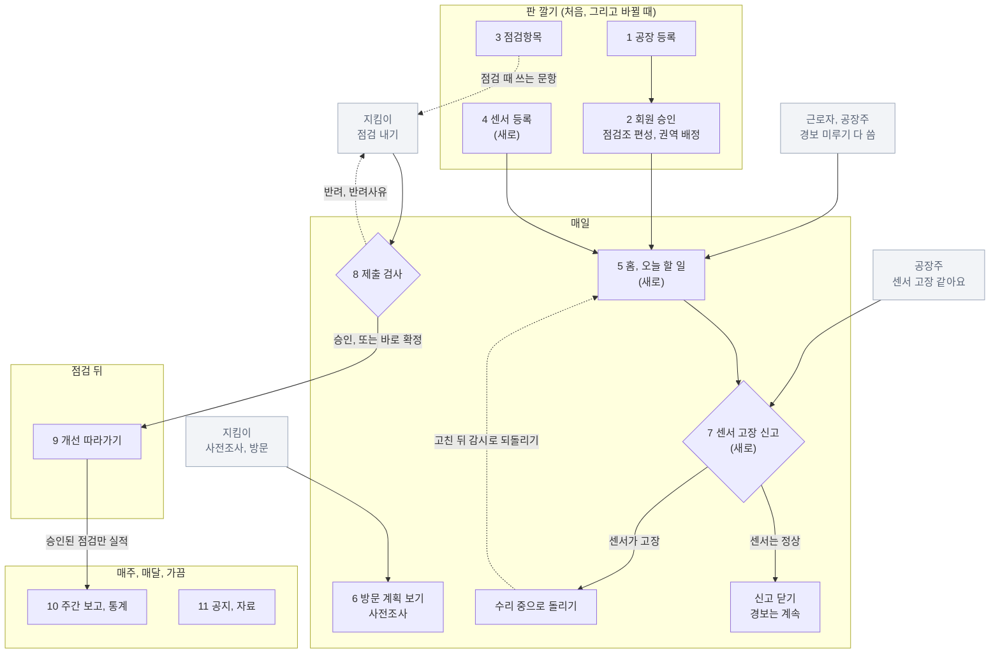

# 운영자 업무 스토리보드 (초안)

- 작성일: 2026-10-20 (같은 날 기존 웹 관리자 화면을 직접 돌아보고 다시 씀)
- 상태: 초안. 운영자(산업안전지킴이 운영센터)가 하는 일을 장면별로 정리했다. 틀은 지킴이 스토리보드(`261012_산업안전지킴이_업무스토리보드.md`)와 같다.
- 바탕:
  - "기존 웹에서는" 줄: **2026-10-20에 관리자 계정으로 기존 산업안전지킴이 웹에 로그인해 메뉴마다 목록과 상세를 연 것**(보기만 함), 그리고 2026-06-16에 같은 웹을 떠 둔 캡처. 사용자가 직접 로그인했고 저장 · 승인 · 반려 · 삭제 단추는 누르지 않았다. 기업 이름 · 사람 이름 · 번호는 옮기지 않았다.
  - "운영자 웹에서는" 줄: 시제품 운영자 웹(`시제품/operator.js`, 2026-10-20 기준).
  - 운영자 업무를 운영자에게 직접 들은 것은 아니다. 화면에서 읽은 것으로 짐작한 것은 `가설`로 표시했다.

## 1. 한눈에 보기

| 항목 | 내용 |
|---|---|
| 누구 | 진흥원 산업안전 담당 직원(화면 이름은 "산업안전지킴이 운영센터") |
| 무엇으로 | 사무실 PC `가설` |
| 보는 범위 | 모든 공장. 다른 공장과의 비교도 운영자만 본다 |
| 규모 (2026-10-20 기존 웹) | 등록 기업 6,845곳, 현장점검 6,794건(승인 6,338 · 제출 101 · 반려 2 · 점검중 353), 점검조 18개, 점검 문항 34개, 공지 1건, 자료 10건. 점검 대상은 약 25,000곳 |
| 한 달 점검 | 올해 4월부터 달마다 약 800~1,200건 승인(통계현황, 목표 칸은 0) |
| 하는 일 | 판을 깐다(공장, 점검조, 회원, 체크리스트). 지킴이 점검을 보고 실적을 모은다. 우리 서비스에서는 센서 등록과 고장 신고 처리가 더해진다 |
| 제일 궁금한 것 | 어디가 밀렸나, 개선이 얼마나 됐나, 어디서 경보가 났나 |

## 2. 기존 웹 메뉴 (관리자 계정, 2026-10-20)

| 큰 메뉴 | 메뉴 | 운영자가 할 수 있는 것 (이 계정에 보인 단추) |
|---|---|---|
| 현장관리 | 기업등록 | 찾기, 목록, 상세 보기, **등록** |
| 기업점검 | 사전조사 | 찾기, 목록, 상세 보기 (등록 단추 없음) |
| 기업점검 | 현장점검 | 찾기, 목록, 상세 보기, 인쇄, **점검결과 엑셀 내려받기** |
| 주간점검 | 주간점검 | 찾기, 목록, 등록 — 2025년부터 지금까지 **기록 0건** |
| 운영관리 | 점검조관리 | 찾기, 목록, **등록 · 수정 · 삭제** |
| 운영관리 | 점검항목관리 | 목록, **등록 · 수정 · 삭제** |
| 자료실 | 자료실 | 목록, 등록 |
| 통계현황 | 월별점검실적 (+ 첫 화면에서 월별개선지도 · 위험요인결과 · 취약분야) | 보기 |
| 고객센터 | 공지사항 | 목록, 등록 |
| 회원관리 | 회원정보관리 | 찾기, 목록, 등록 |

업무 흐름은 메뉴 차례 그대로다.

```
기업등록 → 사전조사 → 현장점검 ─(제출 → 승인 / 반려)─→ 통계현황
 (운영자)   (방문 계획,   (점검 + 개선 전후 사진을      (승인된 점검만 실적으로 셈)
           지킴이 `가설`)  한 기록에, 지킴이)
운영관리(점검조 · 점검항목) · 회원관리 · 공지 · 자료실은 판을 까는 일
```

## 3. 흐름 한눈에 보기

```
판 깔기 (처음, 그리고 바뀔 때)
[1] 공장 등록
[2] 지킴이 회원 승인 → 점검조 편성 → 읍·면·동 권역 배정
[3] 체크리스트(점검항목) 관리
[4] 센서 다는 공장: 기계, 센서, 구역 등록 → 값이 오면 감시 시작        ← 새로 생기는 일
 ↓
매일
[5] 홈과 "오늘 할 일" 보기                                              ← 새로 생기는 일
[6] 방문 계획 보기 (사전조사)
[7] 센서 고장 신고 처리                                                 ← 새로 생기는 일
[8] 지킴이 점검 받기 ──── 기존 웹: 제출 → 승인 또는 반려(반려사유)
                          우리 서비스: 2026-10-14부터 낸 점검은 바로 확정 (아직 정해지지 않음)
 ↓
[9] 개선 따라가기 ──── 기존 웹: 지킴이가 같은 점검 기록에 개선 전후 사진과 개선여부를 채움
                       우리 서비스: 공장주가 고친 사진을 올리고 지킴이가 재점검으로 판정
 ↓
매주, 매달, 가끔
[10] 주간 보고와 통계
[11] 공지와 자료
```

같은 흐름을 머메이드로 그린 것이다. 회색 칸은 다른 역할이 하는 일이다.



## 4. 장면별 스토리보드

### 장면 1. 공장 등록

- 상황: 점검할 공장이 들어온다.
- 기존 웹에서는 (현장관리 › 기업등록):
  - 목록 칸: 기업코드, 기업명, 대표자명, 사업자번호, 행정구역, 최초등록일자, 최종점검일자. 10월 20일 기준 6,845곳.
  - 찾기: 소유형태(소유, 임차, 기타), 기업종류(소공인, 소기업, 중소기업), 행정구역(읍·면·동 29곳), 등록사유(현장등록, 점검신청, 점검거부, 기업DB), 점검일자, 검색항목(기업코드, 기업명, 대표자명, 사업자번호).
  - 상세는 두 덩어리다. 1.기업정보: 기업코드, 기업명, 사업자등록번호, 대표자명, 회사 전화 · 팩스 · 대표메일, 사업장 주소, 행정구역, 업종코드, 주 생산용품, 상시 근로자수, 외국인 근로자수, 소유형태, 기업종류, 안전담당자 성명 · 전화 · 이메일, 재해건수 이력, 등록사유, 등록일자. 꼭 적을 칸은 기업명, 사업자등록번호, 행정구역, 등록사유, 등록일자. 2.등록정보.
  - 목록에 "등록" 단추가 있다. 이 계정으로 연 상세에는 "목록으로 이동"만 보였다.
- 운영자 웹에서는:
  - 공장 탭 → "공장 등록". 기업 정보(기업명, 사업자번호, 대표자, 업종, 기업 종류, 소유 형태, 근로자 수), 위치(읍·면·동, 주소), 등록사유, 대표 휴대폰을 적는다.
  - "등록하고 초대 보내기"를 누르면 공장주에게 초대가 간다. 기존 웹에는 없던 일이다.
  - 맡을 조는 읍·면·동을 고르면 저절로 정해진다. 점검거부로 등록하면 기록으로만 남고 지킴이 목록에는 올리지 않는다.
  - 공장 목록은 읍·면·동, 업종, 기업 종류, 맡은 조, 센서 유무, 이름으로 거른다. 줄마다 마지막 점검, 남은 개선, 센서 상태.
- 다른 점: 기존 웹 상세는 안전담당자, 재해건수 이력까지 있다. 운영자 웹 등록 칸에는 아직 없다(지킴이 앱 기업 정보 탭에서 고치는 칸과 맞춰야 한다).
- 모르는 것: 지킴이가 현장에서 처음 찾은 공장(현장등록)은 누가 넣나. 기업DB는 어디서 받아 넣나.
- 다음: 장면 2

### 장면 2. 회원과 점검조

- 상황: 지킴이가 가입을 신청한다. 조를 짜고 조마다 읍·면·동 권역을 준다.
- 기존 웹에서는:
  - 회원관리 › 회원정보관리: 찾기 칸은 가입유형(관리자, 일반기업, 산업안전지킴이, 행정인력), 상태(가입신청, 승인완료, 반려, 탈퇴), 분야(소방, 전기, 화학, 공통), 근무여부(근무, 퇴직, 휴직, 병가), 아이디 또는 성명. 목록 칸은 가입유형, 성명, 아이디, 분야, 근무여부, 상태. "등록" 단추가 있어 운영자가 회원을 직접 넣을 수도 있다. 처음 열면 목록이 비어 있고 찾아야 나온다.
  - 운영관리 › 점검조관리: 18조. 칸은 점검조, 담당권역, 조장, 조원1~3, 등록일자. 담당권역은 읍·면·동 여럿을 쉼표로 적고, 같은 동을 두 조가 함께 맡기도 한다(동탄 1~9동이 두 조에 들어 있음). 등록, 상세에서 수정하기 · 삭제하기.
- 운영자 웹에서는:
  - 점검조 탭 › 지킴이 명단 맨 위에 가입 신청이 보인다. 승인하면 "조에 넣어 주세요"가 뜨고, 반려할 수도 있다.
  - 명단에서 근무 상태를 바꾼다. 퇴직인데 아직 조에 있으면 "조에서 빼 주세요"가 붙는다.
  - 조 한 곳에서 조원을 넣고 빼고, 조장을 바꾸고, 담당 읍·면·동을 고른다. 다른 조가 맡은 동에는 그 조 이름이 작게 보인다.
  - 맡은 조가 없는 읍·면·동이 있으면 조 목록 위에 알린다.
- 다른 점: 기존 웹은 같은 동을 두 조가 맡을 수 있다. 운영자 웹은 한 동에 한 조로 그렸다. 공장의 "맡을 조"가 읍·면·동으로 저절로 정해진다는 운영자 웹의 전제가 여기서 흔들린다.
- 모르는 것: 같은 동을 두 조가 맡을 때 공장은 어느 조가 가나. 행정인력은 무슨 일을 하나.
- 다음: 장면 3

### 장면 3. 체크리스트(점검항목)

- 상황: 지킴이가 점검에 쓸 문항을 관리한다.
- 기존 웹에서는 (운영관리 › 점검항목관리):
  - 34문항, 5영역(01 산업안전 일반 4, 02 소방안전 3, 03 전기안전 4, 04 화학안전 3, 05 유해위험기구/시설 20). 모두 문항버전 `26VER01`.
  - 목록 칸: 평가영역, 평가문항, 문항버전, 등록일시. 상세 칸: 문항버전, 평가영역, 평가문항, 설명, 자료실번호(자료실 글과 이어짐).
  - 등록, 상세에서 수정하기 · 삭제하기. 판은 문항마다 붙은 "문항버전" 값이고, 올린 문항도 고칠 수 있다.
- 운영자 웹에서는:
  - 체크리스트 탭에 판 목록, 판마다 올린 날 · 문항 수 · 이 판으로 한 점검 수 · 바뀐 점 · 영역별 문항.
  - 올린 판은 고칠 수 없다. "새 판 만들기"로 지금 판을 바탕 삼아 고치고 더하고 빼서 "26VER02로 올리기". 다음 점검부터 새 판을 쓰고, 지난 점검은 옛 판 그대로 남는다.
- 다른 점: 기존 웹은 문항 하나씩 고치고 지운다. 운영자 웹은 판 통째로 새로 올린다. 기존 웹의 "설명"과 "자료실번호" 칸은 운영자 웹에 없다.
- 다음: 장면 4 또는 장면 5

### 장면 4. 센서 등록 (새로 생기는 일)

- 상황: 센서 사이트로 정한 공장에 센서를 단다.
- 기존 웹에서는: 없다. 기존 시스템에는 센서도 경보도 없다.
- 운영자 웹에서는:
  - 공장 한 곳 → 센서 칸 → "센서 더하기"(센서가 없는 공장은 "센서 달기").
  - 구역 → 붙이는 곳(기계 또는 공간) → 기계 이름 → 센서 종류(진동과 온도, 가스, 전기, 누수, 온습도) → 사양서 한계값(있을 때만).
  - 사양서 한계값이 없으면 한계선을 긋지 않고 AI가 평소와 다른지만 본다.
  - 더하면 "설치 기다림"이 되고, 값이 들어오기 시작하면 감시를 시작한다.
  - 여기 적은 기계 이름과 구역 이름이 근로자 경보의 "무엇이, 어디서"가 된다.
- 모르는 것: 실제 설치는 누가 하나. 운영자가 먼저 적고 설치하나, 설치한 뒤 적나.
- 다음: 장면 5

### 장면 5. 하루 시작: 홈과 오늘 할 일 (새로 생기는 일)

- 상황: 출근해서 연다.
- 기존 웹에서는: 로그인하면 첫 화면에 "핵심성과" 칸 넷(점검실적, 개선지도, 유해요인, 취약분야)과 "자세히보기"만 있다. 할 일을 모아 보여 주는 화면은 없다. 제출 점검이 몇 건 기다리는지도 현장점검 메뉴에서 "제출"로 걸러야 안다.
- 운영자 웹에서는:
  - 홈 위쪽에 날짜와 인사, 그 아래 큰 지도.
    - 공장 핀(경보, 검사 대기, 센서 사이트), 점검 대상 점, 할 일 있는 동.
    - 보기: 모든 공장, 할 일 있는 곳, 센서 사이트, 이번 주 점검. 구별로 거르고 공장 이름으로 찾는다. 크게 보기는 네이버 지도.
  - 지도 아래 카드: 점검 건수 그래프와 이번 달 점검실적, 작은 칸 넷(제출 검사 대기, 센서 경보, 가입 신청, 오늘 방문), 점검조(조별 이번 주 점검, 주간 보고 제출 여부, 담당 구역 지도, 조장 전화와 문자), 다음 검사, 개선지도.
  - 맨 위 종 "오늘 할 일"이 급한 순으로 나온다: 미루기를 다 써서 올라온 경보와 고장 신고 → 5분 넘게 조치 안 된 경보와 값 끊김 → 검사 기다리는 점검 → 가입 신청.
- 모르는 것: 경보가 운영자에게 올라오면 운영자가 무엇을 하나. 운영자 웹에는 경보에 누르는 단추가 없다.
- 다음: 장면 6~8

### 장면 6. 방문 계획 보기 (사전조사)

- 상황: 지킴이 조가 어느 공장에 언제 갈지 정한다.
- 기존 웹에서는 (기업점검 › 사전조사):
  - 6,794건. 현장점검 건수와 같아서, 사전조사 한 건이 현장점검 한 건으로 이어지는 것으로 보인다.
  - 목록 칸: 기업코드, 점검코드, 기업명, 사업자번호, 행정구역, 점검조, 방문예정일, 등록일. 찾기는 행정구역, 방문예정일, 검색항목.
  - 운영자 목록에는 "등록" 단추가 없다. 사전조사는 지킴이가 만드는 것으로 보인다 `가설`.
  - 상세는 다섯 덩어리다: 1.기업정보(+ 점검코드, 기업코드, 방문예정일, 점검조, 조장, 조원1~3), 2.위험·기계기구 보유현황(지게차, 사다리, 선반·밀링·CNC 절삭장비, 압력용기 등), 3.위험물질/유해화학물질 취급여부, 4.점검내역(위험시설/설비, 산업안전, 소방, 전기, 화학마다 우수 · 보통 · 미흡 · 해당없음, 조치사항, 개선 전후), 5.등록정보. 종이 체크리스트 앞면 6번(유해위험기구 보유현황)과 7번(위험물질 취급여부)이 여기 있다.
  - 상세에 "등록하기" 단추가 있다(누르지 않음). 현장점검으로 넘어가는 단추로 보인다 `가설`.
- 운영자 웹에서는: 점검 탭 › 방문 일정. 지킴이가 정한 방문일을 보기만 한다(불시에 가기도 해서 여기 없는 방문도 있다).
- 다른 점: 우리 지킴이 앱에는 사전조사 단계가 따로 없다(2026-10-14에 넣었다가 뺌). 보유현황과 취급여부 칸도 없다. 4.점검내역의 우수 · 보통 · 미흡은 지금 문항의 양호 · 보통 · 불량과 말이 다르다. 지난 점검 내역인지, 방문 전에 적는 것인지 모른다.
- 모르는 것: 사전조사를 누가 언제 만드나. 4.점검내역은 무엇을 적는 칸인가.
- 다음: 장면 8

### 장면 7. 센서 고장 신고 처리 (새로 생기는 일)

- 상황: 공장주가 "센서 고장 같아요"를 보냈다. 센서가 고장 나면 값이 계속 이상해서 경보가 끝나지 않는다.
- 기존 웹에서는: 없다.
- 운영자 웹에서는:
  - 오늘 할 일 "고장 신고" → 공장 화면 센서 칸 "신고 확인" → 창.
  - 창에는 신고 내용, 그 센서의 최근 경보, 수리 중으로 돌리면 생기는 일(열린 경보가 "수리로 닫힘"으로 닫히고, 되돌릴 때까지 경보가 울리지 않고, 공장주와 근로자 화면에 "수리 중")이 보인다. 누수처럼 켜짐과 꺼짐만 있는 센서면 공장주 사진과 함께 판단하라는 경고가 붙는다.
  - "작업 때문이라면 수리 중으로 돌리지 말고 공장주에게 작업 예정 알리기를 안내하세요"를 먼저 보인다.
  - 셋 가운데 고른다: "수리 중으로 돌리기"(수리 메모), "센서 정상, 신고 닫기"(경보는 계속), "돌리지 않기". 고친 뒤 "감시로 되돌리기".
  - 값이 안 오는 센서는 오늘 할 일에 "값 끊김"으로 오른다.
  - 공장 화면 아래 "센서 이상 기록"은 운영자도 고칠 수 없다.
- 모르는 것: 설계에서는 운영자가 최근 센서 값을 보고 판단한다고 했는데, 운영자 웹 창에는 값과 그래프가 아직 없다.
- 다음: 장면 5

### 장면 8. 지킴이 점검 받기 (제출 검사)

- 상황: 지킴이 조가 점검을 마치고 냈다.
- 기존 웹에서는 (기업점검 › 현장점검):
  - 점검과정은 넷이다: 점검중(353) → 제출(101) → 승인(6,338) 또는 반려(2). 점검결과는 점검완료, 재점검, 패트롤, 기타.
  - 목록 칸: 점검코드, 기업명, 사업자번호, 행정구역, 점검조, 점검일자, 점검과정, 점검결과, 최종수정일자. 찾기는 행정구역, 점검일자(최근 6개월 단추), 점검결과, 점검과정, 검색항목. "점검결과(엑셀) 다운로드".
  - 상세는 세 덩어리다(반려된 것은 넷).
    - 1.기업정보: 기업등록과 같은 칸.
    - 2.분야별 안전점검: 개선을 위한 조언, 점검코드, 점검결과, 위험요인(재해유형 18종 체크), 지적사항(개선완료 · 미개선 · 개선중), 문항마다 평가내용 · 평가결과(양호 · 보통 · 불량 · 해당없음) · 위험요인, 그리고 개선지도 표(아래 장면 9).
    - 3.반려정보: 반려사유. 반려된 점검에만 있다.
    - 등록정보.
  - 이 계정으로 "제출" 상태 점검을 열어도 **승인 · 반려 단추는 보이지 않았다.** "인쇄하기"와 "목록으로 이동"뿐이다. 화면 코드에는 제출 · 반려 · 승인 · 수정 · 삭제 기능이 들어 있다. 누가 승인하는지(다른 관리자 계정, 행정인력 등)는 모른다 `가설`.
- 우리 서비스에서는 (2026-10-14 사용자 지시, 아직 정해지지 않음): 지킴이 앱에서 제출 검사를 뺐다. 지킴이가 낸 점검은 바로 확정되고, 불량이 있으면 사진과 함께 바로 공장 웹으로 간다.
- 운영자 웹에서는:
  - 점검 탭 › 제출 검사 화면은 남아 있다. 검사 기다리는 점검이 생기지 않아서(가짜 데이터의 것도 10-14에 확정으로 바꿈) 지금은 "검사 기다리는 점검이 없어요"만 보인다.
  - 점검이 있을 때의 모습: 왼쪽에 오래된 것부터 목록, 오른쪽에 불량 · 지난번 미흡 · 접힌 양호 · 보통 · 해당 없음. 위험요인이 없는 불량이나 답하지 않은 항목은 "살펴볼 점"으로 알린다. 승인 확인 창, 반려 창(사유를 여럿 고르고 더 적을 말).
  - 점검 기록 표는 조, 과정, 결과, 공장 이름으로 거른다.
- 다른 점: 기존 웹에서 실제로 반려는 6,794건 가운데 2건뿐이다. 거의 다 승인된다. 승인은 실적을 세는 문(장면 10)이라는 뜻이 더 커 보인다 `가설`.
- 정해야 할 것: 제출 검사를 둘지. 두면 누가 승인하나, 지킴이 앱의 반려 흐름을 되살려야 한다. 안 두면 운영자 웹의 제출 검사 화면과 홈의 "제출 검사 대기" · "다음 검사" 칸을 걷어야 하고, 실적을 무엇으로 셀지 정해야 한다.
- 다음: 장면 9

### 장면 9. 개선 따라가기

- 상황: 점검에서 지적사항이 나왔다. 공장은 2주 안에 고쳐야 한다.
- 기존 웹에서는:
  - 개선을 따로 다루는 메뉴가 없다. **개선은 현장점검 기록 안에 있다.** 2.분야별 안전점검 아래 개선지도 표가 지적 하나에 한 줄이다: 순번, 개선전 사진, 개선후 사진, 지도내용, 개선여부(개선완료 · 개선중 · 미개선), 지도유형.
  - 승인된 점검 몇 건을 열어 보니 점검결과는 "점검완료"인데 개선여부에 개선완료와 개선중이 섞여 있었다. 지킴이가 시정 기간 뒤 개선 사진과 개선여부까지 채워 낸 다음 승인되는 것으로 보인다 `가설`.
  - 그래서 운영자가 "개선 요청을 보내고 완료를 확인한다"(9월 21일 분석 문서의 짐작)기보다, 지킴이가 적은 개선 결과를 승인 때 함께 보는 것에 가깝다 `가설`. 공장주가 기존 웹에서 개선 사진을 올리는 화면은 보지 못했다.
  - 첫 화면 "개선지도" 칸이 이것을 모은 숫자다(요청 24,166건 중 완료 15,677건, 64.9%).
- 우리 서비스에서는 (2026-10-13, 10-14): 공장주가 웹에서 고친 사진을 올리고, 지킴이가 재점검에서 고치기 전 · 고친 뒤를 나란히 보고 항목마다 고쳐짐 · 안 고쳐짐을 정한다. 결과(점검완료, 패트롤, 기타)도 지킴이가 고른다. 운영자 확인은 거치지 않는다 `가설`.
- 운영자 웹에서는: 점검 탭 › 개선 요청. "아직 안 고침", "고쳤다고 함", "안 고쳐짐", "고쳐짐 확인"으로 거르고 줄마다 마지막 소식을 본다. 보기만 한다. 홈 "개선지도" 칸에 고쳐짐 확인 비율과 월별 막대.
- 다른 점: 기존 웹의 개선여부에는 "개선중"이 있다. 우리 서비스는 고쳐짐 · 안 고쳐짐 둘이다. 기존 웹의 "지도유형"과 "지도내용"은 우리 서비스에 없다.
- 모르는 것: 지도유형의 보기에는 무엇이 있나. 패트롤(고용노동부 넘김)과 기타(특별 관리)는 누가 처리하나. 앱에는 그 뒤가 없다.
- 다음: 장면 10

### 장면 10. 주간 보고와 통계

- 상황: 실적을 모아 본다.
- 기존 웹에서는:
  - 주간점검: 목록 칸은 점검조, 작성자, 행정구역, 점검(결과)기업수, 점검완료, 재점검, 패트롤, 기타, 등록일자. **2025년부터 지금까지 기록 0건**이다. 실제로는 쓰지 않는 메뉴로 보인다.
  - 통계현황 › 월별점검실적: 사업년도를 고르면 달마다 목표와 실적이 나온다. 올해 실적은 4월 1,073 · 5월 958 · 6월 1,114 · 7월 1,232 · 8월 802 · 9월 983 · 10월(20일까지) 176, 합계 6,338건. **합계가 승인된 현장점검 수와 같다.** 실적은 승인된 점검만 센다. 목표 칸은 모두 0이라 첫 화면 점검실적이 0%로 보인다.
  - 첫 화면 "자세히보기"로 월별개선지도(요청 · 완료), 위험요인결과(재해유형 18종별 건수), 취약분야(산업안전일반 · 소방 · 전기 · 유해화학물질 · 위험시설 및 장비 5분야별 건수)를 본다.
- 운영자 웹에서는:
  - 점검 탭 › 주간 보고: 받은 보고 목록과 미제출 조. 진흥원에 업무 방식을 물은 뒤 다시 만들기로 미뤄 두었다(2026-10-01).
  - 통계 탭: 이번 달 점검실적, 점검 결과, 개선지도, 월별 점검 건수, 조별 표, 센서 사이트 표(경보 수, 조치까지 평균, 아무도 안 누름, 수리로 닫힘, 고장 신고, 지금 값 모름), AI 제안.
  - "AI 제안 쓰임"은 2026-10-20부터 AI가 점검 포인트만 알려 줘서 새 점검에서는 셀 것이 없다.
- 다른 점: 기존 웹에는 위험요인(재해유형)별 · 취약분야별 통계가 있다. 운영자 웹에는 없다. 기존 웹에는 없는 조별 비교와 센서 통계가 운영자 웹에 있다.
- 정해야 할 것: 주간 보고를 정말 둘지(기존 웹 기록 0건). 우리 서비스에서 제출 검사를 빼면 실적은 "낸 점검"으로 세나.
- 다음: 장면 11

### 장면 11. 공지와 자료

- 기존 웹에서는: 고객센터 › 공지사항(1건), 자료실(10건). 목록 칸은 제목, 작성자, 작성일. 찾기는 제목, 내용, 제목+내용, 작성자. 둘 다 "등록" 단추. 받는 쪽을 고르는 칸은 없다. 자료실 글은 점검항목의 "자료실번호"와 이어진다.
- 운영자 웹에서는:
  - 공지 쓰기: 받는 쪽(지킴이, 공장주, 모두)을 고르면 받는 사람 수가 보인다. 확인 창 "바로 알림이 가요. 올린 뒤에는 고칠 수 없어요."
  - 자료실: 파일을 고르고 받는 쪽을 정해 올린다.
  - 근로자는 받는 쪽에 없다. 근로자 안전 공지는 공장주가 올린다.
- 시제품 한계: 새 공지는 지킴이 앱과 공장주 웹에 아직 이어지지 않는다.

## 5. 기존 웹과 운영자 웹 맞대 보기

| 기존 웹 메뉴 | 운영자 웹 | 다른 점 |
|---|---|---|
| 기업등록 | 공장 | 등록하며 공장주 초대, 맡을 조 저절로, 센서. 안전담당자 · 재해건수 칸은 아직 없음 |
| 사전조사 | 점검 › 방문 일정 | 방문일만 본다. 보유현황 · 취급여부 · 점검내역은 없음 |
| 현장점검 | 점검 › 제출 검사, 점검 기록 | 제출 검사는 지킴이 앱에서 뺐다. 문항별 위험요인(같은 18종)은 있음. 점검 전체의 위험요인 체크, 개선을 위한 조언, 엑셀 내려받기는 없음 |
| (현장점검 안의 개선지도) | 점검 › 개선 요청 | 개선을 따로 쫓는다. 개선 사진은 공장주가 올리고 판정은 지킴이 |
| 주간점검 | 점검 › 주간 보고 | 보류. 기존 웹은 기록 0건 |
| 점검조관리 | 점검조 | 한 동에 한 조. 기존 웹은 두 조가 같은 동을 맡기도 함 |
| 점검항목관리 | 체크리스트 | 판 통째로 새로 올림, 올린 판은 못 고침. 설명 · 자료실번호 칸 없음 |
| 회원정보관리 | 점검조 › 지킴이 명단 | 지킴이만 다룸. 일반기업 · 행정인력 회원은 없음 |
| 통계현황 | 통계, 홈 | 조별 · 센서 통계가 더해짐. 위험요인 · 취약분야 통계는 없음 |
| 공지사항, 자료실 | 공지·자료 | 받는 쪽을 고름 |
| 첫 화면 핵심성과 | 홈 | 지도, 오늘 할 일, 그래프 |
| 없음 | 센서 등록, 고장 신고 처리 | 새로 |

## 6. 아직 운영자 웹에 없는 것

- 기존 웹에 있는데 운영자 웹에 없는 것: 사전조사의 보유현황 · 취급여부, 현장점검 전체의 위험요인 체크와 개선을 위한 조언, 점검결과 엑셀 내려받기, 점검 인쇄, 위험요인 · 취약분야 통계, 기업의 안전담당자 · 재해건수 이력, 점검항목의 설명 · 자료실번호.
- 센서 값과 그래프. 고장 신고를 판단할 때 필요하다.
- 경보가 운영자에게 올라왔을 때 운영자가 할 일.
- 패트롤 넘기기(고용노동부), 기타의 특별 관리.
- 운영자가 바꾼 것(공장 등록, 조 편성, 새 판, 공지)이 지킴이 앱과 공장주 웹에 이어지는 것. 시제품 한계다.

## 7. 정해야 할 것, 확인할 것

- 제출 검사(승인과 반려)를 둘지. 기존 웹에서는 거의 다 승인되고(반려 2건), 승인된 점검만 실적으로 센다. 빼면 실적을 무엇으로 셀지도 함께 정한다.
- 기존 웹에서 승인 단추는 누가 보나. 이 관리자 계정에는 보이지 않았다.
- 개선을 누가 적나. 기존 웹은 지킴이가 점검 기록 안에 개선 전후 사진을 채우는 것으로 보인다. 우리 서비스는 공장주가 올리고 지킴이가 판정한다.
- 같은 읍·면·동을 두 조가 맡을 때 공장은 어느 조가 가나.
- 사전조사 단계를 지킴이 앱에 둘지. 보유현황(종이 6번) · 취급여부(종이 7번)를 어디서 적나.
- 주간 보고를 둘지(기존 웹 기록 0건).
- 위험요인 · 취약분야 통계를 우리 서비스에 넣을지. 위험요인 목록(재해유형 18종)은 지킴이 앱이 문항마다 고르는 목록과 같다. 기존 웹에는 점검 전체의 위험요인 체크가 따로 있다.
- 아무도 조치하지 않은 경보를 몇 분 뒤 운영자에게 올리나, 올라오면 운영자는 무엇을 하나.
- 패트롤은 누가 어떻게 고용노동부에 넘기나.
- AI가 점검 포인트를 알려 주게 바뀌었으니(2026-10-20), 운영자 통계에서 AI가 잘 되는지를 무엇으로 보나.
- 운영자를 직접 만날 기회가 생기면 먼저 확인할 것: 하루에 무엇부터 보나, 제출 점검을 볼 때 무엇을 확인하나, 기존 웹에서 가장 손이 많이 가는 일은 무엇인가.
