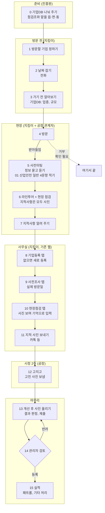

# 산업안전지킴이 업무 스토리보드 — 기존 방식 (초안)

- 작성일: 2026-10-22
- 상태: 초안. 지금 지킴이들이 기존 산업안전지킴이 웹과 종이 체크리스트로 일하는 방식을 첫 단계부터 마지막 단계까지 정리했다. 우리가 만들 서비스의 흐름은 `261012_산업안전지킴이_업무스토리보드.md`에 있다.
- 출처:
  - 지킴이 업무 설명 (구두, 2026-10-12)
  - 산업안전지킴이 분과 미팅 (2026-10-21, `261021_산업안전지킴이_미팅.md`)
  - 기존 웹 관리자 화면 (2026-09-21 · 2026-10-20, `260921_기존시스템_분석.md`, `261020_운영자_업무스토리보드.md`)
  - 종이 체크리스트 양식 (앞뒤 두 장)
- 짐작한 것은 `가설`, 아직 모르는 것은 "확인 필요"로 적었다.

## 1. 한눈에 보기

| 항목 | 내용 |
|---|---|
| 점검 대상 | 화성의 50인 미만 제조시설, 약 25,000곳. 기존 웹에 등록된 기업은 6,845곳 (2026-10-20) |
| 방문 주기 | 기업마다 보통 1년에 한 번 |
| 점검조 | 3인 1조가 원칙. 아주 크거나 위험한 곳이 아니면 보통 2인 1조. 조마다 맡은 읍·면·동이 있다 |
| 방문 건수 | 조마다 하루 평균 1.2곳 |
| 예약 | 따로 없다. 전화로 날을 잡거나, 연결이 안 되면 연락 없이 간다 |
| 강제력 | 법으로는 해야 하는 점검이지만, 안 받았다고 따로 받는 제재는 없다 |
| 현장에서 쓰는 것 | 종이 체크리스트와 사진. 종이에는 거의 적지 않고 지적사항은 모두 사진으로 찍는다 |
| 전산 입력 | 점검을 모두 마치고 사무실에서. 기존 웹의 기업등록 → 사전조사 → 현장점검 탭 |
| 시정 기간 | 점검 뒤 2주 |
| 검토 | 관리자가 등록(승인)하거나 반려한다. 승인된 점검만 실적으로 센다 |

## 2. 등장인물

| 역할 | 누구 | 하는 일 |
|---|---|---|
| 지킴이 조장 | 보통 소방 전문가 | 조를 이끌고 점검한다 |
| 지킴이 조원 | 화학(유해물질) 전문가, 전기 전문가 | 자기 분야를 중심으로 점검한다 |
| 공장 관계자 | 공장주 또는 안전담당관리자 | 사전미팅에 나오고, 라인투어에 같이 다니며 설명하고, 지적사항을 고쳐 사진을 보낸다 |
| 관리자 | 화성산업진흥원 | 기업DB를 다듬어 나눠 주고, 점검조와 맡을 읍·면·동, 점검항목을 관리하고, 지킴이가 낸 점검을 등록하거나 반려한다 |
| 화성시 | | 제조업 기업DB를 준다 |
| 고용노동부 | | 개선하지 않거나 거부한 공장을 넘겨받는다 (패트롤) |

## 3. 흐름 한눈에 보기

```
[0] 준비 ──── 기업DB(화성시 → 진흥원 → 담당 지역 것만), 점검조와 맡을 읍·면·동
 ↓
[1] 방문할 기업 정하기
 ↓
[2] 날짜 잡기 ──── 전화가 안 되면 연락 없이 그냥 간다
 ↓
[3] 가기 전 알아보기 (기업DB: 업종, 규모)
 ↓
[4] 방문 ──── 거부당하면 여기서 끝
 ↓
[5] 사전미팅 ──── 정보를 묻고 듣는다. 종이에는 01 산업안전 일반 4문항만 적는다
 ↓
[6] 라인투어 + 현장 점검 ──── 지적사항은 모두 사진, 꼭 기억할 것만 메모
 ↓
[7] 현장에서 지적사항 알려 주기
 ↓
[8] 사무실: 기업등록 탭 ──── 없는 기업이면 새로 등록
 ↓
[9] 사무실: 사전조사 탭 ──── 방문예정일 칸에 실제 방문일
 ↓
[10] 사무실: 현장점검 탭 ──── 사진을 보며 기억으로 체크리스트, 개선을 위한 조언, 지적사항
 ↓
[11] 지적 사진 공장에 보내기 (카톡 등), 시정 2주
 ↓
[12] 공장 시정 → 고친 사진을 지킴이에게 보냄
 ↓
[13] 개선 후 사진 올리기, 결과 판정, 제출
 ↓
[14] 관리자 검토 ─┬─ 등록(승인)
                  └─ 반려 → 고쳐서 다시 낸다
 ↓
[15] 실적과 그 뒤 ──── 승인된 점검만 실적, 패트롤은 고용노동부, 기타는 특별 관리
```

같은 흐름을 머메이드로 그린 것이다. 점선은 아직 확인하지 않은 길이다.



## 4. 장면별 스토리보드

### 장면 0. 준비: 기업DB와 맡을 지역

- 상황: 지킴이가 점검을 나가기 전에 깔려 있는 것들이다.
- 일어나는 일:
  - 화성시가 제조업 기업DB를 주고, 진흥원이 다듬어 지킴이에게 준다.
  - 지킴이마다 담당 지역이 정해져 있고, 그 지역에 맞는 DB만 받는다.
  - 기업DB에 든 것: 기업명, 주소, 생산품, 종업원 수, 업종명, 전화번호 등.
  - 진흥원은 기존 웹 점검조관리에서 조(조장, 조원1~3)를 짜고 조마다 읍·면·동을 맡긴다. 같은 동을 두 조가 맡기도 한다.
  - 진흥원은 점검항목관리에서 체크리스트 문항을 관리한다. 지금 판은 `26VER01`, 34문항이다.
- 어려운 점: 기업DB는 정확하지 않은 내용이 많다. 특히 전화번호가 빠진 곳이 많다.
- 다음: 장면 1

### 장면 1. 방문할 기업 정하기

- 상황: 기업마다 1년에 한 번꼴로 찾아가야 한다. 대상은 약 25,000곳이다.
- 지킴이가 하는 일: 담당 지역 안에서 방문할 기업을 고른다.
- 모르는 것: 고르는 기준 (확인 필요).
- 다음: 장면 2

### 장면 2. 날짜 잡기

- 상황: 방문 예약 체계는 따로 없다.
- 지킴이가 하는 일: 기업에 전화해 방문 날짜를 잡는다.
- 어려운 점: 전화가 잘 안 되는 경우가 대부분이다. 그럴 때는 연락 없이 그냥 찾아가는 일이 많다.
- 다음: 장면 3

### 장면 3. 가기 전 알아보기

- 상황: 방문하기로 정한 기업이 있다.
- 지킴이가 하는 일: 기업DB로 그 기업의 업종과 규모를 미리 본다.
- 기존 웹의 "사전조사" 탭과는 다르다. 사전조사 탭은 다녀온 뒤 사무실에서 적는다 (장면 9).
- 다음: 장면 4

### 장면 4. 방문

- 상황: 지킴이 조(보통 2인)가 공장에 도착한다.
- 어려운 점: 가서 거부당하는 경우도 많다. 점검을 안 받아도 공장이 받는 제재는 없다.
- 거부하면 여기서 끝난다. 기존 웹 등록사유에 "점검거부"가 있어 거부도 기록으로 남는 것으로 보인다 `가설`. 패트롤로 넘어가는지는 확인 필요.
- 다음: 받아들이면 장면 5

### 장면 5. 사전미팅

- 상황: 현장에 들어가기 전, 공장 안전담당관리자 또는 공장주와 마주 앉는다.
- 지킴이가 하는 일:
  - 방문과 점검의 목적을 설명한다.
  - 종이 체크리스트의 다음 칸을 공장 측에 물어 확인한다.
    - 1 기업정보: 기업DB에 틀리거나 빠진 것(특히 전화번호)을 여기서 직접 여쭤 확인한다.
    - 2 관리정보: 전년도 재해건수, 등록사유, 기업등록일자
    - 3 담당자 정보: 안전담당자, 전화번호, 이메일, 휴대폰
    - 6 유해위험기구 보유현황
    - 7 위험물질/유해화학물질 취급여부
  - 체크리스트 9번 분야별 안전점검 가운데 **01 (공통)산업안전 일반 4문항만** 여기서 종이에 적는다. 경영방침과 목표, 위험성 평가, 안전교육, 비상대피 계획과 훈련을 묻는 문항이다.
  - 모든 항목을 다 볼 수는 없어서, 가능한 부분만 확인한다.
- 여기서 알게 된 정보는 사무실에 돌아가 전산에 넣는다 (장면 8~10).
- 다음: 장면 6

### 장면 6. 라인투어와 현장 점검

- 상황: 공장 관계자와 같이 현장으로 들어간다.
- 지킴이가 하는 일:
  - 라인투어를 한다. 원자재가 들어와서, 가공되고, 최종 출하되기까지의 과정을 따라가며 본다. 공장 관계자가 동행하며 설명한다.
  - **지적사항은 모두 사진으로 찍는다.** 체크리스트 항목에 없는 위험도 찍는다.
    - 예: 호이스트 고리, 적재함이 쏟아질 위험, 페인트 통 안에 다른 화학물질
  - 01 말고 나머지 체크리스트 문항은 종이에 적지 않는다.
  - 꼭 기억해야 하는 내용은 점검 중이나 점검이 끝나자마자 차에서 메모한다.
  - 위험요인은 종이에 번호(①~⑱)나 이름으로 메모하기도 한다. 적는 방식은 지킴이마다 다르다.
- 종이 뒷장(05 유해위험기구 기구별 문항, 10 현장점검 개선사항)은 거의 쓰지 않는다. 뒷장을 빼고 앞장만으로 만든 체크리스트를 쓰는 지킴이도 있다.
- 다음: 장면 7

### 장면 7. 현장에서 지적사항 알려 주기

- 상황: 점검이 끝났다.
- 지킴이가 하는 일: 찾은 지적사항을 공장 측에 모두 알려 준다.
- 다음: 장면 8

### 장면 8. 사무실 ① 기업등록 탭

- 상황: 점검을 모두 마치고 사무실로 돌아왔다. 전산 입력은 모두 이때 한다.
- 지킴이가 하는 일:
  - 기존 웹 기업등록에서 기업을 찾는다. 없으면 새로 등록한다.
  - 등록사유를 하나 고른다: 현장등록, 점검신청, 점검거부, 기업DB, 기타.
  - 기업 정보를 적는다: 기업명, 사업자번호, 대표자명, 행정구역, 회사 전화 · 팩스 · 대표메일, 업종코드, 주 생산용품, 상시 근로자 수, 외국인 근로자 수, 소유형태, 기업종류, 사업장주소 등.
  - 기업DB에서 확실한 것은 그대로 적고, 나머지는 사전미팅에서 확인한 것으로 적는다.
  - 꼭 적어야 하는 칸은 기업명, 사업자등록번호, 행정구역, 등록사유, 등록일자다.
  - 기업코드는 등록할 때 저절로 생긴다.
- 다음: 장면 9

### 장면 9. 사무실 ② 사전조사 탭

- 지킴이가 하는 일:
  - 기업 정보와 함께 관리정보, 담당자 정보, 점검정보, 점검조 정보(조장, 조원1~3), 위험·기계기구 보유현황, 위험물질/유해화학물질 취급여부를 적는다.
  - **방문예정일 칸에는 실제 방문한 날짜를 적는다.**
  - 사전조사 탭에도 체크리스트를 적는 부분(점검내역: 분야마다 우수 · 보통 · 미흡 · 해당없음)이 있지만, 이 단계에서는 넘어간다.
- 사전조사 한 건이 현장점검 한 건으로 이어진다 `가설` (기존 웹 건수가 둘 다 6,794건).
- 어려운 점:
  - 기업등록 · 사전조사 · 현장점검 세 탭이 서로 이어져 있지 않다. 내용을 지우거나 고칠 때 똑같은 작업을 세 번 한다.
  - 사전조사에서 체크한 기계 · 기구가 현장점검 탭에 넘어가지 않는다.
  - 기업등록에서 적은 기업 정보를 처음부터 다시 적는지, 불러오는지는 확인 필요.
- 다음: 장면 10

### 장면 10. 사무실 ③ 현장점검 탭

- 지킴이가 하는 일 (입력 순서대로):
  1. **개선을 위한 조언** (종이 8번 종합평가결과). 쓸 내용이 많아 현장에서는 적지 않고 여기서 쓴다. 앞에 기업 구분 코드가 붙는다 (예: `일반 26ver01`).

     | 구분 | 뜻 |
     |---|---|
     | 일반 | 일반 기업 |
     | WOW (Worst of Worst) | 당장 내일 사고가 나도 이상하지 않은 최악의 기업 |
     | BOB (Best of Best) | 상태가 매우 훌륭한 기업 |

  2. **유해위험기구 보유현황**을 체크한다. 15종(지게차, 이동식 및 천장크레인, 용접기, 리프트, 사다리, 컨베이어, 산업용로봇, 사출성형기, 선반·밀링·CNC 절삭장비, 레이저컷팅기, 프레스, 압력용기, 분쇄기·파쇄기·전단기, 배합기·밀링·혼합기, 롤러기)과 기타.
  3. **분야별 안전점검**: 문항마다 양호, 보통, 불량, 해당없음 중 하나와 평가 내용을 적는다. **지적사항 사진을 보면서 기억으로** 채운다.
     - 불량이면 위험요인을 고른다 (18가지, 5절).
     - 한 문항에 위험요인을 하나만 넣을 수 있다. 한 장비 · 시설에 위험요인이 여럿이면 나머지는 맨 끝 「기타장비·시설」 문항에 적는다. 목록에 없는 장비도 여기에 적는다.
     - 총 위험요인 수와 지적사항 수가 같아야 한다. 지적사항은 개선완료, 개선중, 미개선, 기타로 나뉘고, 넷을 더한 것이 지적사항 수다.
  4. **현장 중점 개선사항**: 지적 하나에 한 줄. 개선 전 사진, 개선여부, 지도유형(유해위험요인), 지도 전 내용, 개선 후 내용.
- 어려운 점:
  - 갖고 있지 않은 기구의 문항(15종 가운데 없는 것)을 하나하나 "해당없음"으로 눌러야 한다.
  - 빈 곳이 있는지, 위험요인 수와 지적사항 수가 맞는지를 사람이 직접 확인한다.
  - 지적사항 하나에 사진을 한 장만 올릴 수 있다.
  - 사진은 한 장 500KB 이하로 올려야 하지만 시스템이 막지 않는다.
  - 임시저장이 없다.
  - 사진을 올린 뒤 수정에서 사진을 더하거나 빼면 오류가 나서, 처음부터 다시 써야 한다.
  - 입력한 글에 `<br>` 같은 태그가 그대로 보인다.
  - "잘된사항" 칸이 사전점검에만 있고 현장점검에는 없다.
  - 위험요인 18가지로는 부족하다.
- 다음: 장면 11

### 장면 11. 지적 사진 보내기와 시정 기간

- 지킴이가 하는 일:
  - 지적사항으로 찍은 사진을 공장에 보낸다 (카톡 등).
  - 공장에 시정 기간 2주를 준다.
- 기존 웹의 점검은 이 동안 "점검중"으로 남아 있는 것으로 보인다 `가설`. 기존 웹 점검과정은 점검중 → 제출 → 승인 또는 반려다.
- 다음: 장면 12

### 장면 12. 공장 시정

- 상황: 2주의 시정 기간이다.
- 공장이 하는 일: 지적사항을 고치고, 고친 모습을 사진으로 찍어 지킴이에게 보낸다 (카톡 등).
- 기존 웹에서 공장이 직접 사진을 올리는 화면은 확인하지 못했다.
- 다음: 장면 13

### 장면 13. 개선 후 사진 올리기와 결과 판정

- 상황: 공장이 보낸 시정 사진을 받았다 (또는 받지 못했다).
- 지킴이가 하는 일:
  - 공장이 보낸 사진을 보고 개선 정도를 판단한다.
  - 현장 중점 개선사항의 줄마다 **개선 후 사진을 올리고** 개선여부(개선완료, 개선중, 미개선, 기타)와 개선 후 내용을 적어 기록을 마친다.
  - 점검결과를 고른다.

    | 결과 | 언제 | 그다음 |
    |---|---|---|
    | 점검완료 | 개선율 50% 이상 | 끝 |
    | 패트롤 | 개선하지 않았거나 거부함 | 고용노동부에 넘긴다 |
    | 기타 | 50% 이상 개선했지만 남은 항목이 매우 위험해 특별 관리가 필요 | 특별 관리 |

  - 다 적으면 제출한다.
- 기존 웹에서 점검완료로 승인된 점검에도 개선여부에 개선완료와 개선중이 섞여 있다.
- 모르는 것:
  - 양식의 점검결과 칸에 있는 "재점검"을 언제 쓰는지 (확인 필요).
  - 개선율 50%를 무엇으로 세는지 (확인 필요).
- 다음: 장면 14

### 장면 14. 관리자 검토

- 상황: 지킴이가 점검을 냈다.
- 관리자가 하는 일: 낸 점검을 보고 최종 등록(승인)할지 반려할지 정한다.
- 미팅에서 들은 반려 사유 (전부인지는 확인 필요):
  1. 체크리스트나 작성 내용에 빈 곳이 있다.
  2. 위험요인 수와 지적사항 수가 맞지 않는다.
  3. 올린 사진이 한 장에 500KB를 넘는다.
- 반려되면 지킴이가 고쳐서 다시 낸다. 반려된 점검에는 반려사유 칸이 붙는다.
- 실제로 반려는 드물다. 2026-10-20 기존 웹의 현장점검 6,794건 가운데 점검중 353, 제출 101, 승인 6,338, 반려 2건이었다.
- 모르는 것: 누가 승인하는지. 관리자 계정 화면에 승인 · 반려 단추가 보이지 않았다 (확인 필요).
- 다음: 장면 15

### 장면 15. 실적과 그 뒤

- 승인된 점검만 실적으로 센다. 기존 웹 월별점검실적의 합계가 승인된 현장점검 수와 같다.
- 기존 웹 통계: 월별점검실적, 월별개선지도(요청, 완료), 위험요인결과(18가지별 건수), 취약분야(산업안전일반, 소방, 전기, 유해화학물질, 위험시설 및 장비 5분야별 건수).
- 패트롤은 고용노동부에 넘기고, 기타는 특별 관리한다. 누가 어떻게 하는지는 확인 필요.
- 기존 웹에 주간점검(조별 주간 보고) 메뉴가 있지만, 2025-01-01부터 기록이 0건이다. 실제로는 쓰지 않는 것으로 보인다 `가설`.
- 같은 기업은 보통 1년 뒤 다시 찾아간다 (장면 1).

## 5. 참고: 종이 체크리스트

앞뒤 두 장이다. 앞장에는 1~8번과 9번의 01~04 영역, 05 영역 앞 네 문항(작업환경, 건축물, 기계분야, 가스)이 있다. 뒷장에는 9번 05 영역의 기구별 문항(지게차 ~ 기타장비·시설)과 10번이 있다.

| 번호 | 칸 | 들어가는 것 | 언제 알게 되나, 언제 적나 |
|---|---|---|---|
| 1 | 기업정보 | 기업명, 사업자번호, 대표자명, 행정구역, 회사 전화번호, 회사 팩스번호, 회사 대표메일, 업종코드, 주 생산용품, 상시 근로자 수, 외국인 근로자 수, 소유형태, 기업종류, 사업장주소, 기타정보 | 가기 전(기업DB)과 사전미팅 |
| 2 | 관리정보 | 전년도 재해건수, 등록사유, 기업등록일자 | 사전미팅 |
| 3 | 담당자 정보 | 안전담당자, 담당자 전화번호, 이메일, 휴대폰 | 사전미팅 |
| 4 | 점검정보 | 점검코드, 기업코드, 방문(예정)일, 점검결과(점검완료, 재점검, 패트롤, 기타) | 확인 필요 |
| 5 | 점검조 정보 | 조장, 조원1, 조원2, 조원3 | 확인 필요 |
| 6 | 유해위험기구 보유현황 | 15종과 기타장비 | 사전미팅 |
| 7 | 위험물질/유해화학물질 취급여부 | 유해화학물질 제조, 유해화학물질 취급, 기준량이하 제조/취급, 해당없음 | 사전미팅 |
| 8 | 종합평가결과 | 개선을 위한 조언 | 종이에는 안 쓰고 사무실에서 전산에 바로 |
| 9 | 분야별 안전점검 | 01 산업안전 일반 ~ 05 유해위험기구/시설 문항마다 양호, 보통, 불량, 해당없음, 위험요인, 평가 내용 | 01 4문항만 사전미팅 때 종이에. 나머지는 사무실에서 사진 보며 |
| 10 | 현장점검 개선사항 | 순번, 개선 전 사진, 개선 후 사진, 개선여부(개선완료, 개선중, 미개선, 기타), 지도유형(유해위험요인), 개선 전 내용, 개선 후 내용 | 종이에는 거의 안 쓴다 |

위험요인 18가지: ①떨어짐(추락) ②넘어짐 ③무너짐 ④부딪힘 ⑤떨어짐(낙하) ⑥끼임 ⑦절단 ⑧근골격계 위험 ⑨이상온도 노출 ⑩이상기압 노출 ⑪소음 노출 ⑫유해위험물질 노출 ⑬산소결핍/질식 ⑭화재 ⑮폭발 ⑯전류접촉 ⑰환경오염 ⑱기타

## 6. 확인 필요

- 방문할 기업을 고르는 기준 (장면 1)
- 방문 때 거부한 기업을 점검거부로 등록하는지, 패트롤로 넘기는지 (장면 4)
- 사전조사 탭이 기업등록에서 적은 기업 정보를 불러오는지 (장면 9)
- 개선을 위한 조언 앞 코드의 뒷부분(`26ver01`)이 점검항목 판 번호인지 (장면 10)
- 시정 기간 동안 점검이 "점검중"으로 남아 있는지 (장면 11)
- 점검결과 "재점검"을 언제 쓰는지, 개선율 50%를 무엇으로 세는지 (장면 13)
- 반려 사유가 셋 말고 더 있는지, 누가 승인하는지 (장면 14)
- 패트롤과 기타 뒤의 처리를 누가 어떻게 하는지 (장면 15)
- 종이 4번 점검정보와 5번 점검조 정보는 언제 적는지 (5절)
- "잘된사항" 칸이 있다는 "사전점검"이 사전조사 탭인지 (장면 10)
